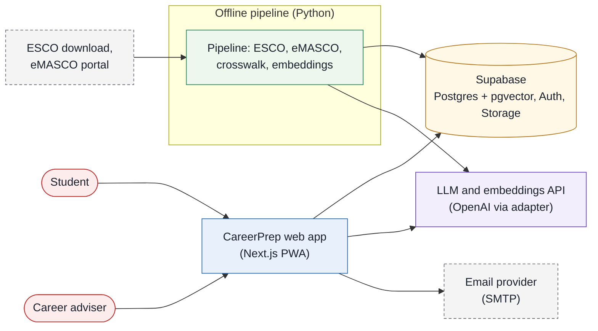

# CareerPrep

| | |
|---|---|
| Document | README.md |
| Version | 0.2 (draft for preliminary-round submission) |
| Status | Draft |
| Related | [01-prd.md](docs/01-prd.md), [03-architecture.md](docs/03-architecture.md), [05-demo-script.md](docs/05-demo-script.md) |

> CareerPrep shows a Malaysian diploma student which real MASCO (Malaysia Standard Classification of Occupations) jobs their modules prepare them for. It closes the skill gaps with 5-minute recall lessons and rehearses the interview for that role, with a human adviser one click away.

Hackathon entry, Track 2: Education and Human Development. Built by Software Engineering students at the German-Malaysian Institute (GMI).

## 1. Purpose and scope

This README is the entry point to the CareerPrep specification set. It states the problem, the four product stages, the architecture at a glance, how to run the project and where each judging criterion is covered. It does not define requirements, the matching method or the system design in full; those live in [docs/01](docs/01-prd.md) to [docs/06](docs/06-evidence.md), listed in the [docs index](#14-docs-index).

## 2. The problem

| Statistic | Definition | Source |
|---|---|---|
| **35.2%** (more than 1 in 3) | Employed tertiary-educated Malaysians in skill-related underemployment (working below their qualifications), Q2 2026 | DOSM via [RinggitPlus](https://ringgitplus.com/en/blog/career/dosm-over-a-third-of-graduates-still-stuck-in-jobs-below-their-skills.html) |
| 10.1% vs 2.9% | Youth (15–24) unemployment rate vs the national rate, Aug 2026 | DOSM via [Malay Mail](https://www.malaymail.com/amp/news/money/2026/10/09/malaysias-august-2026-unemployment-rate-hits-new-low-of-29pc/238372) |
| 46% | Share of diploma/certificate holders in GenAI-exposed jobs, the most exposed education group | ISIS/World Bank, Aug 2025, via [Malay Mail](https://www.malaymail.com/news/malaysia/2025/08/29/study-warns-mid-skilled-young-workers-women-in-malaysia-most-at-risk-from-ai/188895) |

A diploma student can read their module list, but nothing tells them which official occupations those modules lead to, which skills are missing, or what the interview for that role will ask.

Full claim-to-source table: [docs/06-evidence.md](docs/06-evidence.md).

## 3. What CareerPrep does

The product has four stages. The same names are used in the app, the code and every doc.

1. **Map**. The student picks their programme and modules, or uploads a module descriptor PDF. CareerPrep extracts skills from the learning outcomes, normalises them to ESCO (European Skills, Competences, Qualifications and Occupations) skills and matches them to MASCO 2020 occupations. Each skill shows the quoted learning-outcome text it came from and a confidence score. Skills below the threshold τ (default 0.6) are flagged "check with adviser".
2. **Plan**. The student picks a target occupation (for example 2519-01 System Tester), sees the gap skills, rates confidence 1–5 on each, and gets a 5-minute daily micro-lesson plan.
3. **Practice**. Short-answer recall lessons are scheduled with FSRS (ts-fsrs). The AI gives hints and never gives answers. A short mastery check follows (5 questions per gap skill, marked against an answer key with no AI; 4 of 5 passes). Then comes a text-first mock interview built from the eMASCO task list for that occupation.
4. **Feedback**. Each answer gets task-level feedback: STAR structure, evidence, technical accuracy and one concrete next step. Weak areas go back into the review queue. A "Talk to a human" button on every Feedback screen and every low-confidence match card books a career adviser or alumni mentor.

A **career adviser** view lists the adviser's students, their target occupations, gap skills, interview feedback summaries and booking requests. The view is read-only for student data in the MVP. Advisers can accept, decline, complete or cancel a booking, and the student sees each change in the app and by email.

**Figure 0.1 — The four stages and the adviser hand-off.** Every student passes through Map, Plan, Practice and Feedback in order; a human adviser can be reached from a low-confidence match or from any Feedback screen.

```mermaid
flowchart LR
    accTitle: The four CareerPrep stages and the adviser hand-off
    accDescr: The student moves through Map, Plan, Practice and Feedback. Weak areas from Feedback loop back to Practice. A Talk to a human button on low-confidence match cards in Map and on every Feedback screen leads to the Adviser Hand-off and a career adviser.
    S(["Student"]) --> M["Map"]
    M --> P["Plan"]
    P --> PR["Practice"]
    PR --> F["Feedback"]
    F -->|"weak areas"| PR
    M -.->|"low-confidence match card"| H["Talk to a human<br/>(Adviser Hand-off)"]
    F -.->|"every Feedback screen"| H
    H --> A(["Career adviser"])
    classDef person fill:#FDECEC,stroke:#C53030,color:#1A202C
    classDef ui fill:#E8F1FB,stroke:#2B6CB0,color:#1A202C
    classDef svc fill:#EDF7ED,stroke:#2F855A,color:#1A202C
    classDef ai fill:#F3EEFB,stroke:#6B46C1,color:#1A202C
    classDef data fill:#FFF8E6,stroke:#B7791F,color:#1A202C
    classDef ext fill:#F4F4F5,stroke:#71717A,color:#1A202C,stroke-dasharray:4 3
    class S,A person
    class M,P,PR,F,H ui
```



## 4. How it maps to the judging criteria

| Criterion | Weight | Where to look |
|---|---|---|
| Impact | 30% | [The problem](#2-the-problem), [Why it's different](#5-why-its-different), [docs/04-business-and-risk.md](docs/04-business-and-risk.md) (impact and pilot evaluation plan), [docs/06-evidence.md](docs/06-evidence.md) |
| Technical Execution | 30% | [docs/03-architecture.md](docs/03-architecture.md), [docs/02-methodology.md](docs/02-methodology.md) (matcher and evaluation); code: `pipeline/` (data pipeline, crosswalk), `app/` (Next.js routes), `supabase/migrations/` (data model). These are planned paths. |
| Usability | 25% | [docs/01-prd.md](docs/01-prd.md) (personas, user journey, screens), [docs/05-demo-script.md](docs/05-demo-script.md) (3-minute walkthrough), `app/` UI components: mobile-first PWA, keyboard accessible, WCAG 2.2 AA intent |
| Feasibility | 15% | [docs/04-business-and-risk.md](docs/04-business-and-risk.md) (B2B2C model, risks, future work), [docs/03-architecture.md](docs/03-architecture.md) (deployment), [Limitations](#12-limitations) |

## 5. Why it's different

As of 19 Oct 2026, none of the tools we checked combines, for Malaysian diploma students:

1. mapping actual programme learning outcomes to MASCO 2020 occupations and ESCO skill gaps with quoted evidence,
2. spaced micro-lessons on those gaps, and
3. mock interviews built from the matched occupation's official task list, with task-level feedback and a human-adviser hand-off.

AI mock-interview tools (Yoodli, Huru, Big Interview, Final Round AI, Exponent) already tailor questions to job descriptions, so that alone does not set CareerPrep apart. None we found ties questions to an official occupation task list, hands off to a human adviser, or localises for Malaysia.

**MYMahir** (TalentCorp, launched Nov 2024) provides a national skills taxonomy and upskilling recommendations. CareerPrep complements it: it starts from a student's own diploma modules and MASCO codes, and could link out to MYMahir courses. (We have not opened mymahir.my; this claim is unverified.) Details: [docs/04-business-and-risk.md](docs/04-business-and-risk.md).

## 6. Architecture at a glance

**Figure 0.2 — System at a glance.** Students and advisers use one Next.js web app; heavy data work runs offline in a Python pipeline that writes to Supabase, and live AI calls go through one LLM adapter.



Colours follow the legend in [docs/03-architecture.md](docs/03-architecture.md).

Component chain: **Skill Extractor → Skill Normaliser** (offline, Python pipeline) **→ Occupation Matcher → Gap Planner → Lesson Engine → Interview Engine → Feedback Engine → Adviser Hand-off** (request time, TypeScript). Full diagrams, data model and privacy design: [docs/03-architecture.md](docs/03-architecture.md).

## 7. How the matching works

1. The **Skill Extractor** (LLM) reads each learning outcome and returns candidate skills, each with the verbatim quote it came from.
2. The **Skill Normaliser** embeds each candidate and finds the top-k ESCO skills with pgvector. An LLM re-ranker accepts or rejects each one with a confidence score.
3. A self-built crosswalk links MASCO 2020 4-digit codes → ISCO-08 → ESCO occupations. No official machine-readable crosswalk exists, so ours is documented. Each 6-digit MASCO occupation (for example 2519-01) inherits its unit group's ESCO occupations and the union of their skills.
4. Match score for occupation *o* = (covered essential × 1.0 + covered optional × 0.5) / (all essential × 1.0 + all optional × 0.5), shown as a percentage with evidence quotes. A skill is covered only if its link confidence ≥ τ (`MATCH_CONFIDENCE_THRESHOLD`, default 0.6 until tuned).
5. Two team members hand-tag ESCO skills for ~25 learning outcomes, independently of the pipeline. We report precision, recall and F1 alongside PERKESO's 2021 result (precision 59%, F1 64%) and do not claim to beat it.

Full method, including the match score and evaluation plan: [docs/02-methodology.md](docs/02-methodology.md).

## 8. AI guardrails

These guardrails are design requirements (Bastani et al. 2025, *PNAS* 122(26):e2422633122).

| Guardrail | What the system does | Source |
|---|---|---|
| Hints, not answers | Lessons use a 3-step hint ladder (nudge → concept → worked analogue). The tutor never gives the answer. | Bastani et al. 2025 |
| Grounded | Extraction and matching must quote source text. Lessons use vetted content. | Bastani et al. 2025 |
| No-AI mastery checks | 5 questions per gap skill with hints and AI off, marked by answer key or keyword rubric (no LLM); 4 of 5 passes. | Bastani et al. 2025 |
| Human in the loop | Confidence scores are shown, skills below τ are flagged "check with adviser", and a "Talk to a human" button sits on low-confidence match cards and every Feedback screen. | Whiston et al. 2003 |
| Task-level feedback | Feedback targets the answer, never the person. No overall grade or ego-level praise. | Kluger & DeNisi 1996 [K] |

## 9. Tech stack

| Layer | Choice |
|---|---|
| Frontend | Next.js (App Router) PWA with Serwist, Tailwind CSS, Recharts radar chart |
| Backend | Next.js route handlers / server actions |
| Data | Supabase: Postgres + pgvector (HNSW), Auth, Storage |
| Pipeline | Python 3.11 in `/pipeline`: pdfplumber, ESCO CSV loader, eMASCO entry, crosswalk builder, embedding job |
| Embeddings | OpenAI text-embedding-3-small (default); BGE-M3 as open alternative |
| LLM | OpenAI for the demo (one key with embeddings), behind an adapter so Claude / Gemini stay switchable; structured JSON outputs |
| Scheduling | ts-fsrs (FSRS-6) |
| Email | SMTP provider for sign-in and booking status emails (not chosen yet; Supabase's built-in service is limited to 2 emails an hour) |
| Taxonomies | MASCO 2020 (eMASCO, MOHR), ESCO v1.2.x (English) |

## 10. Quick start

> Planned commands; the script names below are the intended interface.

### 10.1 Prerequisites

- Node.js 20+ and pnpm
- Python 3.11 (for `/pipeline`) and the Supabase CLI
- A Supabase project (the free plan is enough; it pauses after 1 week of inactivity)

### 10.2 Environment variables

Copy `.env.example` to `.env.local`:

| Variable | Purpose |
|---|---|
| `NEXT_PUBLIC_SUPABASE_URL` | Supabase project URL |
| `NEXT_PUBLIC_SUPABASE_ANON_KEY` | Supabase public anon key |
| `SUPABASE_SERVICE_ROLE_KEY` | Server-only key for seeding and the pipeline |
| `LLM_PROVIDER` | `openai` (default), `anthropic` or `gemini` |
| `LLM_MODEL` | Model id for the LLM adapter |
| `LLM_API_KEY` | Key for the chosen LLM provider |
| `EMBEDDING_API_KEY` | Embedding provider key; same value as `LLM_API_KEY` when both are OpenAI |
| `MASTERY_PASS_MARK` | Share of mastery-check answers needed to pass, default `0.8` (4 of 5) |
| `SMTP_URL` | SMTP connection for booking status emails (provider not chosen yet) |
| `MATCH_CONFIDENCE_THRESHOLD` | Threshold τ, default `0.6` until tuned on the dev split (see the evaluation plan in [docs/02-methodology.md](docs/02-methodology.md)) |

### 10.3 Commands

Run in this order:

```bash
pnpm install                                   # install JS dependencies
supabase link --project-ref <ref>              # link the Supabase CLI to your project
pnpm db:migrate                                # apply supabase/migrations
python -m venv .venv && source .venv/bin/activate
pip install -r pipeline/requirements.txt
python pipeline/run.py                         # ESCO subset, eMASCO occupations, crosswalk, outcome skills + embeddings → Supabase
pnpm db:seed                                   # demo personas, lessons, recall items (needs pipeline output)
pnpm dev                                       # http://localhost:3000
pnpm test                                      # unit tests
pnpm test:e2e                                  # Playwright end-to-end tests
python pipeline/eval.py                        # matcher precision / recall / F1
```

## 11. Demo personas

The app and video use seeded demo personas only. No real student data is used. The demo persona is **Aina**, a Semester 5 GMI Diploma in Software Engineering student before Industrial Training, targeting 2519-01 System Tester. **Hafiz** (Semester 2, exploring) is the second persona. The team entered learning outcomes from their own course outlines, because GMI does not publish course-level outcomes. `pnpm db:seed` seeds 5 students for the adviser dashboard (Aina + 4). See [docs/05-demo-script.md](docs/05-demo-script.md).

## 12. Limitations

- One programme only: GMI Diploma in Software Engineering (MQA/FA 9541). Each new programme needs its outcomes entered and a labelled check.
- Small evaluation: ~25 hand-tagged learning outcomes is a sanity check, not a benchmark.
- English only: ESCO has no Malay, and the Malay quality of the embeddings is untested. Malay UI strings are a Could (C2 in [docs/01](docs/01-prd.md#7-features-moscow)).
- 9 occupations (listed under "Match score" in [docs/02-methodology.md](docs/02-methodology.md)): titles and tasks were entered by hand from eMASCO, and the MASCO → ISCO → ESCO crosswalk is our own.
- No live vacancy data: demand information is static/periodic.
- No outcome evidence yet: no RCT of an AI career adviser exists, and evidence on AI interview practice is thin. A pilot would measure career decision self-efficacy, career certainty and interview self-efficacy.
- Voice is optional and Chrome-only: the interview is text-first and audio is not stored.

## 13. Future work

1. Add programmes (outcomes entry and a labelled check for each), starting with other GMI and TVET (Technical and Vocational Education and Training) diplomas.
2. Ingest NOSS once a software/IT NOSS code is confirmed; add a Malay UI.
3. Pilot with an institution's career-services unit (B2B2C licence, free student tier); explore links with MYMahir and MyFutureJobs.

Details: [docs/04-business-and-risk.md](docs/04-business-and-risk.md).

## 14. Docs index

| Doc | Contents |
|---|---|
| [01-prd.md](docs/01-prd.md) | Personas, use cases, user journey, screens, features (MoSCoW), acceptance criteria, MVP scope |
| [02-methodology.md](docs/02-methodology.md) | Crosswalk, matching pipeline, scoring, evaluation |
| [03-architecture.md](docs/03-architecture.md) | System diagrams, components, data model, guardrails, security and privacy, deployment |
| [04-business-and-risk.md](docs/04-business-and-risk.md) | Lean canvas, competitors, impact and pilot plan, risks, future work |
| [05-demo-script.md](docs/05-demo-script.md) | 3-minute video script, storyboard, shot list, recording checklist |
| [06-evidence.md](docs/06-evidence.md) | Claim → source table, citations to avoid |
| [07-pitch.md](docs/07-pitch.md) | Project pitch: problem, solution, impact, agent workflow, safeguards, limitations, value |
| [08-technology-upgrades.md](docs/08-technology-upgrades.md) | Which upgrade technologies to adopt, plan, watch or skip (open models, Obsidian, Agent Skills, MCP, evaluation, speech, LTI) |
| [09-system-modelling.md](docs/09-system-modelling.md) | System models: context and data flow diagrams, use cases, sequence, class, activity, state machine and deployment diagrams |
| [10-ui-ux-spec.md](docs/10-ui-ux-spec.md) | UI/UX specification and Codex hand-off: tokens, screens, components, fixtures and acceptance checks |
| [11-repo-structure.md](docs/11-repo-structure.md) | Folder and file layout for the code: tree, import rules, demo vs real mode, naming, ownership, build order |
| [pdf/](docs/pdf/) | Print-ready PDFs of the pitch (07) and the system modelling (09) |
| [diagrams/](docs/diagrams/) | PNG exports of every figure. Docs 01–06 use Mermaid (source inside each doc); the pitch, upgrades and system modelling figures use draw.io (`diagrams/drawio/`) or Mermaid. |

## 15. Team

Assumption: four members. Each member owns the components below.

| Member | Component ownership |
|---|---|
| Faiz (Muhammad Faiz Syahmi), Member A | Lead; data pipeline and Occupation Matcher |
| Member B (placeholder) | Frontend and UX |
| Member C (placeholder) | AI interview (Interview Engine, Feedback Engine), micro-lessons (Lesson Engine) and vetted lesson content |
| Member D (placeholder) | Docs, evidence and demo video |

## 16. Evidence and sources

Every statistic and research claim in this README is traced in [docs/06-evidence.md](docs/06-evidence.md), with its verification status. Items cited from prior knowledge and not re-verified are marked [K] there.

## 17. Glossary

| Term | Meaning |
|---|---|
| MASCO | Malaysia Standard Classification of Occupations; MASCO 2020 is the current version |
| ISCO-08 | International Standard Classification of Occupations 2008 (ILO); MASCO 4-digit codes match it in every case we checked |
| ESCO | European Skills, Competences, Qualifications and Occupations; links occupations to essential/optional skills |
| eMASCO | MOHR's web portal for MASCO 2020: descriptions, task lists, 6-digit titles (Malay) |
| NOSS | National Occupational Skills Standard (Department of Skills Development) |
| DOSM | Department of Statistics Malaysia |
| TVET | Technical and Vocational Education and Training |
| MQA | Malaysian Qualifications Agency, which accredits programmes |
| PLO | Programme Learning Outcome |
| SPM | Sijil Pelajaran Malaysia, the national secondary-school leaving exam |
| PERKESO | Social Security Organisation; runs MyFutureJobs |
| MyCOL | TalentCorp's Critical Occupations List |
| MSOC | PERKESO's ESCO-based occupation taxonomy, used in its 2021 matching study |
| FSRS | Free Spaced Repetition Scheduler; ts-fsrs is its TypeScript library |
| STAR | Situation, Task, Action, Result: a structure for interview answers |
| PDPA | Malaysia's Personal Data Protection Act 2010 (amended 2024) |
| RLS | Row-level security in Postgres/Supabase |
| HNSW | Hierarchical Navigable Small World, an approximate nearest-neighbour index |
| pgvector | Postgres extension for vector similarity search |
| B2B2C | The institution pays; students use it free |
| τ | Match confidence threshold (`MATCH_CONFIDENCE_THRESHOLD`), default 0.6 until tuned |
| MOHR | Ministry of Human Resources (Kementerian Sumber Manusia), which runs eMASCO |
| RCT | Randomised controlled trial |
| DPO | Data Protection Officer (PDPA) |
| MAU | Monthly active users |
| PWA | Progressive Web App, installable from the browser |
| WCAG | Web Content Accessibility Guidelines |
| MoSCoW | Must / Should / Could / Won't prioritisation |

## 18. Licence

Code licence: to be decided before public release. Data terms to respect:

- ESCO: free to reuse under the European Commission reuse policy (Decision 2011/833/EU) with attribution (unverified; the download page does not state a licence).
- MASCO 2020 / eMASCO (MOHR): reuse terms not confirmed (unverified). The team must check before redistributing task lists.
- Avoid AGPL dependencies (for example PyMuPDF) unless the repo is released as open source.

## Run the demo

```bash
pnpm install
cp .env.example .env.local   # optional: the defaults are already demo mode
pnpm dev                     # http://localhost:3000
pnpm test                    # unit tests for lib/ and the visual rules
pnpm exec playwright install chromium   # once
pnpm test:e2e                # demo path with the keyboard, plus axe at 375 and 1280 px
```

Demo mode (`DATA_MODE=fixtures`, `LLM_PROVIDER=recorded`) needs no database and no network. State is kept in memory; "Reset demo data" in the footer puts it back. The footer's "View as" switch moves between the student and adviser views.
