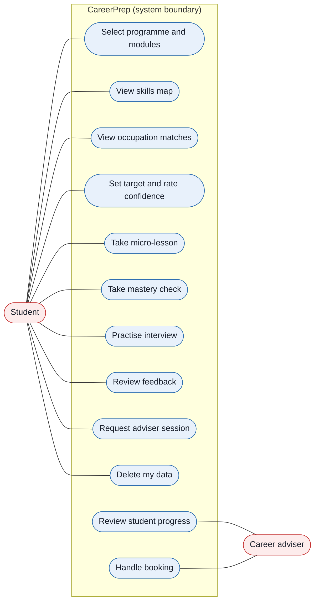
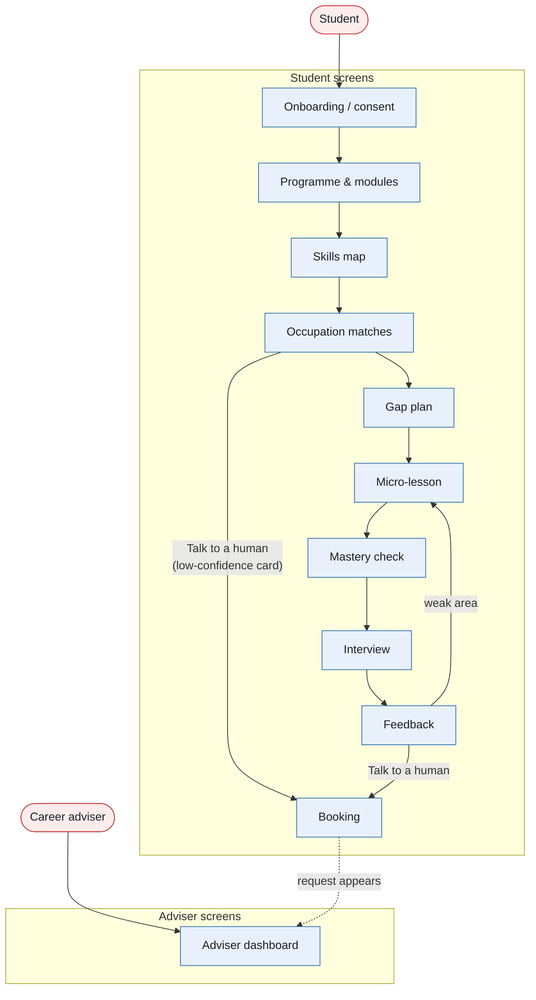

# 01. Product requirements (MVP)

| | |
|---|---|
| Document | 01-prd.md |
| Version | 0.2 (draft for preliminary-round submission) |
| Status | Draft |
| Related | [02-methodology.md](02-methodology.md), [03-architecture.md](03-architecture.md), [05-demo-script.md](05-demo-script.md) |

**Contents:** [1. Purpose and scope](#1-purpose-and-scope) · [2. Problem](#2-problem) · [3. Users and personas](#3-users-and-personas) · [4. User journey](#4-user-journey) · [5. Key screens](#5-key-screens) · [6. Adviser hand-off](#6-adviser-hand-off) · [7. Features (MoSCoW)](#7-features-moscow) · [8. Acceptance criteria](#8-acceptance-criteria-must-features) · [9. MVP scope](#9-mvp-scope-and-out-of-scope) · [10. Open questions](#10-open-questions)

## 1. Purpose and scope

The product summary is in the [README](../README.md). This document specifies who the MVP is for, the Map → Plan → Practice → Feedback user journey, the key screens, the MVP features with their priorities and acceptance criteria, and what is out of scope. It does not specify the matching method ([02-methodology.md](02-methodology.md)), the system design ([03-architecture.md](03-architecture.md)) or the evidence behind each claim ([06-evidence.md](06-evidence.md)).

### 1.1 Conventions

- MUST, SHOULD and MAY in acceptance criteria are used as defined in RFC 2119.
- Must, Should, Could and Won't in the feature table are MoSCoW priorities.
- Requirement IDs (M1–M11, S1–S3, C1–C4, W1) are stable and are referenced from other docs.
- Acronyms and symbols (MASCO, ESCO, FSRS, STAR, PLO, PDPA, τ) are defined in the [README glossary](../README.md#17-glossary).

## 2. Problem

**35.2%** of employed tertiary-educated Malaysians were in skill-related underemployment, working below their qualifications, in Q2 2026 (DOSM, via [RinggitPlus](https://ringgitplus.com/en/blog/career/dosm-over-a-third-of-graduates-still-stuck-in-jobs-below-their-skills.html)). That is more than 1 in 3.
Diploma students rarely see how their own modules connect to named occupations, which skills they are missing, or what the interview for that role will ask.
CareerPrep links programme learning outcomes to MASCO 2020 occupations with quoted evidence, then turns the gaps into practice and a human hand-off. All claims and sources: [06-evidence.md](06-evidence.md).

## 3. Users and personas

Personas are illustrative composites for design, not research participants. The MVP serves one programme: GMI Diploma in Software Engineering.

| Persona | Situation | Needs from CareerPrep | Main stages |
|---|---|---|---|
| Aina, Sem 5 student before Industrial Training (illustrative; the demo persona) | Has completed Quality Assurance & Control, Android Programming and Advanced Web Programming. Will apply for Sem 6 Industrial Training placements next. | A clear target (2519-01 System Tester (Penguji Sistem)), a short gap list, and interview rehearsal built from that role's tasks. | All four stages |
| Hafiz, Sem 2 student, exploring (illustrative) | Taking Basic of Programming, Basic of Software Testing, Software Modelling & Requirements Engineering. Unsure whether "software tester" is a real job or a stepping stone. | See which occupations his modules already point to, and why (quoted outcomes). Light daily practice he can do on his phone. | Map, Plan, Practice (lessons) |
| Puan Rohana, career adviser (illustrative) | Supports many students with limited time; meets them mostly before Industrial Training. | One view of each student's target occupation, gap skills, interview feedback summary and booking requests, so sessions start from evidence. | Feedback (hand-off) |

**Figure 1.1 — Use cases.** The student drives every stage of the product; the career adviser only reviews progress and handles the bookings that students request.

## 4. User journey

The four stages are named the same everywhere: **Map → Plan → Practice → Feedback**.

| Stage | What the student does | What the system does |
|---|---|---|
| Map | Selects programme and modules, or uploads a module descriptor PDF. | Skill Extractor pulls candidate skills from each learning outcome with a verbatim quote. Skill Normaliser maps them to ESCO skills with a confidence score. Occupation Matcher scores MASCO 2020 occupations. The screen shows a radar chart and ranked match cards. |
| Plan | Picks a target occupation and rates confidence 1–5 on each gap skill. | Gap Planner builds a 5-minute daily micro-lesson plan. |
| Practice | Does micro-lessons (short-answer recall), a no-AI mastery check per gap skill, then a text-first mock interview. | Lesson Engine schedules recall items with FSRS (ts-fsrs), gives hints and never answers, and marks the mastery check against an answer key without AI. Interview Engine draws questions from the eMASCO task list and the gap skills. |
| Feedback | Reads task-level feedback per answer; can tap "Talk to a human". | Feedback Engine covers STAR structure, evidence, technical accuracy and one next step. Weak areas re-enter the FSRS queue. Adviser Hand-off creates a booking. |

**Figure 1.2 — User flow.** The main path runs straight through the four stages; two decision points add the adviser flag after Map and the re-practice loop after Feedback.

```mermaid
flowchart LR
    accTitle: CareerPrep user flow
    accDescr: The student completes onboarding and consent, then Map. If any supporting skill link has confidence below tau equal to 0.6, the match card is flagged check with adviser. The student then plans, takes micro-lessons, a no-AI mastery check and a mock interview, and reads feedback. Weak areas go to the re-practice queue and return to micro-lessons. A Talk to a human button on flagged match cards and on every Feedback screen leads to a booking request that appears on the adviser dashboard.
    A["Onboarding and consent"] --> B["Map: modules to skills to occupations"]
    B --> C{"Link confidence < τ (0.6)?"}
    C -->|"yes"| H["Flag: check with adviser"]
    C -->|"no"| D["Plan: pick target, rate gap skills"]
    H --> D
    D --> E["Practice: micro-lessons (FSRS)"]
    E --> M["Practice: mastery check (no AI)"]
    M --> F["Practice: mock interview"]
    F --> G["Feedback: task-level per answer"]
    G --> W{"Weak area?"}
    W -->|"yes"| Q[("Re-practice queue<br/>(review_state)")]
    Q --> E
    H -.->|"Talk to a human"| I["Booking request"]
    G -.->|"Talk to a human"| I
    I --> K["Adviser dashboard"]
    classDef person fill:#FDECEC,stroke:#C53030,color:#1A202C
    classDef ui fill:#E8F1FB,stroke:#2B6CB0,color:#1A202C
    classDef svc fill:#EDF7ED,stroke:#2F855A,color:#1A202C
    classDef ai fill:#F3EEFB,stroke:#6B46C1,color:#1A202C
    classDef data fill:#FFF8E6,stroke:#B7791F,color:#1A202C
    classDef ext fill:#F4F4F5,stroke:#71717A,color:#1A202C,stroke-dasharray:4 3
    class A,B,D,E,M,F,G,H,I,K ui
    class Q data
```

## 5. Key screens

All screens are keyboard operable with visible focus, target WCAG 2.2 AA contrast, label every form field, work from 375px width up, and never carry meaning by colour alone.

| Screen | Purpose | Accessibility notes |
|---|---|---|
| Onboarding / consent | Explains what data is used, that the demo uses seeded personas, and that no audio is stored. Consent checkbox; link to delete-my-data. | Consent is an explicit unchecked checkbox with a visible label; plain-language summary above the fold at 375px. |
| Programme & modules | Pick GMI Diploma in Software Engineering, then tick modules by semester (or upload a descriptor PDF). | Grouped checkboxes per semester with fieldset/legend; upload has a text alternative path (manual entry). |
| Skills map | Radar chart of skill coverage by ESCO skill group; each extracted skill lists its quoted learning-outcome text and confidence. | The radar (Recharts) has an adjacent data table with the same values as its text alternative; quotes are real text, not images. |
| Occupation matches | Ranked cards for MASCO 6-digit occupations (code, English/Malay title, match %, evidence quotes). Low-confidence cards show "check with adviser" and "Talk to a human". | Cards are list items with headings; match % stated in text; the flag uses icon + text. |
| Gap plan | Gap skills for the chosen target; a 1–5 confidence rating each; the resulting daily 5-minute plan. | Rating uses radio groups (not sliders) with labels; plan readable as an ordered list. |
| Micro-lesson | One recall question at a time; 3-step hint ladder (nudge → concept → worked analogue); never shows the answer first. | Answer field labelled; hints announced via a polite live region; no time pressure. |
| Mastery check | 5 questions per gap skill with hints and AI turned off; marked against the answer key without AI; pass is 4 of 5. A failed check can be retaken after the next lesson. | Same form pattern as Micro-lesson; score and result stated in text. |
| Interview | Text-first mock interview for the target occupation; optional browser speech (Chrome only). | Fully usable by keyboard and text; speech is optional and clearly marked; no auto-advancing timers. |
| Feedback | Per-answer feedback: STAR structure, evidence, technical accuracy, one next step. No overall grade. "Talk to a human" button. | Feedback grouped under headings per answer; the button is a real `<button>` with a clear label. |
| Booking | Student picks a preferred slot and adds a note; the request appears on the adviser dashboard. The student's dashboard shows each booking's status with a badge when it changes, and the student can cancel. | Native date/time inputs with labels; confirmation message in text; the badge has a text label, not colour alone. |
| Adviser dashboard | List of students: target occupation, gap skills, feedback summaries, booking requests. Booking actions: accept, decline, complete, cancel with a reason. Accepted bookings past their slot show "needs outcome". Read-only for student data. | Semantic table with column headers; stacks to cards below 768px. |

**Figure 1.3 — Screen navigation map.** Students move down one linear path with two shortcuts to Booking; advisers enter separately and only see the dashboard.

## 6. Adviser hand-off

A student reaches an adviser through the "Talk to a human" button. It appears on every match card flagged "check with adviser" (a supporting skill link below τ, default 0.6) and on every Feedback screen. The booking carries the student's target occupation, gap skills and latest feedback summary, which appear on the adviser dashboard. The adviser can accept or decline the booking, mark it completed after the session, or cancel it with a reason. The student sees each change in the app and gets an email when the adviser accepts, declines or cancels. The email holds only the status, the slot and a link. The adviser cannot edit student data.

**Figure 1.4 — Adviser hand-off flow.** Both triggers lead to one booking request; the adviser accepts or declines it and the student is told in the app and by email. Completing and cancelling are in [03 §8.3](03-architecture.md#83-booking).

```mermaid
flowchart LR
    accTitle: Adviser hand-off flow
    accDescr: A low-confidence match card or any Feedback screen offers Talk to a human. The student submits a booking request with a slot and note, which is stored as a booking row with status requested. It appears on the adviser dashboard with target occupation, gap skills and feedback summary. The adviser accepts or declines, and the student sees the status in the app and gets an email.
    T1["Low-confidence match card"] --> B["Talk to a human"]
    T2["Feedback screen"] --> B
    B --> R["Booking request<br/>(slot + note)"]
    R --> DB[("booking<br/>status: requested")]
    DB --> D["Adviser dashboard<br/>target, gaps, feedback summary"]
    ADV(["Career adviser"]) --> D
    D --> C{"Accept?"}
    C -->|"yes"| AC["accepted"]
    C -->|"no"| DC["declined"]
    AC --> N["Student sees status in app<br/>+ email"]
    DC --> N
    classDef person fill:#FDECEC,stroke:#C53030,color:#1A202C
    classDef ui fill:#E8F1FB,stroke:#2B6CB0,color:#1A202C
    classDef svc fill:#EDF7ED,stroke:#2F855A,color:#1A202C
    classDef ai fill:#F3EEFB,stroke:#6B46C1,color:#1A202C
    classDef data fill:#FFF8E6,stroke:#B7791F,color:#1A202C
    classDef ext fill:#F4F4F5,stroke:#71717A,color:#1A202C,stroke-dasharray:4 3
    class ADV person
    class T1,T2,B,R,D,N ui
    class AC,DC svc
    class DB data
```

## 7. Features (MoSCoW)

Must = needed for the end-to-end demo path. Data entry for the one programme and the 9 MVP occupations (listed under "Match score" in [02-methodology.md](02-methodology.md)) is done offline in `/pipeline`.

| ID | Feature | Stage | Priority |
|---|---|---|---|
| **M1** | Onboarding + consent screen + delete-my-data button (seeded demo personas) | — | Must |
| **M2** | Programme & module selection for GMI Diploma in Software Engineering (learning outcomes pre-entered by the team) | Map | Must |
| **M3** | Skill extraction + normalisation to ESCO with verbatim quote + confidence (precomputed by the pipeline, stored as `outcome_skill`) | Map | Must |
| **M4** | Occupation match score (formula in [02-methodology.md](02-methodology.md)) for the 9 MASCO 6-digit occupations; ranked cards with evidence quotes; skills below τ (default 0.6) not covered and flagged "check with adviser" | Map | Must |
| **M5** | Skills radar chart + equivalent data table | Map | Must |
| **M6** | Gap plan: pick target occupation, list gap skills, 1–5 confidence rating; order gaps essential first, then lowest rating; one ~5-minute lesson per day | Plan | Must |
| **M7** | Micro-lessons: short-answer recall items scheduled with ts-fsrs; 3-step hint ladder (nudge → concept → worked analogue). Vetted lesson content and 5 recall items for each of the 3 demo gap skills only | Practice | Must |
| **M8** | Text-first mock interview: questions from eMASCO tasks + gap skills for the target occupation | Practice | Must |
| **M9** | Task-level feedback per answer (STAR, evidence, technical accuracy, one next step); weak areas re-enter the FSRS queue | Feedback | Must |
| **M10** | "Talk to a human" booking request + adviser dashboard (read-only for student data; adviser accepts, declines, completes or cancels bookings); student sees status in app and by email | Feedback | Must |
| **M11** | No-AI mastery check: one 5-question check per demo gap skill, pass 4 of 5, hints and AI disabled, marked deterministically (answer key / keyword rubric, no LLM) | Practice | Must |
| **S1** | Module descriptor PDF upload → live extraction (pdfplumber) | Map | Should |
| **S2** | PWA install + offline lesson cache (Serwist) | Practice | Should |
| **S3** | Matcher evaluation page: precision / recall / F1 on ~25 hand-tagged outcomes, shown alongside PERKESO 2021 | Map | Should |
| **C1** | Optional browser speech input for the interview (Web Speech API, Chrome only; no audio stored) | Practice | Could |
| **C2** | Malay UI strings | — | Could |
| **C3** | Link-out to MYMahir courses for gap skills | Plan | Could |
| **C4** | JSON export of my data (PDPA portability) | — | Could |
| **W1** | Multiple programmes, NOSS ingestion, live job vacancies, employer side, native mobile app, stored audio | — | Won't (MVP) |

Note on M3: in the MVP the extraction runs offline over the team's entered learning outcomes, and the app reads stored results. Live extraction only comes with S1.

## 8. Acceptance criteria (Must features)

**M1**
- Given a new visitor, when they open the app, then the consent screen MUST appear and Continue MUST stay disabled until the consent box is ticked.
- Given a signed-in student, when they press "Delete my data" and confirm, then their student, gap, review, interview and booking rows MUST be removed.

**M2**
- Given the student is on Programme & modules, when they select GMI Diploma in Software Engineering and tick modules, then only learning outcomes of the ticked modules MUST be used in Map.

**M3**
- Given a ticked module, when the Skills map loads, then every extracted skill MUST show an ESCO skill label, the verbatim learning-outcome quote it came from, and a confidence value. No skill is shown without a quote.

**M4**
- Given the student's covered skills, when Occupation matches loads, then the 9 MASCO occupations MUST be ranked by match % and each card MUST list its evidence quotes.
- Any occupation with a supporting link below τ MUST show "check with adviser" and a "Talk to a human" button.
- The % for a seeded persona MUST equal the value computed by the methodology formula.

**M5**
- Given the Skills map, when it renders, then a radar chart and a data table with identical values MUST both be present, and the table MUST be reachable by keyboard and screen reader.

**M6**
- Given a chosen target occupation, when the Gap plan loads, then it MUST list the skills required by that occupation but not covered.
- When the student rates each 1–5, then a daily plan of about 5 minutes MUST be shown and saved as `gap_skill` rows.

**M7**
- Given a due recall item, when the student requests help, then the tutor MUST give the next hint in the ladder (nudge → concept → worked analogue) and MUST NOT reveal the full answer before the student submits.
- When the student submits and rates recall, then ts-fsrs MUST set the item's next due date and save it in `review_state`.

**M8**
- Given a target occupation, when the student starts an interview, then each question MUST cite the eMASCO task or gap skill it was built from, and the whole session MUST be completable by typing.

**M9**
- Given a submitted answer, when feedback returns, then it MUST contain STAR structure, evidence, technical accuracy and one concrete next step, with no overall grade or praise of the person. Skills marked weak MUST be added to the FSRS queue.

**M10**
- Given a low-confidence match card or the Feedback screen, when the student presses "Talk to a human" and submits a slot, then a `booking` row MUST be created.
- The booking MUST appear on the adviser dashboard with the student's target occupation, gap skills and feedback summary.
- The adviser MAY accept, decline, complete or cancel the booking, MUST give a reason to cancel, and MUST NOT be able to edit student data.
- When the adviser accepts, declines or cancels, the student MUST see the new status on their next visit, and an email with the status, slot and a link MUST be sent. If the email fails, the status change MUST still be saved.
- An accepted booking whose slot has passed without an outcome MUST show "needs outcome" on the adviser dashboard.

**M11**
- Given a demo gap skill, when the student starts its mastery check, then 5 questions MUST appear with hints and AI calls disabled, and each answer MUST be marked against the stored answer key / keyword rubric with no LLM call.
- The skill MUST move to Mastered only with at least 4 of 5 correct (`MASTERY_PASS_MARK`, default 0.8); otherwise it MUST return to Learning. A mastered skill whose later spaced review lapses MUST return to Learning.

## 9. MVP scope and out-of-scope

In scope (locked):
- One programme: GMI Diploma in Software Engineering ("Software Engineering (Software Testing)"), MQA/FA 9541, R/0612/4/0007 (03/28), 6 semesters, Sem 6 Industrial Training. Course-level learning outcomes and module codes are not public, so the team enters learning outcomes from their own course outlines.
- Occupations (MASCO 2020 via eMASCO, MOHR): the 9 occupations listed under "Match score" in [02-methodology.md](02-methodology.md). Primary: 2519-01 Penguji Sistem (System Tester); secondary in 2514, 2512 and 2513; entry-level alternatives in 3512–3514. Match cards are at 6-digit level.
- PLOs are shown as programme context only and are excluded from coverage.
- ESCO v1.2.x English CSV (Malay not included) and our own documented MASCO → ISCO-08 → ESCO crosswalk (no official machine-readable one exists).
- Demand information labelled "static/periodic"; no live vacancy feed.
- Interview text-first; browser speech optional (Chrome only).
- Privacy: demo personas only, consent screen, delete-my-data (Must), JSON export (Could), no audio storage, booking emails limited to status, slot and link. No real student data goes to the Gemini free tier.
- LLM: OpenAI for both embeddings and the LLM (one key); the adapter keeps Claude / Gemini switchable.

Out of scope for the MVP: multiple programmes, NOSS ingestion (future work), live jobs, employer side, full Malay UI (Malay UI strings are C2, Could), native mobile app (the PWA covers it).

## 10. Open questions

- Will a GMI career adviser review the adviser dashboard?
- Which SMTP provider sends sign-in and booking emails? Supabase's built-in service sends only 2 emails an hour, and only to the project team.
- Does GMI sign-in give every student an email address CareerPrep may use for booking emails?
