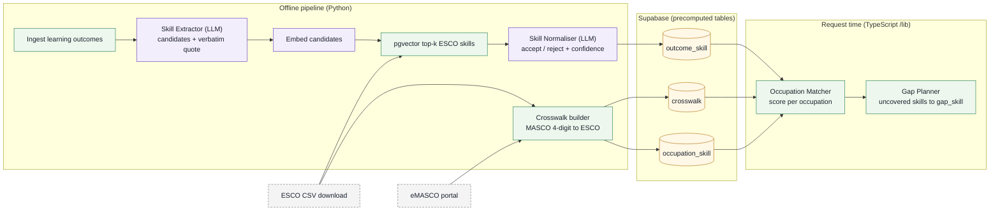
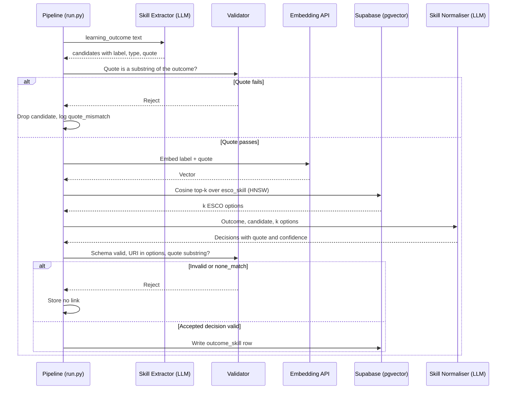
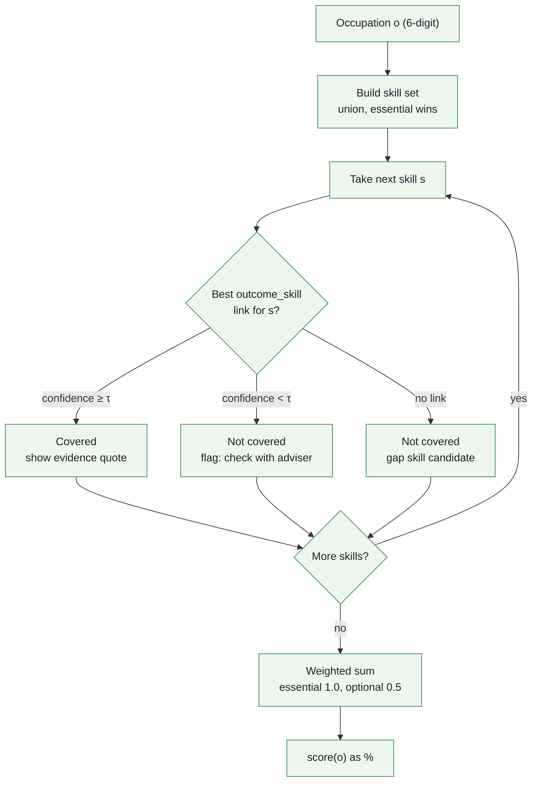
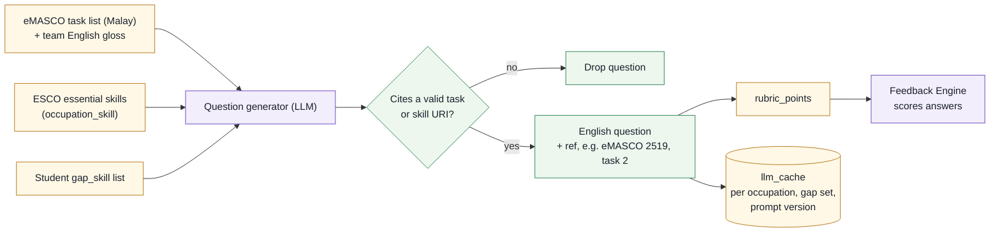
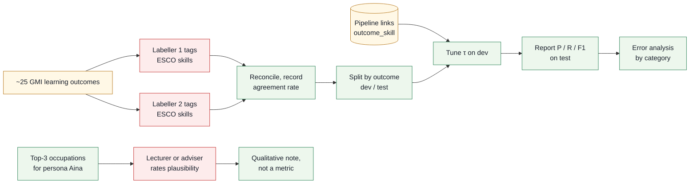

# 02. Methodology: crosswalk, matching pipeline, scoring, evaluation

| | |
|---|---|
| Document | 02-methodology.md |
| Version | 0.2 (draft for preliminary-round submission) |
| Status | Draft |
| Related | [01-prd.md](01-prd.md), [03-architecture.md](03-architecture.md), [06-evidence.md](06-evidence.md) |

**Contents:** [1. Purpose and scope](#1-purpose-and-scope) · [2. Why a crosswalk is needed](#2-why-a-crosswalk-is-needed) · [3. Data sources](#3-data-sources) · [4. Pipeline](#4-pipeline) · [5. Prompt contracts](#5-prompt-contracts) · [6. Match score](#6-match-score) · [7. Interview question generation](#7-interview-question-generation) · [8. Evaluation plan](#8-evaluation-plan) · [9. Known limitations](#9-known-limitations) · [10. How to add a new programme](#10-how-to-add-a-new-programme) · [11. Open questions](#11-open-questions)

## 1. Purpose and scope

This document specifies how CareerPrep turns a programme's learning outcomes into ranked MASCO 2020 occupations and gap skills, and how that mapping is evaluated. It is the single source for the pipeline, the prompt contracts, the match score and the evaluation plan. It does not cover components, storage or deployment ([03-architecture.md](03-architecture.md)), product scope ([01-prd.md](01-prd.md)) or the claim-to-source list ([06-evidence.md](06-evidence.md)). Diagram colours follow the legend in [03 §1.1](03-architecture.md#11-diagram-colour-legend). Acronyms and symbols (MASCO, ESCO, FSRS, STAR, PLO, PDPA, τ) are defined in the [README glossary](../README.md#17-glossary).

## 2. Why a crosswalk is needed

Malaysian occupations are classified in **MASCO 2020**. ESCO's skills are the only free, structured occupation-to-skill data we can use. Nothing official connects the two in a form a program can read:

- MASCO 2020 is published as web pages on the **eMASCO portal** (emasco.mohr.gov.my, MOHR). The pages carry descriptions and task lists, but there is no download or API.
- NOSS standards come as PDFs on MySPIKE. We could not confirm any software or IT NOSS code, so NOSS is future work.
- We found no machine-readable MASCO → ISCO-08 → ESCO crosswalk. eMASCO pages do not mention ISCO-08.
- Each ESCO occupation carries an ISCO-08 code. Every MASCO 4-digit code we checked (2512, 2513, 2514, 2519, 3511–3514) matches the ISCO-08 unit group with the same number and title. This is our inference, not verified from a primary MASCO document.

So we build our own crosswalk, record how each row was made, and treat it as a reviewed dataset rather than a lookup.

## 3. Data sources

| Source | Version | Licence / terms | Accessed | What we use it for |
|---|---|---|---|---|
| GMI Diploma in Software Engineering page (gmi.edu.my/computer-and-information/software-engineering/) | Page as of access date. MQA/FA 9541, R/0612/4/0007 (03/28) | Public web page; reuse terms not stated (unverified) | 19 Oct 2026 | Programme name, 11 PLOs, module names by semester |
| Team course outlines (Assumption: team members' own GMI course outlines) | Current intake | Internal documents; not redistributed | Entered by the team | Course-level learning outcomes. They are not public, so the team enters them by hand |
| eMASCO portal (emasco.mohr.gov.my) | Based on MASCO 2020; updated content expected by end of Q4 2026 | Terms not stated on pages fetched (unverified) | 19 Oct 2026 | Unit-group descriptions, task lists and 6-digit titles (Malay) for the 9 MVP occupations (§6). Scraped or entered by hand |
| ESCO CSV download, English (esco.ec.europa.eu/en/use-esco/download) | v1.2.1 ("last update 10/12/2025"; the date format is ambiguous). ESCO v1.2 (launch deck): 3,039 occupations, 13,939 skills | Reuse with attribution to the European Commission under Decision 2011/833/EU (unverified; the download page states no licence) | 19 Oct 2026 | `skills_en.csv`, `occupations_en.csv` and `occupationSkillRelations_en.csv` (essential/optional). File names are unverified until download |
| Lightcast Open Skills, free tier (optional) | Current API | Commercial-use licence unverified; quota unverified | Not yet used | Optional second normaliser for comparison only. Outputs are cached |

ESCO has no Malay among its 28 languages, so all ESCO labels we use are English.

## 4. Pipeline

Steps 1–7 run offline as Python scripts in `/pipeline` (`python pipeline/run.py`). They write precomputed tables to Supabase: the ESCO/eMASCO tables, `crosswalk`, `occupation_skill`, `outcome_skill` and embeddings. Steps 8–9, the Occupation Matcher and Gap Planner, run in TypeScript (`/lib`) at request time over those tables (see [03 §3](03-architecture.md#3-components)).

**Figure 2.1 — Pipeline overview.** All extraction, normalisation and crosswalk work is precomputed offline; only the Occupation Matcher and Gap Planner run per request.



Steps in order:

1. **Ingest.** Load the programme, its modules and their learning outcomes into `programme`, `module` and `learning_outcome`. For GMI, outcomes are typed in from course outlines. The 11 PLOs are stored as programme context and shown in the UI, but in the MVP they are excluded from extraction and coverage.
2. **Extract (Skill Extractor).** For each learning outcome, the LLM proposes candidate skills, each quoting the exact span of outcome text it came from (§5.1). Code checks the quote is a substring of the outcome text after whitespace normalisation and drops candidates that fail.
3. **Embed.** Embed each candidate label together with its quote. The default model is OpenAI text-embedding-3-small; BGE-M3 (MIT, 1,024-dim) is the open alternative. ESCO skill labels and descriptions are embedded once, ahead of time.
4. **Retrieve.** pgvector cosine search over `esco_skill` returns the top-k ESCO skills per candidate. Assumption: k = 10 to start, adjusted after error analysis.
5. **Re-rank (Skill Normaliser).** The LLM sees the outcome, the candidate and the k ESCO options, and accepts zero or more of them with a quote and a confidence (§5.2). Rejecting all options is allowed and expected.
6. **Crosswalk.** For each MASCO 4-digit unit group, take ESCO occupations whose ISCO-08 code equals the MASCO code (`method = isco_code_equal`). A team member removes clear misfits (`method = manual_review`); ISCO 2519, for example, contains testers and other roles. Each `crosswalk` row stores `masco_code` (4-digit), `esco_occupation_uri`, `method` and `confidence`. Each 6-digit occupation inherits its unit group's rows (Figure 2.2).
7. **Relations.** Copy ESCO essential/optional relations for the crosswalked occupations into `occupation_skill`.
8. **Match score (Occupation Matcher, request time).** Compute §6 per occupation.
9. **Gap skills (Gap Planner, request time).** Uncovered skills for the student's target occupation become `gap_skill` rows. The student rates each one 1–5 in the Plan stage. The plan orders gaps essential first, then lowest rating, with one ~5-minute lesson per day.

**Figure 2.2 — Crosswalk model.** A 6-digit match card inherits its 4-digit unit group's crosswalk rows, and its skill set is the union of the linked ESCO occupations' skills.

```mermaid
flowchart LR
    accTitle: Crosswalk model from MASCO to ESCO skills
    accDescr: A MASCO 6-digit occupation inherits its 4-digit unit group. The unit group maps to the ISCO-08 code with the same number, which selects ESCO occupations through crosswalk rows. Their essential and optional skills in occupation_skill form one skill set, where a skill essential in any occupation counts as essential.
    M6["masco_occupation<br/>6-digit, e.g. 2519-01"] -->|"first 4 digits"| M4["MASCO unit group<br/>4-digit, e.g. 2519"]
    M4 -->|"same number and title<br/>(our inference)"| IS["ISCO-08 unit group 2519"]
    IS -->|"isco_code_equal,<br/>then manual_review"| CW["crosswalk rows<br/>masco_code, esco_occupation_uri,<br/>method, confidence"]
    CW --> EA["esco_occupation A"]
    CW --> EB["esco_occupation B"]
    EA --> OS["occupation_skill<br/>essential / optional"]
    EB --> OS
    OS --> SK["esco_skill set for the card"]
    R["Rule: union of all skills.<br/>Essential in any occupation<br/>means essential"] -.- SK
    classDef person fill:#FDECEC,stroke:#C53030,color:#1A202C
    classDef ui fill:#E8F1FB,stroke:#2B6CB0,color:#1A202C
    classDef svc fill:#EDF7ED,stroke:#2F855A,color:#1A202C
    classDef ai fill:#F3EEFB,stroke:#6B46C1,color:#1A202C
    classDef data fill:#FFF8E6,stroke:#B7791F,color:#1A202C
    classDef ext fill:#F4F4F5,stroke:#71717A,color:#1A202C,stroke-dasharray:4 3
    class M6,CW,EA,EB,OS,SK data
    class M4,IS ext
    class R svc
```



All LLM calls use temperature 0 and a versioned prompt. Outputs are cached by `hash(prompt_version, model, input)`, so a rerun gives the same result ([03 §6](03-architecture.md#6-llm-adapter-structured-output-caching-and-fallbacks)).

## 5. Prompt contracts

The provider sits behind one adapter ([03 §6](03-architecture.md#6-llm-adapter-structured-output-caching-and-fallbacks)). Every call requests schema-constrained JSON, and code validates the result before use. The shapes below are the contract; prompt wording lives in `/pipeline/prompts/`.

**Figure 2.3 — Skill extraction and normalisation.** A skill link is written only after two quote checks, a schema check and an options check pass; every other path ends in no link.



### 5.1 Skill Extractor

Input:
```json
{ "learning_outcome_id": "uuid", "module_name": "Basic of Software Testing",
  "text": "Prepare test cases based on given requirements." }
```
Output:
```json
{ "skills": [
  { "label": "write test cases", "type": "skill",
    "quote": "Prepare test cases based on given requirements" }
] }
```
Rules:
- **Must-quote:** `quote` is copied verbatim from `text`. Paraphrase is invalid, and code rejects any non-substring.
- `type` is `skill` or `knowledge`.
- An empty `skills` array is valid, for example for an outcome that is only about attitude.
- Do not invent skills the text does not state.

### 5.2 Skill Normaliser (re-ranker)

Input:
```json
{ "learning_outcome": { "id": "uuid", "text": "..." },
  "candidate": { "label": "write test cases", "quote": "..." },
  "esco_options": [ { "uri": "http://data.europa.eu/esco/skill/...", "label": "...", "description": "..." } ] }
```
Output:
```json
{ "decisions": [
  { "esco_skill_uri": "http://data.europa.eu/esco/skill/...", "accept": true,
    "quote": "Prepare test cases", "confidence": 0.82, "reason": "short, one sentence" }
], "none_match": false }
```
Rules:
- `esco_skill_uri` must be one of the supplied options. Code rejects anything else.
- The must-quote rule applies again.
- `confidence` is a number in [0, 1].
- **Rejection is allowed.** `none_match: true` with no accepted decisions is valid and is stored as no link.
- Accepted decisions are saved as `outcome_skill` (`learning_outcome_id`, `esco_skill_uri`, `quote`, `confidence`, `method = "embed+llm_rerank"`).

### 5.3 Interview question generator

Input: one `masco_occupation` (`code`, `title_en`, `title_ms`, `tasks[]`), its ESCO essential skills from `occupation_skill`, and the student's `gap_skill` list.

Output:
```json
{ "questions": [
  { "id": "q1", "text": "Walk me through how you would set up a test environment for a new release.",
    "source": { "type": "masco_task", "ref": "2519 task 2" },
    "rubric_points": ["names environment components", "mentions test data", "states how results are recorded"] }
] }
```
Rules:
- Every question cites its source: a `masco_task` index or an `esco_skill` URI.
- Questions with no valid source are dropped.
- At least one question targets a gap skill when the student has any.

## 6. Match score

**Score unit.** Match cards are MASCO 6-digit occupations (e.g. 2519-01). Each inherits its 4-digit unit group's crosswalk. Its skill set is the union of the skills of all crosswalked ESCO occupations, and a skill essential in any of them counts as essential ("essential wins", Figure 2.2). [03-architecture.md](03-architecture.md) uses this rule and does not restate it.

**MVP occupations.** Titles as listed on eMASCO (Malay); English glosses are ours.

| Code | eMASCO title | English gloss | Role |
|---|---|---|---|
| 2519-01 | Penguji Sistem | System Tester | Primary target |
| 2514-01 | Pengaturcara Komputer | Computer Programmer | Secondary |
| 2514-02 | Pengaturcara Sistem | System Programmer | Secondary |
| 2512-01 | Pembangun Perisian | Software Developer | Secondary |
| 2512-04 | Pembangun Sistem | System Developer | Secondary |
| 2513-01 | Pembangun Laman Web | Website Developer | Secondary |
| 3512 (6-digit code: verify on eMASCO) | Juruteknik Sokongan Pengguna TMK (unit group) | ICT User Support Technician | Entry-level alternative |
| 3513 (6-digit code: verify on eMASCO) | Juruteknik Rangkaian dan Sistem Komputer (unit group) | Computer Network and Systems Technician | Entry-level alternative |
| 3514 (6-digit code: verify on eMASCO) | Juruteknik Web (unit group) | Web Technician | Entry-level alternative |

Task lists for 3512–3514 have not been fetched; enter them from eMASCO before seeding.

For occupation *o*:

```
score(o) = ( Σ covered essential skills × 1.0 + Σ covered optional skills × 0.5 )
         / ( Σ all essential skills    × 1.0 + Σ all optional skills    × 0.5 )
```

A skill is **covered** if at least one of the student's learning outcomes links to it in `outcome_skill` with re-ranker confidence ≥ τ. There is one threshold, τ (`MATCH_CONFIDENCE_THRESHOLD`), default 0.6 until it is tuned on the dev split (§8). The UI shows the score as a percentage with the evidence quote for each covered skill. Skills whose best link is below τ are not covered and are flagged "check with adviser" (guardrail 4 in [03 §5](03-architecture.md#5-ai-guardrails-design-requirements)).

**Figure 2.4 — Match score decision flow.** Each skill is covered, flagged for an adviser, or missing; only covered skills add weight to the score.



**Worked toy example.** These numbers are illustrative, not real ESCO data. Occupation *o* has 4 essential skills (E1–E4) and 2 optional skills (O1–O2), with τ = 0.6.

| Skill | Best link confidence | Covered? |
|---|---|---|
| E1 | 0.91 | yes |
| E2 | 0.74 | yes |
| E3 | 0.66 | yes |
| E4 | 0.41 | no (below τ, flagged for adviser) |
| O1 | 0.80 | yes |
| O2 | none | no |

score = (3 × 1.0 + 1 × 0.5) / (4 × 1.0 + 2 × 0.5) = 3.5 / 5.0 = **70%**. Gap skills for this target are E4 (essential, listed first) and then O2.

## 7. Interview question generation

The Interview Engine builds a role rubric for the target occupation from two grounded sources:

1. **eMASCO task list** for the unit group. For example, 2519 lists: develop and document test plans; set up test environments; verify program functions against requirements; execute, analyse and document test results; develop testing policies, procedures and scripts.
2. **ESCO essential skills** for the crosswalked ESCO occupations, with the student's gap skills placed first.

**Figure 2.5 — Interview question generation.** Every question shown to the student is in English, cites an eMASCO task or ESCO skill, and carries the rubric the Feedback Engine scores against.



The tasks on eMASCO are in Malay. The generator receives the Malay task text plus the team's English gloss and writes questions in English. The UI shows each question with its task reference and does not copy the Malay task text. The Feedback Engine scores answers against `rubric_points` at task level: STAR structure, evidence, technical accuracy, and one concrete next step.

## 8. Evaluation plan

**Figure 2.6 — Evaluation workflow.** The gold set is built without seeing pipeline output, τ is tuned only on the dev half, and reported numbers come only from the test half.



**Gold set.** Two team members each hand-tag the relevant ESCO skills for about 25 GMI learning outcomes, using ESCO's own search and without seeing the pipeline output. They reconcile disagreements by discussion, and we record the agreement rate. Because the gold skills do not come from the pipeline, recall is measurable, including extraction misses.

**Split.** We split by learning outcome: τ is tuned on the dev half and results are reported on the test half. With about 12 test outcomes the numbers will be noisy, and we will say so.

**Metrics** at pair level, on the test half:
- Precision = correct predicted links / all predicted links
- Recall = correct predicted links / all gold-relevant links
- F1 = 2PR / (P + R)

**Occupation-ranking sanity check.** A GMI lecturer or career adviser rates whether the top-3 occupations for the demo persona (Aina) are plausible. We report this as a qualitative note, not a metric.

**Error analysis.** Every error is tagged with one category:

| Category | Meaning |
|---|---|
| extraction_miss | Extractor did not propose the skill |
| quote_mismatch | Quote failed the substring check |
| retrieval_miss | Correct ESCO skill not in top-k |
| rerank_false_accept | Re-ranker accepted a wrong skill |
| rerank_false_reject | Re-ranker rejected a correct skill |
| granularity | Accepted skill is too broad or too narrow |
| crosswalk_error | Wrong ESCO occupation attached to a MASCO code |

**Precedent.** The only Malaysian precedent we found is PERKESO (Oct 2021). It used NLP to match 1,900+ NOSS qualifications to 2,942 occupations in its ESCO-based MSOC taxonomy, and reported precision 59% and F1 64% at the main cut-off ([PERKESO report](https://lmx.perkeso.gov.my/bm/storage/2024/02/Employment-Outlook-Leveraging-Artificial-Intelligence-in-Bridging-Occupations-Qualifications.pdf)). Its task differs from ours (qualifications → occupations, versus outcomes → skills). We report our numbers alongside it for context and make no claim to beat it.

## 9. Known limitations

- **English-only ESCO.** ESCO has no Malay labels. Malay learning outcomes rely on a multilingual embedding, and Malay quality is untested for both text-embedding-3-small and BGE-M3.
- **Single programme.** Only the GMI Diploma in Software Engineering is mapped, and τ is tuned on that programme only.
- **Hand-entered outcomes.** Course-level outcomes are not public. The team's entries may contain transcription errors.
- **Crosswalk inference.** The MASCO = ISCO-08 alignment at 4 digits is our inference from the codes we checked. 6-digit picks are manual.
- **Static demand data.** We use no live vacancy feed. Demand context such as MyCOL 2024/25 (secondary source, verify) is labelled "static/periodic".
- **LLM variance.** Fixed temperature and cached outputs make a rerun reproducible for the same model and prompt version. Changing either requires re-running the evaluation.
- **Small evaluation.** About 25 hand-tagged outcomes gives wide uncertainty. The results show whether the approach works at all, not how it would perform at scale.
- **eMASCO changes.** eMASCO content is expected to update by end of Q4 2026. Task lists are stored with an access date.

## 10. How to add a new programme

1. Add the `programme` row (name, code, source URL, access date) and its `module` rows.
2. Enter course-level learning outcomes into `learning_outcome`, recording which document each came from.
3. Run the extractor and normaliser for that programme. Cached ESCO embeddings are reused.
4. If the programme's careers fall outside the current MVP occupations (§6), add those unit groups from eMASCO (description, tasks, 6-digit titles). Then run the crosswalk builder and review its `manual_review` rows.
5. Hand-tag about 25 new outcomes for the programme (§8), tune τ for it, and report P/R/F1 next to the existing programme's results.
6. Seed one demo persona and check the Map → Plan → Practice → Feedback flow end to end.

## 11. Open questions

- Confirm ESCO reuse terms and exact CSV file names after download.
- Confirm eMASCO terms of use for scraped task lists.
- Test Malay → English ESCO matching on 20–30 Malay skill phrases before claiming any Malay support.
- Confirm the 6-digit codes for 3512–3514 on eMASCO.
