# 03. Architecture

| | |
|---|---|
| Document | 03-architecture.md |
| Version | 0.2 (draft for preliminary-round submission) |
| Status | Draft |
| Related | [01-prd.md](01-prd.md), [02-methodology.md](02-methodology.md), [06-evidence.md](06-evidence.md) |

**Contents:** [1. Purpose and scope](#1-purpose-and-scope) · [2. System context and containers](#2-system-context-and-containers) · [3. Components](#3-components) · [4. Data model](#4-data-model) · [5. AI guardrails (design requirements)](#5-ai-guardrails-design-requirements) · [6. LLM adapter, structured output, caching and fallbacks](#6-llm-adapter-structured-output-caching-and-fallbacks) · [7. Key sequences](#7-key-sequences) · [8. Lifecycle states](#8-lifecycle-states) · [9. Privacy and security](#9-privacy-and-security) · [10. Accessibility and responsiveness](#10-accessibility-and-responsiveness) · [11. Deployment](#11-deployment) · [12. Testing](#12-testing) · [13. Repository structure](#13-repository-structure) · [14. Scalability and future work](#14-scalability-and-future-work) · [15. Open questions](#15-open-questions)

## 1. Purpose and scope

This document specifies how CareerPrep is built: system context, containers, components, data model, AI guardrails, LLM handling, key sequences and states, privacy, deployment and tests. The matching pipeline, prompt contracts, match score and evaluation are defined once in [02-methodology.md](02-methodology.md) and linked from here, not repeated. Product scope and requirements are in [01-prd.md](01-prd.md). Acronyms and symbols (MASCO, ESCO, FSRS, STAR, PLO, PDPA, τ) are defined in the [README glossary](../README.md#17-glossary).

### 1.1 Diagram colour legend

Every diagram in the CareerPrep docs uses these colour classes with the same meaning.

| Class | Colour (fill / border) | Meaning |
|---|---|---|
| `person` | Pale red `#FDECEC` / red `#C53030` | Human actor |
| `ui` | Pale blue `#E8F1FB` / blue `#2B6CB0` | Screen or frontend |
| `svc` | Pale green `#EDF7ED` / green `#2F855A` | Our deterministic code |
| `ai` | Pale purple `#F3EEFB` / purple `#6B46C1` | LLM or embedding call |
| `data` | Pale amber `#FFF8E6` / amber `#B7791F` | Database table, store or file |
| `ext` | Pale grey `#F4F4F5` / grey `#71717A`, dashed | Third-party system or data source |

## 2. System context and containers

CareerPrep has two user roles, the **student** (diploma student) and the **career adviser**. Outside dependencies (Figure 3.1):

- **OpenAI API** for LLM calls and embeddings (text-embedding-3-small), behind one adapter. Claude or Gemini can be switched in by config; BGE-M3 is the open embedding alternative.
- **Supabase** for Postgres with pgvector, Auth and Storage.
- An **email provider** reached over SMTP. It sends Auth emails and booking status emails. Supabase's built-in email service sends only 2 emails an hour, and only to the project team, so a custom SMTP provider is needed. The provider is not chosen yet.
- Offline data sources listed in [02 §3](02-methodology.md#3-data-sources).
- An optional **browser speech service**, Chrome only. Chrome sends audio to a web service for recognition, so it does not work offline.

**Figure 3.1 — System context.** Students and advisers use one web app; everything else CareerPrep depends on is a third-party API or data source.

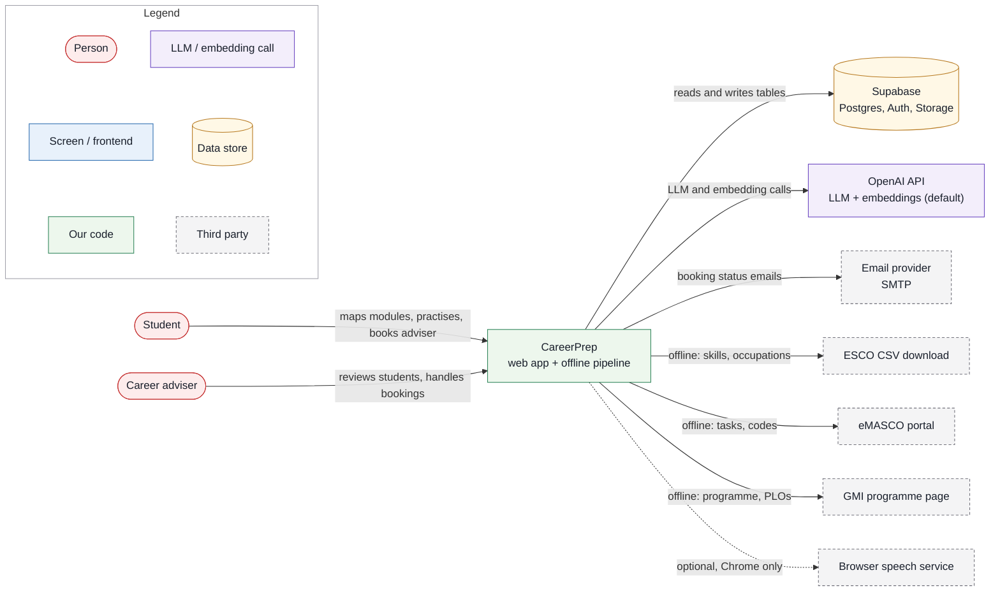

**Figure 3.2 — Containers.** Apart from optional speech, the browser talks only to the Next.js server and Supabase Auth; the Python pipeline runs on a developer machine and writes precomputed tables.

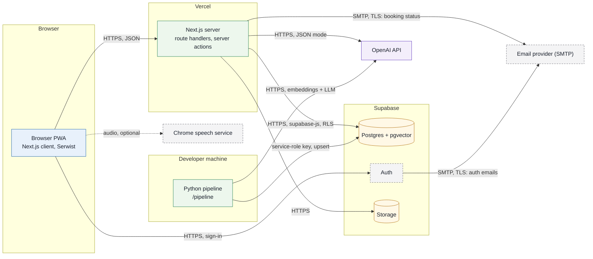

The Python pipeline precomputes the ESCO/eMASCO tables, `crosswalk`, `occupation_skill`, `outcome_skill` and embeddings ([02 §4](02-methodology.md#4-pipeline)). The Occupation Matcher and Gap Planner run in TypeScript (`/lib`) at request time over those tables, so the Map stage makes no LLM call. Live LLM calls are limited to lesson hints, interview turns and feedback.

## 3. Components

Component names match [02-methodology.md](02-methodology.md).

| Component | Responsibility | Inputs → Outputs | Tech |
|---|---|---|---|
| Skill Extractor | Propose candidate skills per learning outcome, each with a verbatim quote | `learning_outcome` → candidates (label, type, quote) | Python, LLM (offline) |
| Skill Normaliser | Map candidates to ESCO skills; accept or reject with quote and confidence | candidate + top-k `esco_skill` → `outcome_skill` | Embeddings, pgvector HNSW, LLM re-ranker (offline) |
| Occupation Matcher | Compute the match score per MASCO 6-digit occupation, using the score unit and "essential wins" rule in [02 §6](02-methodology.md#6-match-score) | `outcome_skill`, `occupation_skill`, `crosswalk` → ranked occupations + evidence quotes | TypeScript in `/lib`, SQL; request time |
| Gap Planner | List uncovered skills for the target, collect 1–5 confidence ratings, order gaps (essential first, then lowest rating), one ~5-minute lesson per day | `target_occupation` → `gap_skill`, `lesson` plan | TypeScript in `/lib`; request time |
| Lesson Engine | Serve micro-lessons and recall items; schedule reviews; give hints without answers; run the no-AI mastery check (5 questions per demo gap skill, pass 4 of 5, marked by answer key / keyword rubric) | `lesson`, `recall_item`, `review_state` → next items, updated `review_state` | ts-fsrs (FSRS-6), LLM adapter for hints only |
| Interview Engine | Build the role rubric and questions from eMASCO tasks and ESCO essential skills; run a text-first mock interview | `masco_occupation.tasks`, `occupation_skill`, `gap_skill` → `interview_session`, `interview_turn` | LLM adapter, optional Web Speech API |
| Feedback Engine | Task-level feedback per answer: STAR, evidence, technical accuracy, one next step; requeue weak areas | `interview_turn` + rubric → `feedback_item`, new `review_state` cards | LLM adapter |
| Adviser Hand-off | "Talk to a human" booking from low-confidence match cards and every Feedback screen; read-only adviser dashboard; accept, decline, complete, cancel; status emails to the student | student state → `booking`; adviser view; email | Next.js, Supabase RLS, SMTP |

**Figure 3.3 — Components and the tables they use.** Only three request-time components call the LLM, and all of them go through one adapter backed by `llm_cache`.

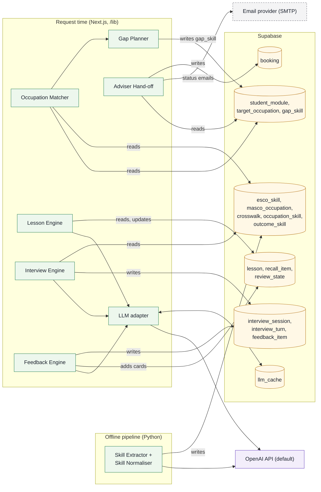

## 4. Data model

The model has 21 entities, so it is shown as two diagrams with key fields only. `module`, `masco_occupation` and `esco_skill` appear in both. Full DDL lives in `/supabase/migrations`.

**Figure 3.4 — Data model: reference data and crosswalk.** Everything here is precomputed by the pipeline and read-only at request time.

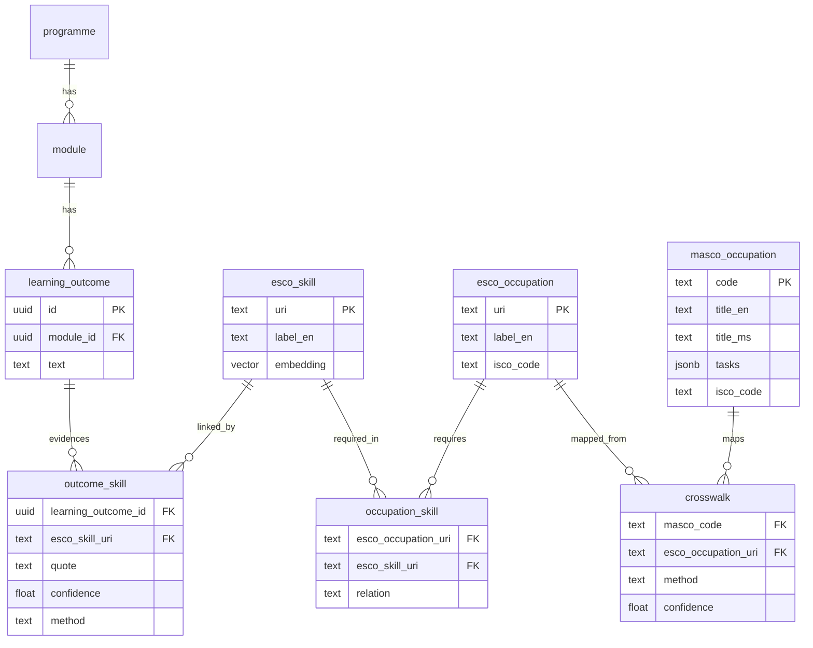

**Figure 3.5 — Data model: student activity.** Every student-owned row hangs off `student`, which is what row-level security and delete-my-data key on.

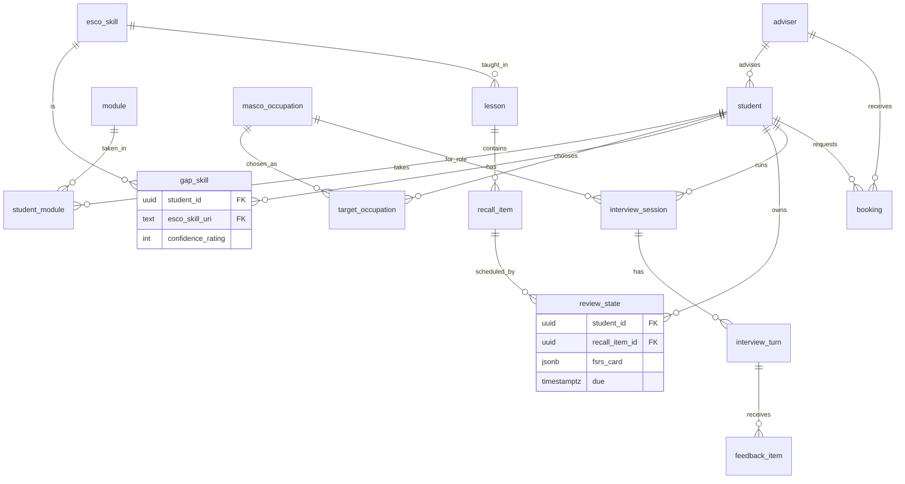

Notes:
- Entities without an attribute block carry the foreign keys implied by their relationships, plus: `interview_session` (status, §8.2), `interview_turn` (question, answer_text, needs_adviser), `feedback_item` (dimension, next_step), `booking` (status, §8.3, slot, note, cancelled_by, cancel_reason), `student` (adviser_id, consent_given). Mastery-check questions and their answer key / keyword rubric are stored in `recall_item` (kind = `mastery`, answer_key).
- `masco_occupation.tasks` holds `tasks[]` as a JSON array of task strings.
- `masco_occupation.code` is the 6-digit code (e.g. 2519-01). `crosswalk.masco_code` is the 4-digit unit group; a 6-digit occupation uses the rows for its first four digits ([02 §6](02-methodology.md#6-match-score)).
- `occupation_skill.relation` is `essential` or `optional`.
- `interview_turn` stores answer text only. No audio is stored.
- One support table outside the domain model, `llm_cache` (key hash, prompt version, model, JSON output), backs §6.

## 5. AI guardrails (design requirements)

Bastani et al. (2025, *PNAS* 122(26):e2422633122) ran a field experiment with about 1,000 Turkish high-school students: unrestricted GPT-4 access raised practice grades by 48% but left unassisted exam scores 17% below the control group. A guardrailed tutor (hints, teacher-provided solutions) avoided that harm, though it did not beat the control group. The following are requirements.

| # | Requirement | How it is enforced | Source |
|---|---|---|---|
| 1 | Hints, not answers, in lessons | Lesson Engine uses a hint ladder: nudge, then concept, then worked analogue. The output schema has no `answer` field. The model gets the answer key only to judge correctness | Bastani et al. 2025 |
| 2 | Grounded outputs | Extraction and matching must quote source text, and code verifies each quote as a substring ([02 §5](02-methodology.md#5-prompt-contracts)). Lessons draw on vetted content in `lesson.content`. Interview questions cite a MASCO task or ESCO skill | Bastani et al. 2025 |
| 3 | No-AI mastery checks | One 5-question check per demo gap skill, pass 4 of 5, with hints and AI disabled, marked deterministically against an answer key / keyword rubric (no LLM). Its result updates `review_state` | Bastani et al. 2025 |
| 4 | Human in the loop | Confidence is shown on every link. Skills below τ (default 0.6) are not covered and show "check with adviser". A "Talk to a human" button is on every low-confidence match card and every Feedback screen | Whiston et al. 2003 |
| 5 | Task-level feedback | `feedback_item` covers dimensions (STAR, evidence, technical accuracy) plus one next step. There is no overall grade or praise of the person | Kluger & DeNisi 1996 [K] |

## 6. LLM adapter, structured output, caching and fallbacks

**Figure 3.6 — LLM call path.** A request-time LLM result reaches the student only after it passes validation; every failure path ends in a fixed fallback.

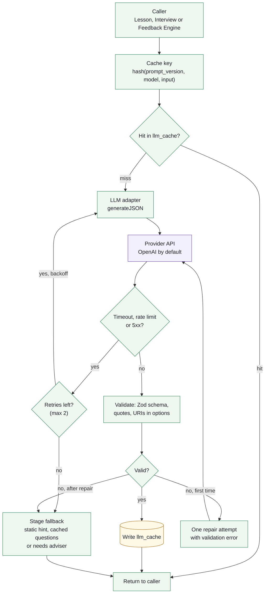

- **Adapter.** `server/llm/adapter.ts` exposes `generateJSON(schema, prompt, input, opts)`. Provider modules implement each vendor's schema-constrained JSON mode. Switching provider is a config change (`LLM_PROVIDER`), including `recorded`, which replays saved responses for the demo and end-to-end tests. The Python pipeline follows the same pattern in `pipeline/careerprep_pipeline/llm.py`. Each side keeps its prompts next to the code that uses them (`server/llm/prompts/`, `pipeline/prompts/`), because no prompt is shared between runtime and pipeline.
- **Validation.** Responses are parsed against a Zod schema (TypeScript) or a pydantic schema (Python), then quote and URI checks run. Responses that fail validation are never shown.
- **Determinism.** Temperature is fixed at 0. Each prompt version is stored with its output.
- **Caching.** The key is `hash(prompt_version, model, input)`. The pipeline writes JSON files in `/pipeline/cache/`; the runtime writes to `llm_cache`. Interview question sets are cached per (occupation, gap set, prompt version).
- **Retries** follow Figure 3.6. Assumption: at most 2 retries.
- **Fallbacks when the LLM fails:**
  - **Map:** precomputed results are always available, so there is no runtime dependency.
  - **Lesson hint:** show the vetted static hint for that `recall_item`.
  - **Interview question:** serve the cached question set for the occupation.
  - **Feedback:** keep the answer, mark the turn **"needs adviser"**, and offer the adviser hand-off.
- **Data routing.** Real student data must never be sent to the Gemini free tier, because content sent there is used to improve Google's products (per a third-party summary; [06 §6](06-evidence.md#6-technical-facts-used)). The demo uses seeded personas only.

## 7. Key sequences

### 7.1 Map flow

**Figure 3.7 — Map flow.** Scoring reads only precomputed tables, so the Map stage makes no LLM call.

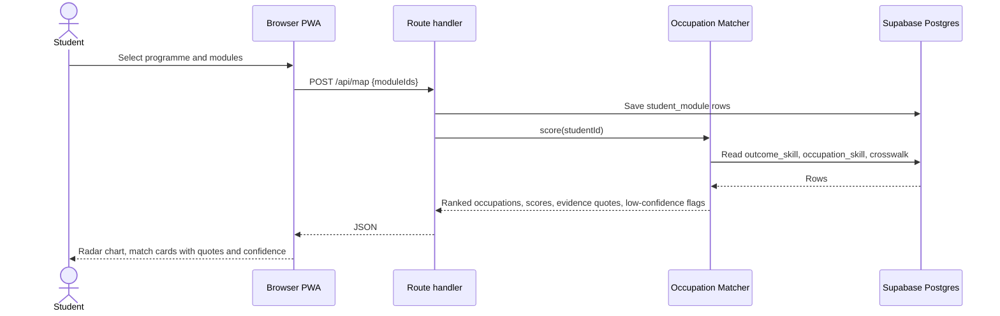

### 7.2 Practice: lesson and hint ladder

**Figure 3.8 — Practice lesson.** Hints escalate one level per request and never contain the answer; the student's own rating drives the FSRS schedule.

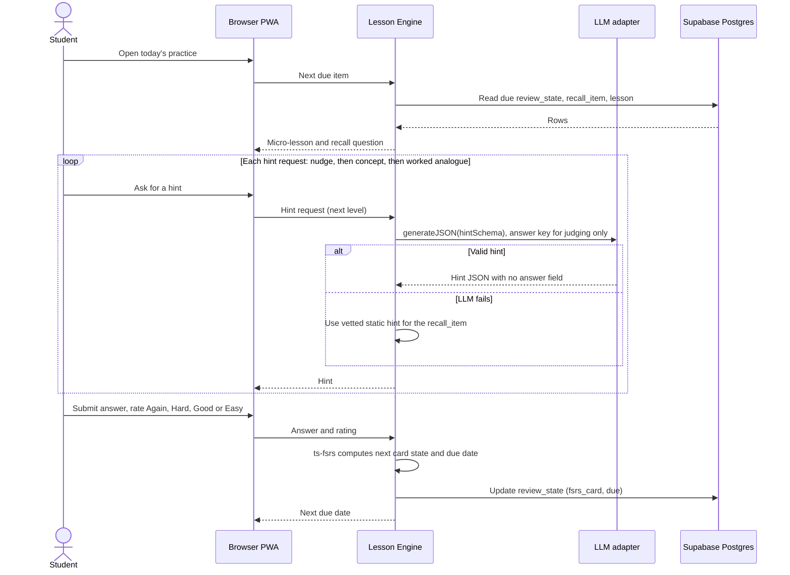

### 7.3 Mastery check

**Figure 3.9 — Mastery check.** The check is marked by code against an answer key, with no LLM anywhere in the flow. The skill is mastered with at least 4 of 5 correct (`MASTERY_PASS_MARK`, default 0.8).

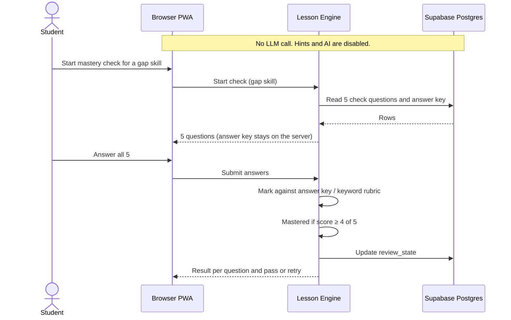

### 7.4 Interview turn and feedback

**Figure 3.10 — Interview turn and feedback.** Answer text is saved before evaluation, so an LLM failure loses nothing and routes the student to an adviser.

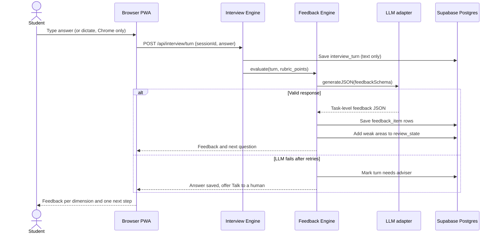

### 7.5 Adviser hand-off and booking

**Figure 3.11 — Adviser hand-off.** The booking carries the student's evidence to the adviser, who can change the booking status but not the student's data. The status is saved before the email is sent.

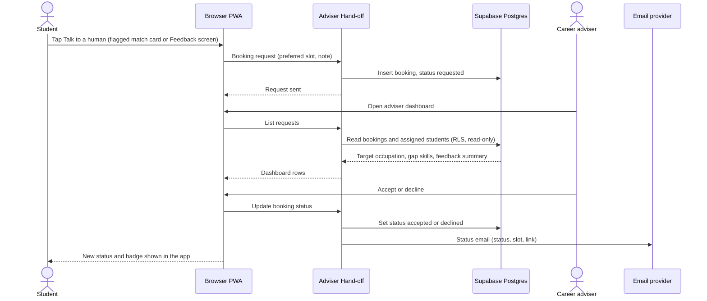

## 8. Lifecycle states

### 8.1 review_state card

`review_state.fsrs_card` holds a ts-fsrs card. Cards are created for each recall item of a gap-skill lesson and for weak areas found by the Feedback Engine. Transitions follow ts-fsrs with its default short-term learning steps.

**Figure 3.12 — review_state card states.** A card leaves Learning once it is recalled well, and a lapse in Review sends it to Relearning rather than back to New.

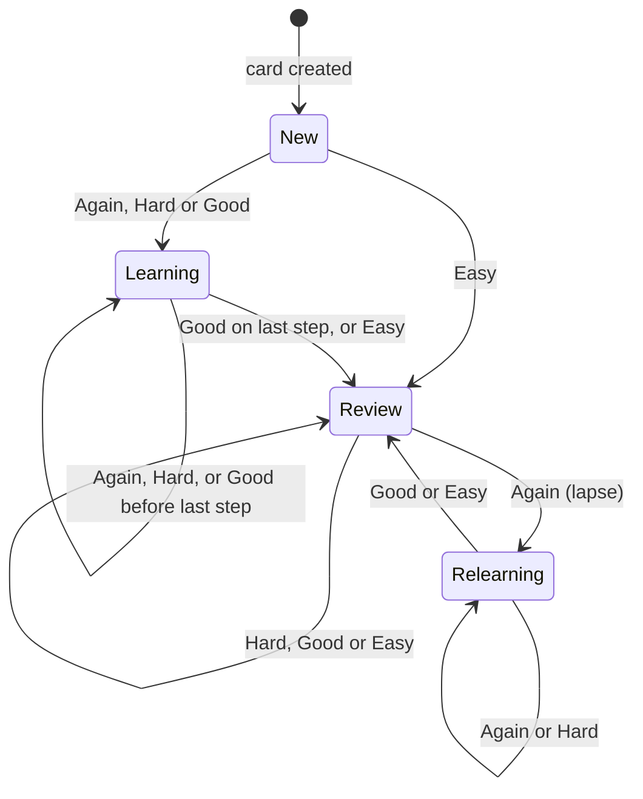

### 8.2 interview_session

**Figure 3.13 — interview_session states.** A session is closed only after feedback is ready; a session left early is kept as abandoned.

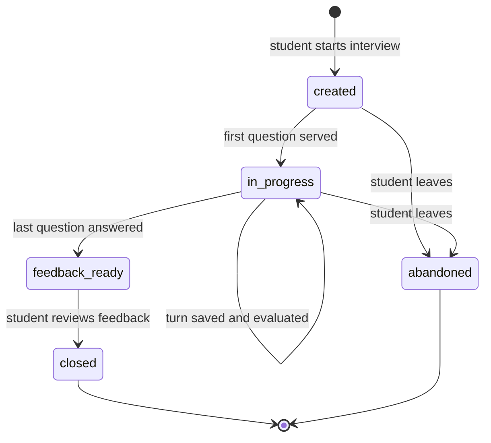

A turn marked "needs adviser" (§6) does not change the session state.

### 8.3 booking

**Figure 3.14 — booking states.** Only an accepted booking can be completed, and only the adviser completes it. The student can cancel a request, and either side can cancel an accepted booking; the adviser must give a reason.

```mermaid
stateDiagram-v2
    accTitle: booking states
    accDescr: A booking starts as requested. The adviser accepts or declines it, or the student cancels it. The adviser marks an accepted booking completed after the session. Either side can cancel it; the adviser gives a reason, which is stored with who cancelled.
    [*] --> requested: Talk to a human
    requested --> accepted: adviser accepts / email student
    requested --> declined: adviser declines / email student
    requested --> cancelled: student cancels
    accepted --> completed: adviser marks session held
    accepted --> cancelled: student cancels
    accepted --> cancelled: adviser cancels [reason given] / email student
    declined --> [*]
    completed --> [*]
    cancelled --> [*]
```

## 9. Privacy and security

Legal context (Malaysia PDPA 2010, with the 2024 amendments phased in on 1 Jan, 1 Apr and 1 Jun 2025):
- Breach notification to the Commissioner is due within 72 h, and to affected data subjects within 7 days after that where significant harm is likely.
- A DPO is mandatory above 20,000 data subjects, or 10,000 for sensitive data.
- Data portability is a new right.
- Biometric data is now sensitive. Whether voice recordings count as biometric is unconfirmed, so we treat them cautiously.

**Figure 3.15 — Personal-data flow.** Student data leaves the browser as text, except opt-in audio sent to the speech service, and audio is never stored.

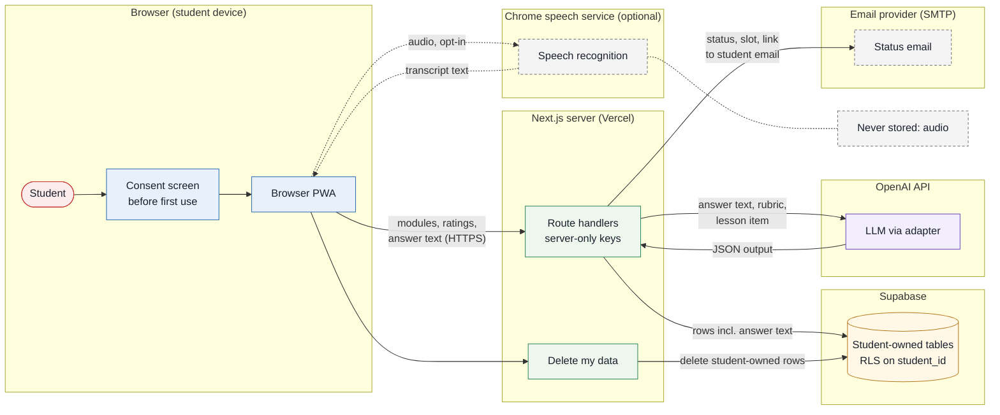

MVP measures:
- **Demo personas only.** The demo and the judges' build contain no real student data.
- **Consent screen** before first use, with an English notice. A Malay notice is a stretch goal.
- **Delete-my-data** (Must) removes all student-owned rows. A JSON export for portability is a Could (C4 in [01 §7](01-prd.md#7-features-moscow)).
- **Minimal emails.** Booking status emails carry the status, the slot and a link to the app. Gap skills, feedback and interview answers never go into an email. The email provider receives the student's email address, so it is a data processor like Supabase and the LLM API.
- **No audio storage.** Typed or transcribed text is the only thing saved. Speech is opt-in, with a note that Chrome sends audio to a web service for recognition.
- **Row-level security** is on for every student-owned table:
  - Students can access only rows where `student_id = auth.uid()`.
  - Advisers get read-only access to rows of their assigned students. The one exception is `booking`: an adviser can change `status` and `cancel_reason` on bookings addressed to them, and nothing else.
  - Reference tables (`esco_*`, `masco_occupation`, `crosswalk`, `occupation_skill`) are read-only.
- **Secrets.** LLM and service-role keys live only in Vercel and Supabase environment variables, server-side. Only `NEXT_PUBLIC_*` values reach the browser. `.env.local` is git-ignored, and `.env.example` lists the names.
- **Cross-border.** Supabase, the LLM APIs, Chrome speech and, depending on the provider chosen, the email provider all process data outside Malaysia. We prefer a Singapore Supabase region and record the transfer basis before any pilot.

## 10. Accessibility and responsiveness

We aim for WCAG 2.2 AA and treat it as a goal, not a claim, until it has been audited.
- **Layout.** Mobile-first Tailwind layouts, checked at 375 px and desktop widths. The app is installable as a PWA via Serwist.
- **Keyboard.** Every flow works by keyboard, with a visible focus ring and logical tab order.
- **Labels.** Every input has a label. Errors are given in text, not by colour alone.
- **Radar chart.** It has a data-table alternative and an `aria-label` summary. Match cards carry the same information in text.
- **Interview.** It is text-first. Speech is feature-detected (`SpeechRecognition || webkitSpeechRecognition`) and hidden when unsupported.
- **Motion.** Animations respect `prefers-reduced-motion`.

## 11. Deployment

**Figure 3.16 — Deployment.** One GitHub repo feeds Vercel previews and production; the pipeline runs from a developer machine against the same Supabase free-plan project.

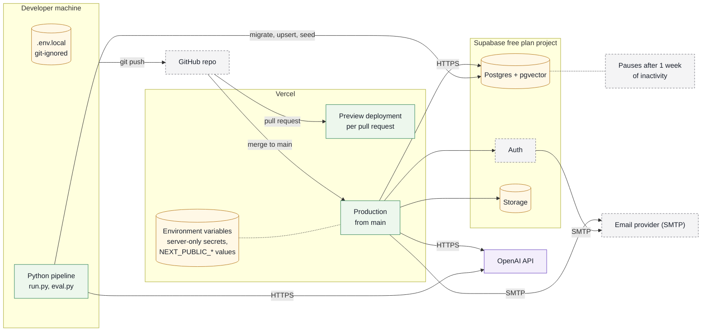

- **Vercel** hosts the Next.js app. Each pull request gets a preview deployment, and `main` deploys to production.
- **Supabase free plan:**
  - Limits: 500 MB database, 1 GB storage, 5 GB egress, 50,000 MAU, 2 active projects.
  - Projects pause after 1 week of inactivity. Keep the project active while the demo build must be reachable, or upgrade (Pro is $25/month).
  - pgvector uses HNSW indexes.
- **Setup order** (same as the [README Quick start](../README.md#10-quick-start)):
  1. `pnpm install`
  2. `supabase link` + `pnpm db:migrate` (applies `supabase/migrations`)
  3. `python pipeline/run.py`: loads the ESCO subset (English CSV), the eMASCO occupations ([02 §6](02-methodology.md#6-match-score)) and the GMI outcomes. It builds `crosswalk` and `occupation_skill`, then extracts and embeds outcome skills into `outcome_skill` (from cache where present).
  4. `pnpm db:seed` (`supabase/seed/`): demo personas (Aina + 4), one adviser, lessons and recall items. It needs the pipeline output.
  5. `pnpm dev`

  Steps 3 and 4 upsert, so they are safe to re-run.
- **Environment variables** (planned names):

| Variable | Where | Purpose |
|---|---|---|
| `NEXT_PUBLIC_SUPABASE_URL` | Browser + server | Supabase project URL |
| `NEXT_PUBLIC_SUPABASE_ANON_KEY` | Browser + server | Anon key (RLS applies) |
| `SUPABASE_SERVICE_ROLE_KEY` | Server, pipeline only | Seed and pipeline writes |
| `DATA_MODE` | Server | `fixtures` (demo default: reads `content/`, no database) or `supabase` ([11 §5](11-repo-structure.md#5-demo-mode-and-real-mode)) |
| `LLM_PROVIDER` | Server | `openai`, `anthropic`, `gemini`, or `recorded` (demo default: replays `content/llm/`) |
| `LLM_MODEL` | Server | Model id for the adapter |
| `LLM_API_KEY` | Server | Key for the chosen provider |
| `EMBEDDING_API_KEY` | Pipeline | Embedding provider key; same value as `LLM_API_KEY` when both are OpenAI |
| `MASTERY_PASS_MARK` | Server | Share of mastery-check answers needed to pass, default `0.8` (4 of 5) |
| `SMTP_URL` | Server | SMTP connection for booking status emails; Supabase Auth's custom SMTP is set in the Supabase dashboard |
| `MATCH_CONFIDENCE_THRESHOLD` | Server | τ, default `0.6` until tuned on the dev split ([02 §8](02-methodology.md#8-evaluation-plan)) |

## 12. Testing

Commands: `pnpm test` (unit), `pnpm test:e2e` (Playwright), `python pipeline/eval.py` (matcher P/R/F1).
- **Unit tests (Vitest; Assumption):**
  - Match-score function: the toy example from [02 §6](02-methodology.md#6-match-score) must give 70%. Also test the τ boundary, an occupation with no optional skills, and empty coverage.
  - FSRS wrapper around ts-fsrs: a new card gets a due date, a rating of "Again" brings the next review sooner than "Good", and weak interview areas create cards.
  - Mastery-check marking against the answer key / keyword rubric, with no LLM call. 4 of 5 passes and 3 of 5 fails.
  - Booking transitions: only the adviser can complete; an adviser cancel without a reason is rejected; a failed email still saves the status.
- **Pipeline tests (pytest):**
  - The quote substring check accepts or rejects as expected.
  - Out-of-options URIs are rejected.
  - Crosswalk rows carry `method` and `confidence`.
- **Evaluation script.** `pipeline/eval.py` computes P/R/F1 against the hand-tagged gold set, tunes τ on the dev split and prints error categories ([02 §8](02-methodology.md#8-evaluation-plan)).
- **Playwright end-to-end tests** run with a seeded persona and the LLM adapter in fixture mode (recorded responses):
  - (1) Map shows ranked cards with quotes.
  - (2) Plan saves confidence ratings.
  - (3) Practice serves a recall item and a hint with no answer.
  - (4) An interview turn returns task-level feedback.
  - (5) An LLM failure shows "needs adviser".

## 13. Repository structure

The full tree, import rules, naming and ownership are in [11-repo-structure.md](11-repo-structure.md). Summary:

```text
/app                  Next.js App Router routes and layouts only
/features             One folder per stage (map, matches, plan, practice, interview, feedback, booking, adviser): UI + server actions
/components/ui        Shared building blocks (button, field, radio scale, drawer, status chip…)
/lib                  Pure logic: Occupation Matcher, Gap Planner, FSRS wrapper, mastery marking, booking transitions
/server               Server-only: data store (fixtures or Supabase), LLM adapter, engines, email
/content              Demo personas, lessons, mastery questions, interview script, recorded LLM responses
/pipeline             Python: run.py (ingest, extract, normalise, crosswalk, embed), eval.py, prompts/, cache/
/supabase/migrations  SQL schema, RLS policies, pgvector indexes
/supabase/seed        seed.ts loads content/ into the database (pnpm db:seed)
/docs                 01–11 planning and technical docs
/tests                unit/, pipeline/, e2e/ (Playwright + axe)
```

## 14. Scalability and future work

- **More programmes.** Each programme costs data entry plus about 25 hand-tagged outcomes, following [02 §10](02-methodology.md#10-how-to-add-a-new-programme). The runtime does not change.
- **Storage.** About 14k ESCO skills and 3k occupations (ESCO v1.2, launch deck) with embeddings is about 70–100 MB including the HNSW index (our estimate, not measured). It fits the 500 MB free database. Switch to `halfvec` if space gets tight.
- **Cost control.** Most LLM work is offline and cached. Runtime calls are limited to hints, interview turns and feedback.
- **Future work:**
  - NOSS ingestion, once a software or IT NOSS code is confirmed.
  - Malay UI strings, plus Malay matching after testing.
  - A periodic demand-data refresh.
  - Institution and adviser accounts at scale.
  - Other ISCO-based countries in Southeast Asia.

## 15. Open questions

- Supabase region availability (Singapore) on the free plan.
