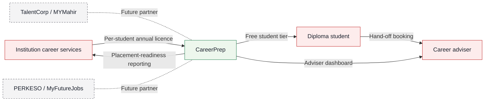
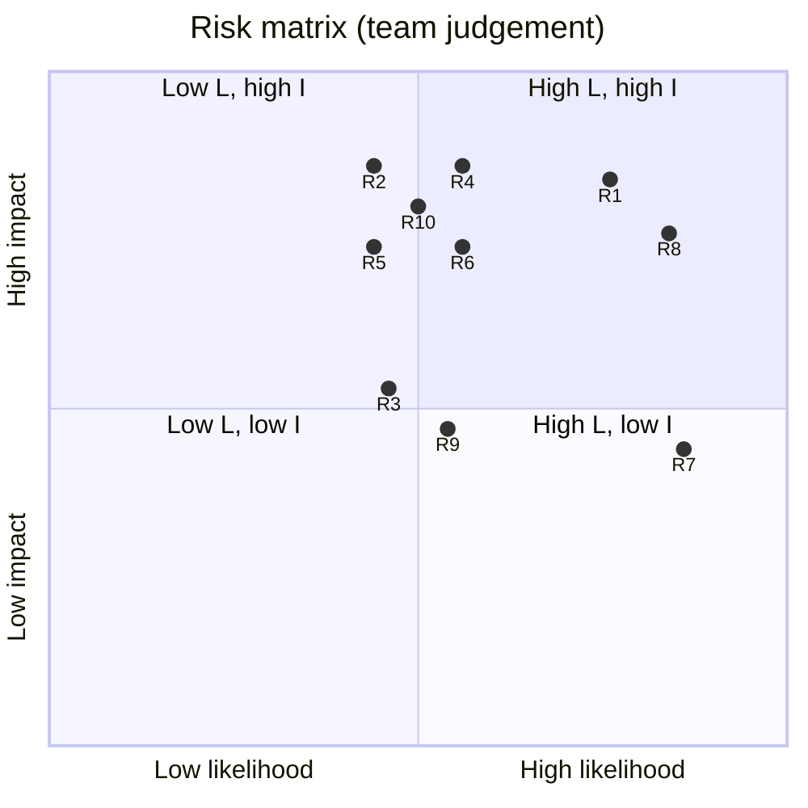
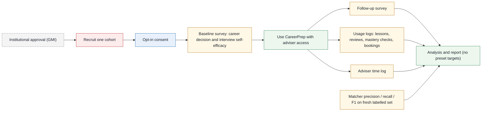

# 04. Business model, competitors, impact and risks

| | |
|---|---|
| Document | 04-business-and-risk.md |
| Version | 0.2 (draft for preliminary-round submission) |
| Status | Draft |
| Related | [01-prd.md](01-prd.md), [03-architecture.md](03-architecture.md), [06-evidence.md](06-evidence.md) |

**Contents:** [1. Purpose and scope](#1-purpose-and-scope) · [2. Problem and impact summary](#2-problem-and-impact-summary) · [3. Lean canvas](#3-lean-canvas) · [4. Competitors](#4-competitors) · [5. Risk register](#5-risk-register) · [6. Impact and pilot evaluation plan](#6-impact-and-pilot-evaluation-plan) · [7. Future work](#7-future-work) · [8. Costs at pilot scale (order of magnitude)](#8-costs-at-pilot-scale-order-of-magnitude) · [9. Open questions](#9-open-questions)

## 1. Purpose and scope

This document specifies who pays for CareerPrep, which products it competes with, how a pilot would measure impact, what can go wrong, and which capabilities come after the MVP. It does not define product requirements ([01-prd.md](01-prd.md)), the matching method ([02-methodology.md](02-methodology.md)) or the system design ([03-architecture.md](03-architecture.md)). Every figure traces to [06-evidence.md](06-evidence.md). Diagram colours follow the legend in [03 §1.1](03-architecture.md#11-diagram-colour-legend). Acronyms and symbols (MASCO, ESCO, FSRS, STAR, PLO, PDPA, τ) are defined in the [README glossary](../README.md#17-glossary).

## 2. Problem and impact summary

| Signal | Figure | Source (see [06-evidence.md](06-evidence.md)) |
|---|---|---|
| Skill-related underemployment, employed tertiary-educated Malaysians | **35.2%** (more than 1 in 3), Q2 2026 | DOSM via RinggitPlus |
| Youth unemployment (15–24) vs national | 10.1% vs 2.9%, Aug 2026 | DOSM via Malay Mail |
| Graduate supply vs skilled job creation | ~100,000 TVET + ~300,000 university graduates/year vs ~50,000 skilled high-paying jobs/year | HR Minister, Jan 2025 |
| GenAI exposure by education group | Diploma/certificate holders most exposed: 46% | ISIS/World Bank, Aug 2025 |
| TVET scale | 1,398 TVET institutions; 57.4% of SPM leavers entered TVET in 2025 (official figure) | Bernama, Nov 2025 |
| Reach | 98.3% internet use, 99.6% mobile phone use | DOSM 2025 |

For a diploma student this means two things. They finish a programme without a clear link between their modules and specific occupations, and the jobs most open to them are also the most exposed to GenAI. CareerPrep targets the point before Industrial Training (Sem 6), when students choose Industrial Training placements.

Impact claim: CareerPrep uses ingredients that career-intervention research associates with better outcomes (Brown & Ryan Krane [K]). The MVP implements individualised interpretation (quoted matches), labour-market information (MASCO occupations and tasks), a light written exercise (target choice and confidence ratings) and support-building (Brown & Ryan Krane's term; here, the adviser hand-off). It keeps a counsellor in the loop (Whiston et al. 2003). We do not claim proven outcomes. Section 6 describes how a pilot would test them.

## 3. Lean canvas

| Block | Content |
|---|---|
| Problem | 1. Students cannot see which occupations their actual modules prepare them for. 2. Gap skills are vague, so revision is unfocused. 3. Interview practice is generic, not tied to the target role. 4. Advisers have little time per student. |
| Customer segments | Payer: career-services and industry-liaison units at TVET institutions, polytechnics and colleges. User: diploma students, first at GMI (Diploma in Software Engineering). Secondary user: career advisers and alumni mentors. |
| Unique value proposition | "Your modules → real MASCO jobs → the exact skills you are missing → practice for that role's interview, with every match backed by a quote from your own course outcomes." |
| Solution | Four stages: Map (outcomes → ESCO skills → MASCO 2020 occupations, with quotes and confidence), Plan (gap skills + confidence rating), Practice (FSRS micro-lessons, hint-only tutor, AI mock interview from eMASCO tasks), Feedback (task-level feedback, weak areas re-queued, "Talk to a human"). Adviser dashboard. |
| Channels | Institution career-services units; student societies; lecturers running Industrial Training preparation; later, TalentCorp/MYMahir and PERKESO/MyFutureJobs partnerships. |
| Revenue streams | B2B2C: per-student annual licence paid by the institution; free student tier. Later: employer talent signal (opt-in). No price is set. |
| Cost structure | LLM tokens, embeddings, Supabase hosting, email delivery, programme onboarding labour (entering outcomes + labelled check per programme), adviser time. Order of magnitude in section 8. |
| Key metrics (what a pilot would measure, not targets) | Career decision self-efficacy (pre/post); interview self-efficacy (pre/post); career certainty; adviser minutes per student; matcher precision/recall/F1 on hand-tagged outcomes; share of matches flagged "check with adviser"; lesson completion and FSRS review adherence; hand-off bookings made. |
| Unfair advantage | The documented MASCO 2020 ↔ ISCO-08 ↔ ESCO crosswalk plus a labelled programme-outcome dataset, built by students inside the programme. Each new programme adds to it. |

**Figure 4.1 — Business model (B2B2C).** The institution pays, students use CareerPrep free, advisers work from the dashboard, and national partners are a later channel (dashed).

### 3.1 Value by stakeholder

| Stakeholder | What they get | Why they would pay or take part |
|---|---|---|
| Diploma student | A ranked list of MASCO jobs backed by quotes from their own course outcomes; a short daily plan for gap skills; interview practice for that role | Free tier; less guesswork before Industrial Training |
| Career adviser / alumni mentor | Dashboard of students' target occupations, gap skills and interview feedback summaries; booking requests | Spends adviser time on students who ask for help, not on repeating basics (to be measured in the pilot) |
| Institution (career services, industry liaison) | Placement-readiness reporting by programme and occupation | Institutions are measured on graduate employability (government reports 95.1% TVET graduate marketability, an official figure) |
| National bodies (TalentCorp, PERKESO) | A programme-outcome → MASCO dataset and a student-facing entry point to their own platforms | Complementary to MYMahir and MyFutureJobs; partnership is a later step, not assumed |

### 3.2 Business assumptions the pilot must test

- Assumption: career-services units will pay a per-student licence. Untested; no price is set.
- Assumption: entering one programme's outcomes and hand-tagging ~25 of them takes days, not months. Measure it on the second programme.
- Assumption: advisers will act on hand-off requests within their current workload.
- Assumption: students return for spaced lessons without grades attached. Watch FSRS review adherence.
- Assumption: Malaysian employers' interviews for 2519/2514 roles reflect the eMASCO task lists. Check with Industrial Training supervisors.

## 4. Competitors

Researched 19 Oct 2026. "?" means not known or not checked. "No evidence" means not found in the sources we read, which is weaker than "No". Sources and caveats are in [06-evidence.md](06-evidence.md#5-competitive-evidence).

| Product | Module → occupation mapping | MASCO codes | Gap lessons | Role-specific interview | Human hand-off | Malaysia focus |
|---|---|---|---|---|---|---|
| CareerPrep | Yes (diploma learning outcomes → MASCO 2020 via ESCO) | Yes (2519, 2514, 2512, 2513, 3512–3514) | Yes (FSRS micro-lessons) | Yes (from eMASCO task list) | Yes (adviser/mentor booking) | Yes |
| MYMahir (TalentCorp) | No evidence (role library + self-assessment) | ? | Recommends training/upskilling, not lessons | No evidence | ? | Yes |
| mynext.my (TalentCorp), unverified | ? | ? | ? | ? | ? | Yes |
| MyFutureJobs (PERKESO) | Qualification → job match (AI), not module-level | ? (PERKESO's 2021 study used MSOC, ESCO-based) | No | No | ? (job-centre services unverified) | Yes |
| Hiredly | No | ? | No | Not listed | No | Yes |
| Jobstreet (SEEK) | No | ? | No | Not mentioned | No | Yes |
| Yoodli | No | No | No | General/behavioural + delivery analytics | ? (coaching tier unverified) | No evidence |
| Big Interview | No | No | ? (curriculum unverified) | Question bank + STAR builder | ? (offered via schools) | No evidence |
| Final Round AI | No | No | No | Yes (resume-aware; behavioural, technical, case) | No | No evidence |
| Huru | No | No | No | Yes (tailored to pasted job description) | No | No evidence |
| Exponent | No | No | ? | Yes (coding, system design, PM, behavioural) | ? (Pramp offers peer mocks, not advisers) | No evidence |

Prices come from a July 2026 comparison published by competitor Nora AI, so they are biased and possibly stale: Yoodli free → USD 8–20/mo, Huru USD 24.99/mo, Big Interview USD 39/mo, Final Round AI free → ~USD 149/mo, Exponent ~USD 12/mo.

What the table shows:
- Role-tailored questions and delivery feedback are standard. They are not our differentiator.
- MYMahir overlaps on skills taxonomy, assessment and upskilling recommendations.
- Prior art exists for matching. PERKESO (Oct 2021) matched 1,900+ NOSS qualifications to 2,942 ESCO-based occupations with NLP (precision 59%, F1 64% at the main cut-off). We report our matcher's numbers alongside it and do not claim to beat it.

Differentiation statement: see [README §5](../README.md#5-why-its-different); this table is its basis.

Positioning: complementary to MYMahir. MYMahir answers "what skills does this role need and where can I train?". CareerPrep answers "what does *my programme* already give me, which MASCO job is closest, and can I interview for it?". Where a gap skill has a matching MYMahir training recommendation, CareerPrep can link to it rather than duplicate it. A TalentCorp partnership is a later channel, not an assumption.

## 5. Risk register

Likelihood (L) and Impact (I) are team judgements: H / M / L. Owners use the member letters in [README.md](../README.md). Assumption: 4 members, A = Faiz (Lead), data pipeline & matcher; B = frontend/UX; C = AI interview & micro-lessons; D = docs, evidence & video.

| ID | Risk | L | I | Mitigation | Owner |
|---|---|---|---|---|---|
| R1 | Mapping errors: wrong skill extracted or wrong occupation matched | H | H | Every skill shows its verbatim quote + confidence; quote checked as a substring in code; skills below τ flagged "check with adviser" with "Talk to a human"; ~25 hand-tagged outcomes; publish precision/recall/F1 next to PERKESO's 59%/64%. | A |
| R2 | LLM hallucination in lessons, hints or feedback | M | H | Structured JSON outputs; lessons grounded in vetted content; hint-only tutor; feedback must cite the eMASCO task or ESCO skill it assesses; adviser review path. | C |
| R3 | Data licence terms: Lightcast commercial use unverified; ESCO reuse terms not re-checked; eMASCO portal terms unknown | M | M | ESCO English CSV as core, attribution to European Commission; Lightcast optional and cached only; eMASCO tasks entered for the 9 MVP occupations with source link; confirm all three before any paid use. | D |
| R4 | PDPA non-compliance (consent, breach, cross-border transfer, voice as biometric) | M | H | Demo personas only; consent screen; delete-my-data; no audio stored; document processors (Supabase, LLM vendor, Chrome speech) and transfer basis; legal check before pilot. | A |
| R5 | Supabase free project pauses after 1 week of inactivity, breaking the judged demo | M | H | Scheduled ping while the demo is being judged, or upgrade to Pro (USD 25/mo); keep a seeded local fallback and the recorded video. | A |
| R6 | Demo failure (API outage, rate limit, network) | M | H | Record the 3-minute video from a stable run; cache LLM responses for the demo personas; text-first interview so speech failure does not block. | D |
| R7 | Speech/accent issues: Malaysian English or Malay mis-transcribed; Web Speech is Chrome-only and sends audio to a server | H | M | Text-first by default; speech is optional and labelled; runtime feature detection; feedback scores content, not accent or delivery. | C |
| R8 | Scope creep | H | H | MVP locked to one programme and 9 occupations; NOSS, live jobs, Malay UI, employer side out of scope; A cuts any feature not on the demo path. | A |
| R9 | Competitor overlap: MYMahir or mynext.my already map courses to occupations | M | M | Check both sites before repeating the differentiation claim; position as complementary; differentiation rests on outcome-level quotes + MASCO + task-based interview + hand-off, not on any single feature. | D |
| R10 | Over-reliance on AI: students use it as a crutch or trust matches blindly (Bastani et al. 2025) | M | H | Hints not answers; no-AI mastery check per gap skill; confidence shown on every match; "Talk to a human" on every low-confidence match card and every Feedback screen; no overall "grade". | C |

**Figure 4.2 — Risk matrix.** Most risks sit in the high-impact half, and R1 (mapping errors) and R8 (scope creep) are top priority; positions are the team's H/M/L judgements from the table (L = 0.2, M = 0.5, H = 0.8, offset slightly so labels do not overlap), not measured probabilities. M-rated risks sit on the midlines; offsets are only for legibility.

## 6. Impact and pilot evaluation plan

Evidence base. We found no randomised trial of an AI career adviser. Meta-analyses show career interventions work best on career decision self-efficacy (Whiston et al. 2017) and that computer tools work better with counsellor support (Whiston et al. 2003). OECD Working Paper 258 (2021) links career-readiness activities, including CV/interview training, to better adult outcomes, but these are associations, not causal effects. Evidence on AI mock interviews is one 20-student study with no control group (arXiv 2506.16542). The pilot therefore measures outcomes instead of assuming them.

Pilot design (proposal).

| Item | Plan |
|---|---|
| Setting | One cohort at GMI, Diploma in Software Engineering, before Industrial Training. Cohort size set with the department. |
| Design | Single-group pre/post. Optional comparison: a later cohort or a wait-list group, if the department agrees. Pre/post alone cannot show causation. |
| Primary outcomes | Career decision self-efficacy (validated short-form scale, pre/post); interview self-efficacy (pre/post). |
| Secondary outcomes | Career certainty; adviser minutes per student (adviser time log, before vs during pilot); matcher precision/recall/F1 on a fresh labelled set; share of matches advisers overrode. |
| Process data | Lesson completion, FSRS review adherence, no-AI mastery check results, interview sessions per student, hand-off bookings. |
| Qualitative | Short adviser and student interviews on trust, usefulness and errors. |
| Targets | None set in advance. We report what we observe, with confidence intervals where the sample allows. |

**Figure 4.3 — Pilot evaluation design.** The pilot is a single-group pre/post study: surveys bracket CareerPrep use, and process data, adviser time and matcher accuracy feed the same analysis.

Ethics and consent:
- Institutional approval from GMI before any real student data is used. The demo uses seeded demo personas only.
- Informed, opt-in consent with a bilingual (Malay/English) privacy notice. Participation does not affect grades.
- PDPA 2010 + 2024 amendments: data minimisation, delete-my-data and export, no audio storage, named contact person, breach response plan (72 h to Commissioner).
- No real student data goes to any LLM free tier that uses content for training (e.g. Gemini free tier).
- Advisers see only their own students. Results are reported in aggregate.

## 7. Future work

The MVP covers one programme (GMI Diploma in Software Engineering), 9 MASCO occupations, the four stages end to end, an adviser dashboard (read-only for student data), evaluation on ~25 hand-tagged outcomes, and demo personas. Later capabilities:

- Verification and hardening: widen the labelled set; verify MYMahir/mynext.my, licence terms and the MyCOL primary source; accessibility pass (WCAG 2.2 AA intent); Malay UI strings as a stretch item.
- Pilot with one GMI cohort, after institutional approval: design in section 6; ethics approval; real course outlines entered with the department; adviser workflow tested.
- More programmes, each needing outcomes entry and a labelled check; NOSS ingestion.
- Full Malay UI, and other ISCO-08-based countries in Southeast Asia.
- Partnerships with TalentCorp/MYMahir and PERKESO/MyFutureJobs.

## 8. Costs at pilot scale (order of magnitude)

All rows are assumptions built from published unit prices captured on 19 Oct 2026. They are not quotes and not a budget.

| Item | Unit price (source) | Assumption | Order of magnitude |
|---|---|---|---|
| Embed ESCO skills once | OpenAI text-embedding-3-small USD 0.02 / 1M tokens | Assumption: 13,939 skill labels (ESCO v1.2, launch deck) + descriptions under 2M tokens | Under USD 0.05, one-off |
| Embed student learning outcomes | Same | Assumption: a programme's outcomes are a few thousand tokens | Under USD 0.01 per programme |
| Database, auth, storage | Supabase Free USD 0; Pro USD 25/mo | Pilot moves to Pro to avoid the 1-week pause | ~USD 25/mo |
| Sign-in and booking status emails | SMTP provider, not chosen yet | Assumption: a few emails per booking and per sign-in | Not costed |
| LLM calls (extraction, re-ranking, lessons, interview, feedback) | Not captured in our notes | Measured in the pilot: logged tokens × vendor price at that time | Unknown until measured |
| Embeddings alternative | BGE-M3, MIT licence | Self-hosted; compute cost not estimated | n/a |
| Programme onboarding labour | n/a | Entering outcomes + hand-tagging ~25 per programme | Staff hours, not costed |

Embeddings and hosting are small. LLM usage and onboarding labour drive cost, and the pilot measures both before any price is set.

## 9. Open questions

- Open mymahir.my and mynext.my and confirm neither maps programme learning outcomes to MASCO occupations. If one does, change the differentiation claim (README, this doc, video voice-over).
- Lightcast Open Skills commercial-use terms and rate limits; ESCO reuse wording; eMASCO terms of use.
- Whether interview voice recordings count as biometric data under the amended PDPA (legal advice before any audio storage).
- MyCOL 2024/25 primary TalentCorp document and MASCO codes (currently a secondary source).
- Which validated short-form scales to use for career decision self-efficacy and interview self-efficacy, and their licence terms.
