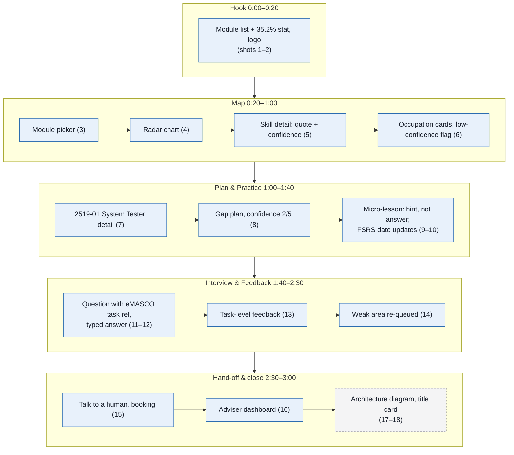

# 05. Demo video script

| | |
|---|---|
| Document | 05-demo-script.md |
| Version | 0.2 (draft for preliminary-round submission) |
| Status | Draft |
| Related | [README](../README.md), [01-prd.md](01-prd.md), [03-architecture.md](03-architecture.md) |

**Contents:** [1. Purpose and scope](#1-purpose-and-scope) · [2. Goal of the video](#2-goal-of-the-video) · [3. Segments and storyboard](#3-segments-and-storyboard) · [4. Voice-over script](#4-voice-over-script) · [5. Shot list](#5-shot-list) · [6. Demo persona and seeded data](#6-demo-persona-and-seeded-data) · [7. Recording checklist](#7-recording-checklist) · [8. Backup plan if a live call fails](#8-backup-plan-if-a-live-call-fails) · [9. Pre-submission checklist](#9-pre-submission-checklist) · [10. Open questions](#10-open-questions)

## 1. Purpose and scope

The 3-minute video is one of three things judges review, with the source code and the docs. This document specifies the word-for-word voice-over, the storyboard, the shot list, the seeded data and the recording checks. It does not define product behaviour; product names, stage names and numbers follow [../README.md](../README.md) and [01-prd.md](01-prd.md). Acronyms and symbols (MASCO, ESCO, FSRS, STAR, PLO, PDPA, τ) are defined in the [README glossary](../README.md#17-glossary).

Hard limit: **≤ 3:00**. The voice-over budget at ~140 words/minute is ≤ ~420 words. The script below is 341 words (counting only the quoted voice-over lines).

## 2. Goal of the video

In 3 minutes, each judge must see:

| Judge must see | Criterion (weight) | Segment |
|---|---|---|
| A real, measured Malaysian problem (35.2% skill-related underemployment, DOSM) | Impact (30%) | Hook |
| Skills extracted from real learning outcomes, with the quoted source text and a confidence score | Technical Execution (30%) | Map |
| A real MASCO 2020 code (2519-01 System Tester) and a match score with evidence | Technical Execution, Impact | Map, Plan & Practice |
| A flow a diploma student can follow without help | Usability (25%) | All |
| Guardrails working: hint not answer, task-level feedback, human hand-off | Impact, Usability | Plan & Practice, Interview & Feedback, Hand-off & close |
| How it is built and who pays | Feasibility (15%), Technical Execution | Hand-off & close |

## 3. Segments and storyboard

| Time | Segment | What is on screen |
|---|---|---|
| 0:00–0:20 | Hook | 35.2% stat card over the GMI Software Engineering module list |
| 0:20–1:00 | Map | Select modules → radar chart builds → click a skill → quoted learning outcome + confidence; ranked occupation cards |
| 1:00–1:40 | Plan & Practice | Top match 2519-01 System Tester with MASCO code → gap skill → confidence rating → recall question from the 5-minute micro-lesson, hint (not answer) → plan updates |
| 1:40–2:30 | Interview & Feedback | English question generated from an eMASCO task, with its task reference → student types answer → task-level feedback with one next step → weak area queued for re-practice |
| 2:30–3:00 | Hand-off & close | "Talk to a human" → adviser dashboard → architecture flash → B2B2C line → differentiation line |

**Figure 5.1 — Video storyboard.** The screens appear in recording order and each one belongs to exactly one of the five segments; shot numbers refer to the [shot list](#5-shot-list).

## 4. Voice-over script

Lines starting with `>` are spoken. Everything else is direction. Read at a calm pace; pauses are marked `[beat]`.

### 4.1 Hook, 0:00–0:20 (43 words)

> More than one in three employed, tertiary-educated Malaysians work below their qualifications. 35.2 percent, according to DOSM.
> [beat]
> This is a module list from GMI's Diploma in Software Engineering. It tells a student what they studied. Not which job it leads to. CareerPrep does.

### 4.2 Map, 0:20–1:00 (77 words)

> Meet Aina, a demo student. She ticks the modules she has completed.
> CareerPrep reads every learning outcome, extracts the skills, and matches them to ESCO skills and MASCO 2020 occupations. Her skills radar builds as she goes.
> [beat]
> Click any skill and you see why: the exact learning-outcome sentence it came from, and a confidence score. Low-confidence matches are flagged "check with adviser".
> On the right, ranked occupations, each with a match score and the evidence behind it.

### 4.3 Plan & Practice, 1:00–1:40 (80 words)

> Her top match: 2519-01, System Tester, from MASCO 2020.
> CareerPrep shows the gap skills. She rates her confidence on one, two out of five, and gets a five-minute daily plan.
> [beat]
> Here is one recall question from today's five-minute lesson. She's stuck, so she asks for help. The tutor gives a hint, not the answer.
> She answers, and her review schedule updates. Spaced practice, timed by the FSRS algorithm, so the skill comes back when she is likely to forget it.

### 4.4 Interview & Feedback, 1:40–2:30 (76 words)

> Now the interview for that exact role.
> Every question is built from the official eMASCO task list for System Tester, plus her gap skills. Text works on any device; voice is optional.
> [beat]
> She types her answer.
> The feedback is about the answer, not about her: structure, evidence, technical accuracy, and one concrete next step. No overall grade.
> [beat]
> The weakest area goes straight back into her review queue. So tomorrow's lesson targets exactly what this interview exposed.

### 4.5 Hand-off & close, 2:30–3:00 (65 words)

> When she wants a person, "Talk to a human" books a career adviser, who sees her target role, gaps and feedback on one dashboard.
> Under the hood: Next.js, Supabase with pgvector, and our documented MASCO-to-ESCO crosswalk.
> Institutions license it. Students use it free.
> [beat]
> None of the tools we checked maps real diploma modules to MASCO jobs, closes the gaps, and rehearses that exact interview.
> CareerPrep.

Word counts: 43 + 77 + 80 + 76 + 65 = 341 words (≈ 2:26 at 140 wpm), which leaves ~34 s for beats and UI waits. If a take runs long, cut the last sentence of Plan & Practice first, then "Text works on any device; voice is optional."

## 5. Shot list

Assumption: Member D records the screen and the voice-over and edits the video; Member B drives the UI for the Map, Plan and hand-off shots; Member C drives the lesson and interview shots. See [README → Team](../README.md#15-team).

| # | Time | Screen | Action | Overlay text | Who records |
|---|---|---|---|---|---|
| 1 | 0:00 | GMI SE module list (seeded, in app) | Slow scroll | "35.2% of employed tertiary-educated Malaysians are in skill-related underemployment — DOSM, Q2 2026" | Member D |
| 2 | 0:12 | Same, logo fade-in | Hold | "CareerPrep" | Member D |
| 3 | 0:20 | Map → module picker | Tick 4–6 modules | "Map" stage label | Member B |
| 4 | 0:30 | Map → radar chart | Radar animates as modules are ticked | — | Member B |
| 5 | 0:40 | Skill detail drawer | Click one skill; show quote + confidence | "Quoted from the learning outcome" | Member B |
| 6 | 0:50 | Occupation cards | Hover top 3 cards; show one low-confidence flag | "MASCO 2020 · ESCO v1.2" | Member B |
| 7 | 1:00 | Occupation detail | Open 2519-01 System Tester; show code + match % | "2519-01 Penguji Sistem (System Tester)" | Member B |
| 8 | 1:10 | Plan | Gap skill list; set confidence 2/5; plan appears | "Plan" stage label | Member B |
| 9 | 1:20 | Lesson (Practice) | Recall question → click "Hint" → hint shown → answer | "Hint, not answer" | Member C |
| 10 | 1:35 | Plan / review queue | Next-review date updates | "Scheduled with FSRS (ts-fsrs)" | Member C |
| 11 | 1:40 | Interview | English question card with its task reference tag (e.g. "Source: eMASCO 2519, task 2") | "Practice → Interview" | Member C |
| 12 | 1:55 | Interview | Answer typed in (pre-written, sped up 2×) | — | Member C |
| 13 | 2:05 | Feedback | Feedback panel: STAR, evidence, accuracy, one next step | "Task-level feedback · no grade" | Member C |
| 14 | 2:20 | Review queue | Weak area appears as new recall item | "Weak area re-queued" | Member C |
| 15 | 2:30 | Feedback → "Talk to a human" | Click; booking confirmation | "Human adviser one click away" | Member B |
| 16 | 2:38 | Adviser dashboard | Student row: target occupation, gaps, feedback summary | "Adviser view" | Member B |
| 17 | 2:45 | Architecture diagram (from [03-architecture.md](03-architecture.md)) | Static, 3 s | "Next.js · Supabase + pgvector · MASCO→ISCO→ESCO crosswalk" | Member D |
| 18 | 2:50 | Title card | Hold to end | "B2B2C: institutions license, students free" then differentiation line + repo URL | Member D |

## 6. Demo persona and seeded data

All demo data is fictional. No real student data appears in the video.

- Persona: "Aina" (fictional), Semester 5, before Industrial Training, GMI Diploma in Software Engineering. Completed modules chosen so the top match is 2519-01 System Tester (her target).
- Programme: GMI Diploma in Software Engineering (MQA/FA 9541): module names by semester from gmi.edu.my, and learning outcomes entered by the team from their own course outlines (not public).
- Occupations: the 9 MASCO 2020 occupations listed under "Match score" in [02-methodology.md](02-methodology.md), with title_en, title_ms, tasks[] and isco_code.
- Crosswalk + ESCO subset: occupation_skill rows for each mapped ESCO occupation; outcome_skill rows with quote + confidence for Aina's modules, including at least one below τ (to show the "check with adviser" flag and "Talk to a human" on the card).
- Gap skills for the demo: 3 ESCO essential skills of System Tester that Aina lacks; one is shown on screen with its exact ESCO label.
- Lessons: vetted lesson content and 5 recall items for each of the 3 gap skills, with a 3-step hint ladder (nudge → concept → worked analogue) and a 5-question no-AI mastery check per skill (pass 4 of 5).
- Interview: one English question generated from an eMASCO 2519 task, shown with its task ID (the task wording on eMASCO is Malay and is not copied on screen), one pre-written student answer, and a cached feedback_item.
- Adviser: one fictional adviser account with 5 demo students (Aina + 4, including Hafiz), one booking request (status: requested).

## 7. Recording checklist

- [ ] 1920×1080 (1080p), 30 fps; record the browser window only.
- [ ] Browser zoom set so text is readable at 1080p (try 110–125%); same zoom for every take.
- [ ] Hide bookmarks bar, extensions, notifications; use a clean browser profile; close other tabs.
- [ ] Pre-warm Supabase (free plan pauses after 1 week inactive) and LLM caches: run the full flow once before recording.
- [ ] Use cached LLM outputs for extraction, hints and interview feedback. No live LLM call on camera.
- [ ] Captions/subtitles burned in or uploaded as SRT, generated from this script (accessibility; also helps judges watching muted).
- [ ] Test audio: quiet room, external or headset mic, record a 10-s test and listen back; no clipping.
- [ ] Mouse movements slow and deliberate; cursor highlight on.
- [ ] Record voice-over separately from screen capture, then align in edit.
- [ ] Check every on-screen number matches [../README.md](../README.md): 35.2%, 2519-01, MASCO 2020.
- [ ] Open mymahir.my and mynext.my and confirm neither maps programme learning outcomes to MASCO occupations; if one does, change the claim in the closing line.

## 8. Backup plan if a live call fails

- Cached output is already the default: the demo build reads stored extraction, hint and feedback results for the Aina persona.
- If Supabase is unreachable: run the app against a local Supabase instance seeded with the same data.
- If a screen breaks mid-take: re-record that shot only; the shot list is built so each shot can be cut in independently.
- If a feature is not finished by recording time: show it with a clearly labelled screen ("Prototype screen — not yet wired") rather than a mock that pretends to work. Do not fake functionality.
- Keep a complete good take from the earliest stable build as a fallback video.

## 9. Pre-submission checklist

- [ ] Video length ≤ 3:00 (check the exported file, not the editor timeline).
- [ ] Video plays from the submitted link in a logged-out / incognito window.
- [ ] Repo is public (or accessible to judges) and opens from a logged-out window.
- [ ] README and docs render on GitHub: every Mermaid figure shows, tables align, images load (or placeholders are removed).
- [ ] All relative doc links in README and `docs/` work.
- [ ] No secrets committed: `.env.local` ignored; `.env.example` holds names only.
- [ ] No real student data in repo, seed files or video.
- [ ] Submission form fields filled: repo URL, video URL, team names.

## 10. Open questions

- Which eMASCO 2519 task (and task ID) the on-screen interview question is generated from.
- Which 3 ESCO essential skills are Aina's demo gap skills.
- Final role split for recording (shot list assumes Member B/C/D as above).
