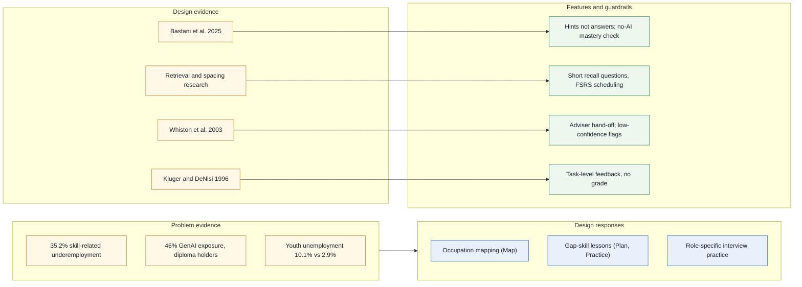

# 06. Evidence: claims, sources and status

| | |
|---|---|
| Document | 06-evidence.md |
| Version | 0.2 (draft for preliminary-round submission) |
| Status | Draft |
| Related | [02-methodology.md](02-methodology.md), [03-architecture.md](03-architecture.md), [04-business-and-risk.md](04-business-and-risk.md) |

**Contents:** [1. Purpose and scope](#1-purpose-and-scope) · [2. How to read this](#2-how-to-read-this) · [3. Problem evidence](#3-problem-evidence) · [4. Design evidence](#4-design-evidence) · [5. Competitive evidence](#5-competitive-evidence) · [6. Technical facts used](#6-technical-facts-used) · [7. Claims we deliberately do NOT make](#7-claims-we-deliberately-do-not-make) · [8. Design decisions](#8-design-decisions) · [9. References](#9-references) · [10. Open questions](#10-open-questions)

## 1. Purpose and scope

This document lists every number and research claim used in the CareerPrep docs, with its source and verification status. A figure that is not here is unsupported. It does not argue for the product: business use of these figures is in [04-business-and-risk.md](04-business-and-risk.md), the method in [02-methodology.md](02-methodology.md) and the guardrails in [03-architecture.md](03-architecture.md). Diagram colours follow the legend in [03 §1.1](03-architecture.md#11-diagram-colour-legend). Acronyms and symbols (MASCO, ESCO, FSRS, STAR, PLO, PDPA, τ) are defined in the [README glossary](../README.md#17-glossary).

## 2. How to read this

| Status | Meaning |
|---|---|
| **Verified** | The source was fetched during our research on 19 Oct 2026 and the figure was read there. "Verified" means we read it in the cited source, not that we audited the underlying data. |
| **[K]** | Prior knowledge from well-known published work; citation details not re-checked. Re-check before quoting decimals. |
| **Unverified** | From a secondary source, a search snippet, or background knowledge only. Do not repeat as fact without checking. |

All URLs accessed 19 Oct 2026 unless stated.

## 3. Problem evidence

| Claim | Figure | Definition | Date | Source | Status |
|---|---|---|---|---|---|
| More than 1 in 3 employed tertiary-educated Malaysians work below their qualifications | **35.2%** | Employed tertiary-educated persons in skill-related underemployment | Q2 2026 (published 28 Aug 2026) | DOSM via [RinggitPlus](https://ringgitplus.com/en/blog/career/dosm-over-a-third-of-graduates-still-stuck-in-jobs-below-their-skills.html) | Verified |
| Youth unemployment is far above the national rate | 10.1% vs 2.9% | Ages 15–24 vs all labour force | Aug 2026 | DOSM via [Malay Mail](https://www.malaymail.com/amp/news/money/2026/10/09/malaysias-august-2026-unemployment-rate-hits-new-low-of-29pc/238372) | Verified |
| Graduate supply exceeds skilled job creation | ~100,000 TVET + ~300,000 university graduates/yr vs ~50,000 skilled high-paying jobs/yr | Ministerial estimate | Jan 2025 | HR Minister, [Malay Mail/Bernama](https://www.malaymail.com/news/money/2025/01/20/low-wages-skills-mismatch-and-insufficient-job-opportunities-three-paradoxes-straining-malaysias-labour-market-says-hr-minister/163945) | Verified |
| Diploma/certificate holders are the most GenAI-exposed education group | 46% (vs 37% degree, 8% no certificate) | Share of workers in the group exposed to generative AI | Study launched 25 Aug 2025 | ISIS Malaysia & World Bank, via [Malay Mail](https://www.malaymail.com/news/malaysia/2025/08/29/study-warns-mid-skilled-young-workers-women-in-malaysia-most-at-risk-from-ai/188895) | Verified |
| Guidance capacity is thin (school level) | 1:500 vs 1:250 target | School counsellors to students | Jul 2026 | [Malay Mail](https://www.malaymail.com/news/malaysia/2026/07/13/malaysian-schools-need-more-mental-health-professionals-amid-rising-student-crises-say-experts/227407) | Verified — schools only, not TVET; context only, not used as a headline claim |
| TVET is large | 1,398 institutions; 57.4% of SPM leavers entered TVET | Official government figure; broad TVET definition likely | 2025 (reported 22 Nov 2025) | [Malay Mail/Bernama](https://malaymail.com/news/malaysia/2025/11/22/zahid-tvet-no-longer-second-choice-as-enrolment-among-spm-leavers-set-to-increase/199372) | Verified (official claim) |
| Institutions are measured on employability | 95.1% TVET graduate marketability | Government-reported figure | Nov 2025 | Same Malay Mail/Bernama article | Verified (official claim) |
| Students can be reached on mobile | 98.3% internet use; 99.6% mobile phone use | Individuals, DOSM ICT Use & Access Survey | 2025 (reported 28 Apr 2026) | DOSM via [RinggitPlus](https://ringgitplus.com/en/blog/personal-finance-news/dosm-nearly-all-malaysians-are-now-online-in-2025.html) | Verified |
| National job matching is AI-led but job-focused | 3M jobseekers; 100k+ employers; 7.5M visits/month; 32,887 placements | MyFutureJobs (PERKESO) platform figures | 2025 placements; reported 5 Jul 2026 | [The Star](https://www.thestar.com.my/news/nation/2026/07/05/ai-enhances-job-matching-predictions-says-ramanan) | Verified |
| Market size (directional) | Malaysia edtech USD 1.18B; 10.9% CAGR | Analyst estimate (source: USD 1,179.2M; 10.89% CAGR 2026–2034) | 2025 | [IMARC Group](https://www.imarcgroup.com/malaysia-edtech-market) | Verified — analyst estimate, not hard data |
| Employer training money exists | RM2.3B HRD Corp levy collected | Record annual levy collection | 2024 (reported 9 Feb 2025) | [Malay Mail](https://www.malaymail.com/news/malaysia/2025/02/09/hrd-corp-hits-record-rm23b-in-levy-collection-pledges-faster-disbursement-says-sim/166105) | Verified |
| Software roles are on the critical occupations list | Software Developers, Application Programmers, Software and Application Developers and Analysts | MyCOL 2024/25, 66 critical jobs across 18 industries | Blog dated 20 Jul 2026 | [AJobThing summary](https://www.ajobthing.com/resources/blog/66-critical-jobs-malaysia-2026-full-mycol-list-talent-corp) | Unverified (secondary; primary TalentCorp PDF not fetched) |

Do not mix the 35.2% headline with the 32.2% (graduates, 2024) or 36.8% (cited by the HR Minister, Jan 2025) underemployment figures. They use different populations and dates.

## 4. Design evidence

**Figure 6.1 — Evidence-to-design map.** Problem statistics motivate the three product stages as a group; each guardrail traces to one body of design research.

| Design choice | Evidence | Effect / finding | Caveat | Citation |
|---|---|---|---|---|
| Map and Plan draw on: individualised interpretation (quoted matches), labour-market information (MASCO occupations and tasks), a light written exercise (target choice and confidence ratings), building support (adviser hand-off) | Brown & Ryan Krane: five critical ingredients of career-choice interventions | Interventions containing these ingredients show larger effects; the MVP implements only the four listed | [K]; not re-checked | Brown et al. 2003 |
| "Talk to a human" hand-off; low-confidence matches flagged "check with adviser" | Whiston, Brecheisen & Stephens 2003 meta-analysis | Counsellor-free interventions less effective; computer tools work better with counsellor support | Older studies; pre-LLM tools | Whiston et al. 2003 (Verified) |
| Career decision self-efficacy as the primary pilot outcome | Whiston et al. 2017 meta-analysis, 57 studies | Largest effects on career decision self-efficacy | Effect sizes not obtained | Whiston et al. 2017 (Verified) |
| Interview practice + gap-skill building + motivation support | Liu, Huang & Wang 2014 meta-analysis of job-search interventions | Odds of employment OR ≈ 2.67; larger when skills and motivation combined | [K]; not AI-based | Liu et al. 2014 |
| Interview practice is worth including | OECD Working Paper 258 (8 countries, longitudinal) | CV/interview training associated with +4–5% earnings (Canada) | Associations, not causal; some indicators ran negative; p < 0.1 | Covacevich et al. 2021 (Verified) |
| Short-answer recall questions (not rereading) | Dunlosky et al. 2013; Adesope et al. 2017 | Practice testing rated "high utility"; g ≈ 0.61 overall | [K]; smaller in messy real courses | Dunlosky 2013; Adesope 2017 |
| FSRS spaced scheduling | Latimier et al. 2021 | Spaced retrieval beats massed, g ≈ 0.74 | [K] | Latimier 2021 |
| ts-fsrs (FSRS-6) as scheduler | srs-benchmark, ~10k Anki users, ~727M reviews | FSRS-6 log loss 0.3460 vs FSRS-5 0.3561 | Flashcard data, not career skills; SM-2 comparison unverified | srs-benchmark (Verified) |
| Hints not answers; no-AI mastery check | Bastani et al. 2025 field experiment, ~1,000 students | Unguarded GPT: −17% on unassisted exam; hint-only GPT Tutor avoided the harm | Guarded tutor did not beat control; maths, high school | Bastani et al. 2025 (Verified) |
| Why practice scores alone are not trusted | Bastani et al. 2025 (same study) | Unguarded GPT-4 raised practice grades by 48% while lowering unassisted exam scores | Same caveats as above | Bastani et al. 2025 (Verified) |
| Grounded lessons; quote-the-source extraction | Bastani et al. built GPT Tutor on teacher solutions because of model errors | Grounding used to limit hallucination | No error-rate statistic found | Bastani 2025; Wharton summary |
| Task-level feedback; no "grade" or praise | Kluger & DeNisi 1996 | Mean d ≈ 0.41, but over one-third of feedback effects negative, especially self-focused feedback | [K] | Kluger & DeNisi 1996 |
| Mock interview framed as practice, not proven outcome | Gomez et al. 2025, n = 20, one AI voice mock interview | 80% realistic, 80% useful, 60% less anxious; 85% reported flow/timing problems | No control group; no hiring outcomes; unpublished | arXiv 2506.16542 (Verified) |

## 5. Competitive evidence

| Competitor fact | Source | Status |
|---|---|---|
| MYMahir launched Nov 2024 by TalentCorp: skills taxonomy, in-demand/emerging roles, skill assessment → upskilling and career recommendations, AI-affected roles | [Bernama, 28 Nov 2024](https://www.bernama.com/en/general/news.php?id=2368788) | Verified (news); mymahir.my itself not opened |
| MYMahir: no diploma-module input, MASCO codes or mock interviews seen | Absence in the Bernama article only | Unverified |
| mynext.my: TalentCorp student platform, possibly career-readiness assessments | Background knowledge | Unverified — must check |
| MyFutureJobs: AI matching on qualifications; 3M jobseekers, 100k+ employers, 7.5M visits/month, 32,887 placements (2025); no MASCO, skills mapping or interview practice mentioned | [The Star, 5 Jul 2026](https://www.thestar.com.my/news/nation/2026/07/05/ai-enhances-job-matching-predictions-says-ramanan) | Verified |
| Hiredly: AI job matching, CV builder, JD summariser; 1.3M+ job seekers, 80k+ hires (undated page); no interview prep listed | [Hiredly llms.txt](https://my.hiredly.com/llms.txt) | Verified (undated) |
| Jobstreet: AI platform launched 4 Dec 2023; career advice, salary info, suitability matching; no interview prep or career pathing mentioned | [Jobstreet news](https://my.jobstreet.com/about/news/article/ai-powered-platform-launch) | Verified |
| Yoodli (free → USD 8–20/mo), Huru (USD 24.99/mo), Big Interview (USD 39/mo), Final Round AI (free → ~USD 149/mo), Exponent (~USD 12/mo); features as in [04 §4](04-business-and-risk.md#4-competitors) | [Nora AI guide, 14 Jul 2026](https://interview.norahq.com/interview-guides/best-ai-mock-interview-tools-2026) | Verified as published; biased source |
| PERKESO NOSS → MSOC NLP matching: 1,900+ qualifications, 2,942 occupations; cut-off 60: precision 59%, sensitivity 71%, F1 64% | [PERKESO LMX PDF, Oct 2021](https://lmx.perkeso.gov.my/bm/storage/2024/02/Employment-Outlook-Leveraging-Artificial-Intelligence-in-Bridging-Occupations-Qualifications.pdf) | Verified |
| Lightcast Career Coach maps programmes to careers (US/UK) | Background knowledge | Unverified |

Nora AI bias caveat: the mock-interview prices and features come from a comparison written by Nora AI, a vendor reviewing its own competitors. It says prices change often. We use it only to show that role-tailored questions and delivery feedback are common and cheap, not to rank products.

## 6. Technical facts used

| Fact | Source | Status |
|---|---|---|
| ESCO v1.2: 3,039 occupations, 13,939 skills/knowledge concepts, 28 languages; current download v1.2.1 | [ESCO v1.2 launch deck](https://esco.ec.europa.eu/system/files/2024-05/V1.2%20Launch%20-%20ESCO%20SEC%20combined%20-%20final%20clean.pdf); [ESCO download](https://esco.ec.europa.eu/en/use-esco/download) | Verified |
| ESCO has no Malay; English available; free CSV download (email required) | [ESCO download](https://esco.ec.europa.eu/en/use-esco/download) | Verified |
| ESCO reuse under Commission Decision 2011/833/EU with attribution | Background knowledge | Unverified |
| eMASCO portal (MOHR) is "based on MASCO 2020"; unit groups list descriptions and tasks; 2519 names software tester, system tester and QA engineer; 2519-01 Penguji Sistem | [eMASCO 2519](https://emasco.mohr.gov.my/masco/2519); [eMASCO 251](https://emasco.mohr.gov.my/masco/251) | Verified |
| MASCO 4-digit codes match ISCO-08 one-to-one for every code checked; no official machine-readable crosswalk found | eMASCO pages compared with ISCO-08 titles | Inference — our own check, not an official statement |
| PERKESO 2021 precedent (see §5) | PERKESO LMX PDF | Verified |
| FSRS-6 log loss 0.3460, RMSE 0.0653 vs FSRS-5 0.3561; ~727M reviews; ts-fsrs is MIT | [srs-benchmark](https://github.com/open-spaced-repetition/srs-benchmark); [ts-fsrs](https://github.com/open-spaced-repetition/ts-fsrs) | Verified; SM-2 rows Unverified |
| PDPA 2024 amendments in force in phases 1 Jan / 1 Apr / 1 Jun 2025; biometric data sensitive; max fine RM1M | [DFDL](https://www.dfdl.com/insights/legal-and-tax-updates/malaysia-implementation-of-the-personal-data-protection-amendment-act-2024/) | Verified |
| Breach notice to Commissioner within 72 h, then to affected data subjects within 7 days where significant harm is likely; DPO above 20,000 subjects (10,000 sensitive); data portability right | [DLA Piper, Mar 2025](https://privacymatters.dlapiper.com/2025/03/malaysia-guidelines-issued-on-data-breach-notification-and-data-protection-officer-appointment/) | Verified |
| Supabase Free: 500 MB DB, 1 GB storage, 5 GB egress, 50,000 MAU, 2 active projects, pauses after 1 week inactivity; Pro USD 25/mo | [Supabase pricing](https://supabase.com/pricing) | Verified |
| text-embedding-3-small USD 0.02 / 1M tokens | [OpenAI model page](https://developers.openai.com/api/docs/models/text-embedding-3-small.md) | Verified |
| Web Speech API "Limited availability"; Chrome sends audio to a server | [MDN SpeechRecognition](https://developer.mozilla.org/en-US/docs/Web/API/SpeechRecognition) | Verified |
| Gemini free-tier content "used to improve our products" | [yingtu.ai summary](https://yingtu.ai/en/blog/google-gemini-api-free-tier-limits-2026) | Unverified (third-party summary) |
| GMI Diploma in Software Engineering: R/0612/4/0007 (03/28), MQA/FA 9541, 6 semesters, 11 PLOs; course-level outcomes not published | [GMI programme page](https://www.gmi.edu.my/computer-and-information/software-engineering/) | Verified |

## 7. Claims we deliberately do NOT make

| Claim not made | Why |
|---|---|
| That CareerPrep improves employment or interview outcomes | No RCT of an AI career adviser exists; we have not run a pilot. |
| That our matcher beats PERKESO's 59% precision / 64% F1 | Different data and task; we report ours alongside it. |
| That AI mock interviews are proven to work | One n = 20 study, no control group. |
| That we are the first programme-to-occupation mapper | Lightcast Career Coach and PERKESO's study are prior art. |
| That role-tailored questions or delivery feedback are our differentiator | Most competitors already offer them. |
| Live job demand or vacancy counts | No live feed; demand info is static/periodic. |
| Wang & Fan 2025 ChatGPT meta-analysis (AI-learning effects) | Retracted May 2026; we cite Bastani et al. 2025 instead. |
| 2015 JobStreet survey as current | From 2015; outside any current evidence window. |
| TalentCorp–MCMC 268 roles / 748 skills as software demand | That study covers the communications and multimedia sector. |
| 32.2% or 36.8% underemployment in place of 35.2% | Different populations and dates; mixing them misleads. |
| eMASCO 2519 starting salary as a market wage | Basis of the figure not explained on the page. |
| Malay-language skill matching quality | ESCO has no Malay; no benchmark found; untested. |

## 8. Design decisions

Evidence for the three decisions in [09 §8](09-system-modelling.md#8-design-decisions). Sources fetched on 20 Oct 2026.

| Claim | Source | Status |
|---|---|---|
| Bloom-style mastery learning gives correctives below "a mastery level of typically 80% or 90%" | [Great Hearts Institute, Research on Mastery Learning](https://institute.greatheartsamerica.org/media/scholarship-and-research/research-on-mastery-learning-including-a-comparison-of-the-bloom-model-and-the-fwtm-model/), citing Guskey (2005) | Verified (secondary source) |
| Khan Academy: under 70% is Attempted, 70–99% Familiar, 100% Proficient; Mastered only from a later correct mixed-skill answer | [Khan Academy Help Center](https://support.khanacademy.org/hc/tr/articles/5548760867853) | Verified |
| A 0.95 BKT threshold declared mastery too early for nearly all simulated learners; no universal threshold; the cut trades premature mastery against over-practice | [Pelánek, Conceptual issues in mastery criteria](https://www.fi.muni.cz/~xpelanek/publications/mastery-modeling.pdf) | Verified |
| Students ending a lesson at BKT ≥ 0.98 did better in the next lesson (5,039 micro-lessons, 543 students); correlational, preliminary | [EDM 2025 short paper](https://learninganalytics.upenn.edu/ryanbaker/edm25_short_bkt%20threshold_CR_final.pdf) | Verified |
| Pass probabilities for 3- and 5-question checks (e.g. 74% for a student at 80% accuracy with 4 of 5) | Binomial calculation, our own | Inference |
| iOS web push needs iOS 16.4+, a Home Screen install and a user tap before the permission prompt; a denied prompt needs a reinstall | [OneSignal iOS web push docs](https://documentation.onesignal.com/docs/ios-web-push) | Verified |
| Supabase's default email service sends 2 messages an hour, only to project team addresses; custom SMTP is recommended for production | [Supabase Auth SMTP docs](https://supabase.com/docs/guides/auth/auth-smtp) | Verified |
| Supabase Realtime applies RLS to inserts and updates but not deletes | [Supabase Postgres Changes docs](https://supabase.com/docs/guides/realtime/postgres-changes) | Verified |
| Booking tools let staff set Completed, Canceled and No Show, and show "Yet to Mark" when staff have not recorded an outcome | [Zoho Bookings statuses](https://help.zoho.com/portal/en/kb/bookings/view-bookings/articles/status-14-3-2023) | Verified |
| Google's booking spec lists NO_SHOW as a status next to CONFIRMED and CANCELED | [Google Actions Center booking status](https://developers.google.com/actions-center/reference/grpc-api-v2/booking-status-specification) | Verified |

Web push on Android was not checked.

## 9. References

Adesope, O. O., Trevisan, D. A., & Sundararajan, N. (2017). Rethinking the use of tests: A meta-analysis of practice testing. *Review of Educational Research, 87*(3), 659–701. https://doi.org/10.3102/0034654316689306 [K]

Bastani, H., Bastani, O., Sungu, A., Ge, H., Kabakcı, Ö., & Mariman, R. (2025). Generative AI without guardrails can harm learning: Evidence from high school mathematics. *PNAS, 122*(26), e2422633122. https://doi.org/10.1073/pnas.2422633122

Bernama. (2024, November 28). [Report on TalentCorp's MYMahir platform]. https://www.bernama.com/en/general/news.php?id=2368788

Brown, S. D., Ryan Krane, N. E., et al. (2003). [Critical ingredients of career choice interventions; title not re-checked]. *Journal of Vocational Behavior, 62*(3), 411–428. https://doi.org/10.1016/S0001-8791(02)00052-0 [K]

Covacevich, C., Mann, A., Santos, C., & Champaud, J. (2021). *Indicators of teenage career readiness: An analysis of longitudinal data from eight countries* (OECD Education Working Paper No. 258). https://one.oecd.org/document/EDU/WKP%282021%2915/en/pdf

DFDL. (2025). Malaysia: Implementation of the Personal Data Protection (Amendment) Act 2024. https://www.dfdl.com/insights/legal-and-tax-updates/malaysia-implementation-of-the-personal-data-protection-amendment-act-2024/

DLA Piper. (2025, March). Malaysia: Guidelines issued on data breach notification and data protection officer appointment. https://privacymatters.dlapiper.com/2025/03/malaysia-guidelines-issued-on-data-breach-notification-and-data-protection-officer-appointment/

Dunlosky, J., Rawson, K. A., Marsh, E. J., Nathan, M. J., & Willingham, D. T. (2013). Improving students' learning with effective learning techniques. *Psychological Science in the Public Interest, 14*(1), 4–58. https://doi.org/10.1177/1529100612453266 [K]

eMASCO (Ministry of Human Resources). (n.d.). MASCO 2020 unit groups 251, 2512, 2513, 2514, 2519, 351. https://emasco.mohr.gov.my/masco/2519

European Commission. (2024). ESCO v1.2 launch. https://esco.ec.europa.eu/system/files/2024-05/V1.2%20Launch%20-%20ESCO%20SEC%20combined%20-%20final%20clean.pdf ; ESCO download page: https://esco.ec.europa.eu/en/use-esco/download

German-Malaysian Institute. (n.d.). Diploma in Software Engineering. https://www.gmi.edu.my/computer-and-information/software-engineering/

Gomez, Batham, Volonte, & Do. (2025, June 23). [AI voice mock technical interview study, n = 20] (arXiv:2506.16542v2, unpublished draft). https://arxiv.org/pdf/2506.16542

IMARC Group. (2025). Malaysia EdTech market. https://www.imarcgroup.com/malaysia-edtech-market

Kluger, A. N., & DeNisi, A. (1996). The effects of feedback interventions on performance. *Psychological Bulletin, 119*(2), 254–284. https://doi.org/10.1037/0033-2909.119.2.254 [K]

Latimier, A., Peyre, H., & Ramus, F. (2021). A meta-analytic review of the benefit of spacing out retrieval practice episodes on retention. *Educational Psychology Review, 33*, 959–987. https://doi.org/10.1007/s10648-020-09572-8 [K]

Liu, S., Huang, J. L., & Wang, M. (2014). Effectiveness of job search interventions: A meta-analytic review. *Psychological Bulletin, 140*(4), 1009–1041. https://doi.org/10.1037/a0035923 [K]

Malay Mail. (2025, January 20; 2025, February 9; 2025, August 29; 2025, November 22; 2026, July 13; 2026, October 9). See URLs in §3.

MDN. (n.d.). SpeechRecognition. https://developer.mozilla.org/en-US/docs/Web/API/SpeechRecognition

Nora AI. (2026, July 14). Best AI mock interview tools 2026 [vendor comparison; biased]. https://interview.norahq.com/interview-guides/best-ai-mock-interview-tools-2026

Open Spaced Repetition. (n.d.). srs-benchmark. https://github.com/open-spaced-repetition/srs-benchmark ; ts-fsrs. https://github.com/open-spaced-repetition/ts-fsrs

OpenAI. (n.d.). text-embedding-3-small. https://developers.openai.com/api/docs/models/text-embedding-3-small.md

PERKESO EIS (EIAS team). (2021, October). *Employment Outlook: Leveraging Artificial Intelligence in Bridging Occupations & Qualifications*. https://lmx.perkeso.gov.my/bm/storage/2024/02/Employment-Outlook-Leveraging-Artificial-Intelligence-in-Bridging-Occupations-Qualifications.pdf

RinggitPlus. (2026). DOSM: Over a third of graduates still stuck in jobs below their skills. https://ringgitplus.com/en/blog/career/dosm-over-a-third-of-graduates-still-stuck-in-jobs-below-their-skills.html ; DOSM: Nearly all Malaysians are now online in 2025. https://ringgitplus.com/en/blog/personal-finance-news/dosm-nearly-all-malaysians-are-now-online-in-2025.html

Supabase. (n.d.). Pricing. https://supabase.com/pricing

The Star. (2026, July 5). AI enhances job matching predictions, says Ramanan. https://www.thestar.com.my/news/nation/2026/07/05/ai-enhances-job-matching-predictions-says-ramanan

Whiston, S. C., Brecheisen, B. K., & Stephens, J. (2003). [Meta-analysis of career counselling modality]. *Journal of Vocational Behavior, 62*(3), 390–410. Via CDI compilation: https://thecdi.net/getattachment/cde72121-526b-4ef6-b0f8-74465fabdfb6/250312-Meta-reviews.pdf

Whiston, S. C., Li, Y., Goodrich Mitts, N., & Wright, L. (2017). [Meta-analysis of career choice interventions]. *Journal of Vocational Behavior, 100*, 175–184. Via CDI compilation (as above).

Other competitor sources: [Hiredly llms.txt](https://my.hiredly.com/llms.txt); [Jobstreet news](https://my.jobstreet.com/about/news/article/ai-powered-platform-launch); [AJobThing MyCOL summary](https://www.ajobthing.com/resources/blog/66-critical-jobs-malaysia-2026-full-mycol-list-talent-corp) (secondary).

## 10. Open questions

- Fetch the TalentCorp MyCOL 2024/25 primary document to move the MyCOL row from Unverified.
- Re-check [K] items (Brown & Ryan Krane, Liu et al., Kluger & DeNisi, Dunlosky, Adesope, Latimier) against the DOIs before quoting decimals in the video.
- Fetch the SM-2 rows of srs-benchmark before comparing FSRS with SM-2.
- MYMahir / mynext.my check: tracked in [04 §9](04-business-and-risk.md#9-open-questions); update §5 afterwards.
