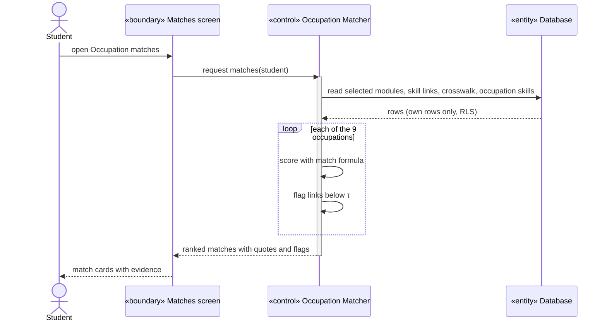
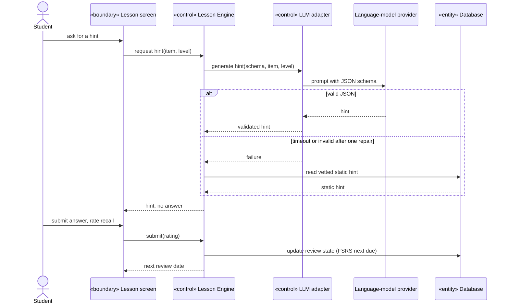
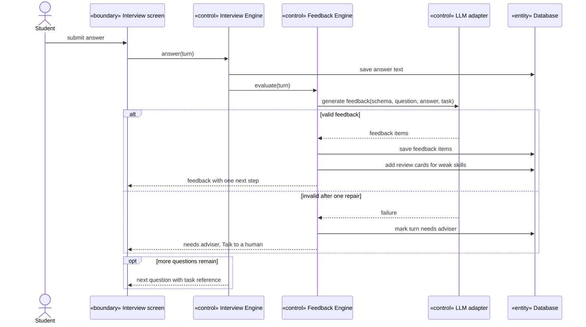
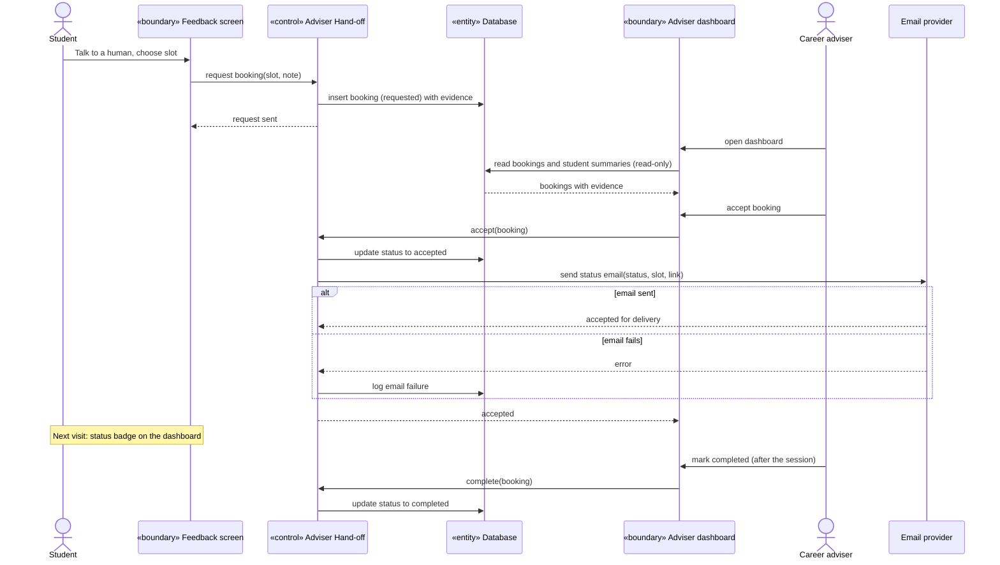
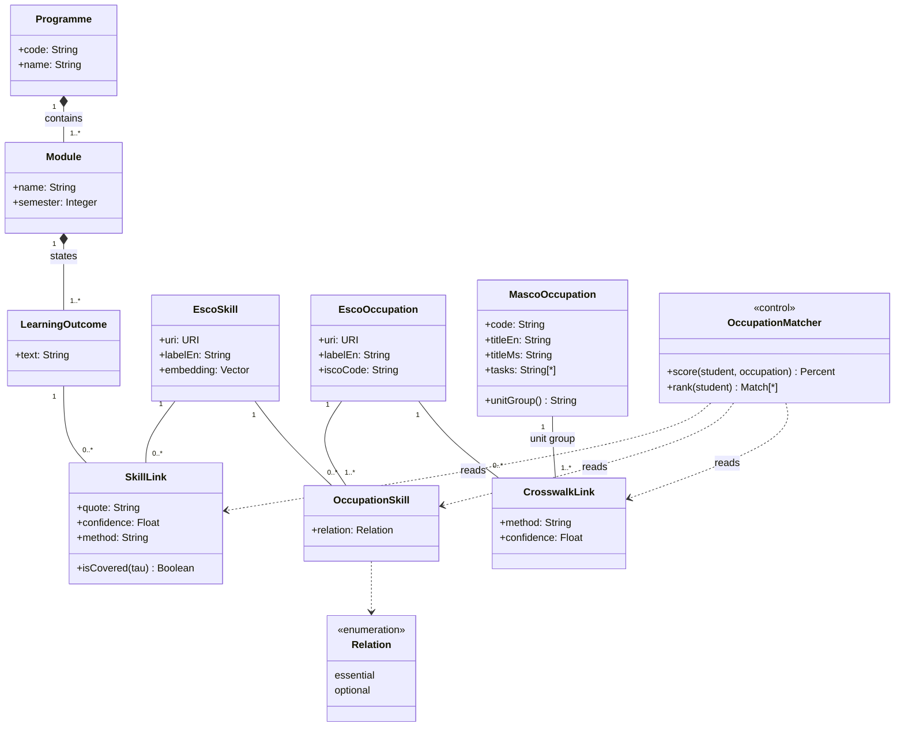
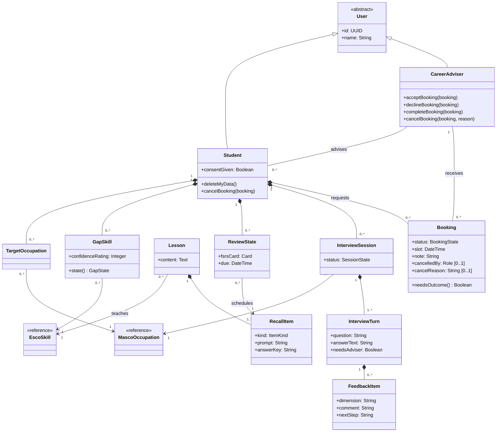
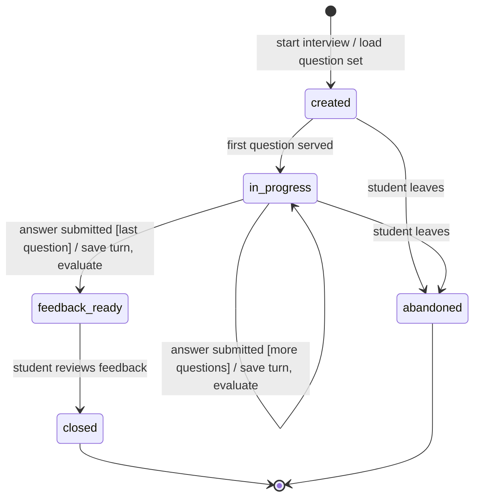

# 09. System modelling

| | |
|---|---|
| Document | 09-system-modelling.md |
| Version | 0.2 (draft for preliminary-round submission) |
| Status | Draft |
| Related | [01-prd.md](01-prd.md), [02-methodology.md](02-methodology.md), [03-architecture.md](03-architecture.md) |

**Contents:** [1. Introduction](#1-introduction) · [2. Context models](#2-context-models) · [3. Interaction models](#3-interaction-models) · [4. Structural models](#4-structural-models) · [5. Behavioural models](#5-behavioural-models) · [6. Deployment model](#6-deployment-model) · [7. Model consistency](#7-model-consistency) · [8. Design decisions](#8-design-decisions)

## 1. Introduction

### 1.1 Purpose

This document models CareerPrep from five views: its context, the interactions between users and the system, its structure, its behaviour and its deployment. The models describe the MVP as specified in [01-prd.md](01-prd.md) and [03-architecture.md](03-architecture.md). Where this document and those disagree, the PRD's requirements win and this document is corrected.

### 1.2 Scope

In scope: the GMI Diploma in Software Engineering, the nine MVP occupations, the four product stages (Map, Plan, Practice, Feedback) and the adviser hand-off. Out of scope: the upgrades in [08-technology-upgrades.md](08-technology-upgrades.md), which are planned but not part of the MVP.

### 1.3 Notations

| View | Model | Notation |
|---|---|---|
| Context | Context diagram, level 1 data flow diagram | Gane and Sarson DFD |
| Interaction | Use case diagram, use case descriptions, sequence diagrams | UML 2.5.1; descriptions follow Cockburn's fully dressed format |
| Structure | Analysis class diagrams | UML 2.5.1 |
| Behaviour | Activity diagram, state machine diagrams | UML 2.5.1 |
| Deployment | Deployment diagram | UML 2.5.1 |

Conventions used throughout:

- Sequence diagrams use analysis stereotypes: «boundary» for screens, «control» for logic, «entity» for stored data.
- State machine transitions read `event [guard] / action`.
- In the DFDs, a data store or external entity drawn more than once carries the Gane and Sarson duplicate mark: an extra bar on a store, a corner slash on an entity. It is the same store or entity each time.

Figures 9.1–9.3, 9.10 and 9.14 are draw.io files in [diagrams/drawio/](diagrams/drawio/). The others are Mermaid, kept inline so they render on GitHub, with PNG copies in [diagrams/](diagrams/). Terms are defined in the [README glossary](../README.md#17-glossary). τ is the match confidence threshold (default 0.6).

## 2. Context models

### 2.1 Context diagram

**Figure 9.1 — Context diagram (DFD level 0).** CareerPrep is one process exchanging data with six external entities. Only the student and the adviser use the system interactively. The other four supply reference data, licences and model outputs, or receive reports.

![Context diagram: process 0 CareerPrep in the centre. Career adviser sends booking actions and receives student progress and booking requests. Institution career services sends licence and adviser accounts and receives placement-readiness reports. Diploma student sends module selection, ratings, answers and booking requests, and receives matches with evidence, plan, lessons, feedback and booking status. The language-model provider receives prompts with a JSON schema and returns structured JSON outputs. The CareerPrep team sends learning outcomes and gold labels and receives an evaluation report. Reference data sources send skills, occupations and task lists.](diagrams/drawio/fig-9-1-context-dfd0.png)

*Source: [fig-9-1-context-dfd0.drawio](diagrams/drawio/fig-9-1-context-dfd0.drawio)*

| External entity | Role |
|---|---|
| Diploma student | Primary user. Selects modules, plans, practises, asks for help |
| Career adviser | Reviews students' progress and handles booking requests |
| Institution career services | Buys the licence, creates adviser accounts, receives placement-readiness reports |
| Language-model provider | Returns schema-constrained outputs for extraction, hints, questions and feedback (OpenAI by default) |
| CareerPrep team (data curator) | Enters learning outcomes from course outlines and the hand-tagged gold set |
| Reference data sources | ESCO (skills, occupations, essential and optional links) and eMASCO (MASCO 2020 titles and task lists) |

### 2.2 Level 1 data flow diagram

**Figure 9.2 — Level 1 data flow diagram.** Process 1.0 runs offline, once per programme. Processes 2.0–5.0 run when a student acts. Only 1.0 and 4.0 exchange data with the language-model provider.

![Level 1 DFD with five processes. 1.0 Build reference data receives ESCO and eMASCO data and learning outcomes, exchanges outcome text and extracted skills with the language-model provider, and writes skill links and the crosswalk to D1. 2.0 Match occupations reads D1, writes selected modules to D2, and returns matches with evidence to the student. 3.0 Plan gap skills reads required skills from D1, reads and writes target and gap skills in D2, and returns the gap plan. 4.0 Run practice and mock interviews reads target and gap skills from D2 and task lists from D1, exchanges prompts and outputs with the language-model provider, reads and writes review state in D3 and writes turns and feedback to D4. 5.0 Handle adviser bookings reads the feedback summary from D4, reads and writes D5, sends requests with evidence to the career adviser and receives accept, decline, complete or cancel.](diagrams/drawio/fig-9-2-dfd1.png)

*Source: [fig-9-2-dfd1.drawio](diagrams/drawio/fig-9-2-dfd1.drawio)*

| Process | Inputs | Outputs | Requirements |
|---|---|---|---|
| 1.0 Build reference data | ESCO and eMASCO data, learning outcomes, gold labels, model outputs | D1 skill links and crosswalk, evaluation report | M3, S3 |
| 2.0 Match occupations | Module selection, D1 | Ranked matches with evidence; selected modules to D2 | M2, M4, M5 |
| 3.0 Plan gap skills | Target, confidence ratings, D1, D2 | Gap plan; target and gap skills to D2 | M6 |
| 4.0 Run practice and mock interviews | Answers, hint requests, D1, D2, D3, model outputs | Lessons, hints, mastery results, questions, feedback; D3 and D4 updates | M7, M8, M9, M11 |
| 5.0 Handle adviser bookings | Booking request, D4, adviser actions (accept, decline, complete, cancel) | Booking status to the student, in app and by email; requests with evidence to the adviser; D5 updates | M10 |

| Store | Contents | Tables ([03 §4](03-architecture.md#4-data-model)) |
|---|---|---|
| D1 Reference data and skill links | Programme, modules, outcomes, ESCO and MASCO data, crosswalk, skill links | programme, module, learning_outcome, esco_skill, esco_occupation, masco_occupation, crosswalk, occupation_skill, outcome_skill |
| D2 Student plan | Selected modules, target occupation, gap skills and ratings | student, student_module, target_occupation, gap_skill |
| D3 Learning progress | Lessons, recall and mastery items, FSRS review state | lesson, recall_item, review_state |
| D4 Interview records | Sessions, answers, feedback | interview_session, interview_turn, feedback_item |
| D5 Bookings | Adviser booking requests and their status | booking, adviser |

Consent and data deletion (M1) act on D2–D5 as a whole and are left out of Figure 9.2 to keep it readable. They appear as UC8 in [§3.1](#31-use-case-diagram).

## 3. Interaction models

### 3.1 Use case diagram

**Figure 9.3 — Use case diagram.** The student starts eight of the twelve use cases. The language-model provider is a secondary actor: it serves use cases but never starts one. «include» marks a step that always happens; «extend» marks one that happens only when the student chooses.

![Use case diagram. Inside the CareerPrep boundary the student is associated with UC1 Select programme and modules, UC2 View occupation matches, UC3 Plan gap skills, UC4 Take micro-lesson, UC5 Take mastery check, UC6 Practise mock interview, UC7 Request adviser session and UC8 Manage my data. UC2 includes Show skill evidence. Ask for a hint extends UC4. UC6 includes Evaluate answer. The data curator is associated with UC9 Load reference data and learning outcomes and UC10 Evaluate matcher. The language-model provider is associated with UC9, Ask for a hint, UC6 and Evaluate answer. The career adviser is associated with UC11 Review student progress and UC12 Handle booking.](diagrams/drawio/fig-9-3-use-cases.png)

*Source: [fig-9-3-use-cases.drawio](diagrams/drawio/fig-9-3-use-cases.drawio)*

| Use case | Primary actor | Requirements |
|---|---|---|
| UC1 Select programme and modules | Student | M2 |
| UC2 View occupation matches (includes Show skill evidence) | Student | M3, M4, M5 |
| UC3 Plan gap skills | Student | M6 |
| UC4 Take micro-lesson (extended by Ask for a hint) | Student | M7 |
| UC5 Take mastery check | Student | M11 |
| UC6 Practise mock interview (includes Evaluate answer) | Student | M8, M9 |
| UC7 Request adviser session | Student | M10 |
| UC8 Manage my data (consent, delete; export is C4) | Student | M1, C4 |
| UC9 Load reference data and learning outcomes | Data curator | M3 |
| UC10 Evaluate matcher | Data curator | S3 |
| UC11 Review student progress | Career adviser | M10 |
| UC12 Handle booking (accept, decline, complete, cancel) | Career adviser | M10 |

### 3.2 Use case descriptions

The four use cases below carry the product's main risks, so they are described in full. The others follow directly from their requirements in [01 §8](01-prd.md#8-acceptance-criteria-must-features).

**UC2 View occupation matches**

| Field | Description |
|---|---|
| Primary actor | Student |
| Preconditions | The student has consented (M1) and selected at least one module (UC1). The pipeline has produced skill links for the programme. |
| Trigger | The student opens Occupation matches. |
| Main success scenario | 1. The system reads the skill links of the selected modules' learning outcomes. 2. It scores each of the nine occupations with the match formula ([02 §6](02-methodology.md#6-match-score)). 3. It shows the occupations ranked by match %, each with its covered skills. 4. The student opens a skill and sees the quoted learning outcome and the confidence value (Show skill evidence). |
| Extensions | 2a. A supporting link is below τ: the skill does not count as covered, the card shows "check with adviser" and a "Talk to a human" button (UC7). 3a. No module is selected: the system asks the student to select modules. |
| Postconditions | None stored. Matches are computed on request. |
| Non-functional | The Map stage makes no language-model call, so it works when the model service is down. The radar chart has an equivalent data table (M5). |

**UC4 Take micro-lesson**

| Field | Description |
|---|---|
| Primary actor | Student. Secondary: language-model provider (hints only) |
| Preconditions | The student has a gap plan (UC3) and a recall item is due. |
| Trigger | The student opens today's lesson. |
| Main success scenario | 1. The system shows the lesson and a recall question. 2. The student answers. 3. The system shows the correct answer. 4. The student rates how well they recalled it. 5. The system schedules the next review with FSRS. |
| Extensions | 2a. The student is stuck and asks for a hint (Ask for a hint): the system returns the next step of the hint ladder (nudge, then concept, then worked analogue) and never the answer. 2a1. The model call fails or returns invalid output: the system shows the vetted static hint for that item. |
| Postconditions | The item's review state and due date are saved. |
| Non-functional | The hint output schema has no answer field. |

**UC6 Practise mock interview**

| Field | Description |
|---|---|
| Primary actor | Student. Secondary: language-model provider |
| Preconditions | The student has a target occupation. |
| Trigger | The student starts an interview. |
| Main success scenario | 1. The system serves a question built from an eMASCO task or gap skill for the target occupation, citing its source. 2. The student types an answer. 3. The system saves the answer and evaluates it (Evaluate answer). 4. It shows feedback on STAR structure, evidence and technical accuracy, plus one next step. 5. It adds weak skills to the review queue. 6. Steps 1–5 repeat until the last question. |
| Extensions | 1a. Question generation fails: the system serves the cached question set for the occupation. 3a. Feedback is still invalid after one repair attempt: the answer is kept, the turn is marked "needs adviser", and "Talk to a human" is offered. 2a. The student leaves: the session is kept as abandoned. |
| Postconditions | Turns and feedback are stored. Weak skills have new review cards. |
| Non-functional | No overall grade and no praise or criticism of the person. No audio is stored. |

**UC7 Request adviser session**

| Field | Description |
|---|---|
| Primary actor | Student. Supporting: career adviser (UC12) |
| Preconditions | The student is on a low-confidence match card or a Feedback screen. |
| Trigger | The student presses "Talk to a human". |
| Main success scenario | 1. The student picks a slot and may add a note. 2. The system creates a booking with the student's target occupation, gap skills and feedback summary attached. 3. The booking appears on the adviser's dashboard. 4. The adviser accepts it (UC12). 5. The system emails the student and shows the accepted status, with a badge, on their next visit. 6. After the session, the adviser marks the booking completed. |
| Extensions | 4a. The adviser declines: the student is emailed and sees the declined status. 4b. The student cancels before the adviser responds. 5a. Either party cancels the accepted booking: the adviser must give a reason, and the student is emailed when the adviser cancels. 5b. The email cannot be sent: the status still changes and the in-app badge still shows. 6a. The slot has passed and the adviser has not recorded an outcome: the dashboard shows the booking as "needs outcome". |
| Postconditions | A booking exists with status requested, accepted, declined, completed or cancelled. A cancelled booking records who cancelled it. |
| Non-functional | The adviser can change only the booking status. Student data is read-only to the adviser. Status emails carry the status, the slot and a link, and no gap skills or feedback. |

### 3.3 Sequence diagrams

Each sequence diagram realises one use case. Lifelines are analysis objects, not code modules; the matching components are named in [03 §3](03-architecture.md#3-components).

**Figure 9.4 — UC2 View occupation matches.** Scoring reads stored skill links only, so the whole sequence runs without a language-model call.

**Figure 9.5 — UC4 Take micro-lesson, with Ask for a hint.** The hint is the only model call. If it fails, the student still gets a vetted hint, and the answer is never sent to the screen before the student submits.

**Figure 9.6 — UC6 Practise mock interview, one turn.** The answer is saved before evaluation, so a model failure loses nothing and sends the student to an adviser instead.

**Figure 9.7 — UC7 Request adviser session and UC12 Handle booking.** The booking carries the student's evidence, so the adviser starts the meeting from it. The adviser can change the booking's status and nothing else. Each status change the student did not make is sent to them by email; the status is saved first, so a failed email loses nothing.

## 4. Structural models

The class diagrams are analysis models. They show what the system knows and how the concepts relate. The physical tables in [03 §4](03-architecture.md#4-data-model) implement them; class names are singular nouns, and table names are their snake_case forms.

### 4.1 Reference data and matching

**Figure 9.8 — Class diagram: reference data and matching.** Two link classes carry the evidence. A SkillLink records which learning outcome supports which ESCO skill, quoting the source. An OccupationSkill records whether a skill is essential or optional for an occupation. The Occupation Matcher only reads these classes.

A MascoOccupation is a 6-digit occupation such as 2519-01. Its crosswalk links belong to its 4-digit unit group, returned by `unitGroup()`. Its skill set is the union of the skills of every linked ESCO occupation, and a skill that is essential for any of them counts as essential ([02 §6](02-methodology.md#6-match-score)).

### 4.2 Learner activity

**Figure 9.9 — Class diagram: learner activity.** Everything a student creates is owned by the Student object (composition), which is why deleting a student removes all of their data (M1). A CareerAdviser is associated with students and bookings but owns neither.

`RecallItem.kind` is either recall or mastery; mastery items hold the answer key used by the no-AI check (M11). `GapSkill.state()` is derived from the review states of the skill's recall items and its mastery result. It is not stored; its states are modelled in [§5.2](#52-state-machines).

## 5. Behavioural models

### 5.1 Activity diagram

**Figure 9.10 — Student journey with responsibilities (UML activity diagram).** The partitions show who does each action. CareerPrep acts only after the student does, and the adviser enters only through a booking. That booking comes from one of two places: a low-confidence match, or a feedback step that needs an adviser.

![UML activity diagram with three partitions: Student, CareerPrep and Career adviser. The student selects modules, CareerPrep computes matches with evidence, and the student reviews them. On low confidence, flow goes to CareerPrep creating a booking. On a confident match, the student picks a target and rates gaps, CareerPrep builds a daily plan, the student does a lesson with hints, CareerPrep schedules the next review, the student takes the mastery check, and CareerPrep marks it against the answer key. If not mastered, flow returns to the lesson. If mastered, the student answers interview questions and CareerPrep generates task-level feedback. If the feedback is valid the student reviews it and the flow ends. If an adviser is needed, CareerPrep creates a booking with evidence. The adviser accepts or declines it, and later completes or cancels it.](diagrams/drawio/fig-9-10-activity.png)

*Source: [fig-9-10-activity.drawio](diagrams/drawio/fig-9-10-activity.drawio)*

### 5.2 State machines

Three classes have states that change in response to events. Transitions read `event [guard] / action`.

**Figure 9.11 — GapSkill state machine.** A skill is never marked done by the AI. Only the no-AI mastery check moves it to Mastered, with at least 4 of 5 correct. A weak interview answer or a lapsed review sends it back to Learning.

```mermaid
stateDiagram-v2
    accTitle: GapSkill state machine
    accDescr: When a target is chosen and the skill is not covered, the gap skill enters the Active composite state as Identified. Rating moves it to Rated and the first lesson to Learning; each rated review is an internal transition that keeps it in Learning. Starting the mastery check moves it to MasteryCheck. The check is marked against the pass mark: 4 or more correct out of 5 moves it to Mastered, fewer returns it to Learning. Mastered returns to Learning when an interview flags a weak area or a later spaced review of the skill lapses. Changing the target ends the gap skill from any state.
    [*] --> Active: target chosen [skill not covered]
    state Active {
        [*] --> Identified
        Identified --> Rated: rating given / add to plan
        Rated --> Learning: first lesson due
        Learning --> MasteryCheck: student starts check
        MasteryCheck --> Learning: check marked [score < 4 of 5]
        MasteryCheck --> Mastered: check marked [score ≥ 4 of 5]
        Mastered --> Learning: interview flags weak area / create review card
        Mastered --> Learning: review lapses
    }
    Active --> [*]: target changed
    note right of Learning
        internal: recall rated / FSRS schedules next review
    end note
```

**Figure 9.12 — InterviewSession state machine.** A session closes only after its feedback is ready. A session the student leaves early is kept as abandoned rather than deleted.

A turn marked "needs adviser" does not change the session's state.

**Figure 9.13 — Booking state machine.** Only an accepted booking can be completed, and only the adviser completes it. Either party can cancel an accepted booking; the adviser must give a reason. Every change the student did not make sends them an email.

```mermaid
stateDiagram-v2
    accTitle: Booking state machine
    accDescr: Pressing Talk to a human creates a requested booking with evidence attached. The adviser accepts or declines it, and the student is emailed; or the student cancels it. The adviser marks an accepted booking completed after the session. The student can cancel an accepted booking; the adviser can cancel it with a reason, and the student is emailed. Once the slot has passed, an accepted booking shows as needs outcome on the dashboard; this is a derived flag, not a state.
    [*] --> requested: Talk to a human / attach evidence
    requested --> accepted: adviser accepts / email student
    requested --> declined: adviser declines / email student
    requested --> cancelled: student cancels
    accepted --> completed: adviser marks session held
    accepted --> cancelled: student cancels
    accepted --> cancelled: adviser cancels [reason given] / email student
    note right of accepted
        needs outcome: slot has passed (derived flag, not a state)
    end note
    declined --> [*]
    completed --> [*]
    cancelled --> [*]
```

## 6. Deployment model

**Figure 9.14 — Deployment diagram (UML).** The student's device runs only the PWA. All request-time logic runs on Vercel, all data sits in Supabase, and the pipeline runs from a developer machine. The only external runtime dependencies are the OpenAI API and an email provider reached over SMTP.

![UML deployment diagram. A student phone or laptop device hosts a web browser execution environment with the CareerPrep PWA artifact, connected over HTTPS to the Vercel cloud platform, which hosts a Node.js runtime with the Next.js server app artifact. Vercel connects to the Supabase cloud platform over TLS Postgres and HTTPS Auth; Supabase hosts PostgreSQL with pgvector and the schema and migrations artifact. Vercel connects to the OpenAI API cloud service over HTTPS and to an email provider cloud service over SMTP with TLS. A developer machine hosts Python 3.11 with the pipeline artifact and connects to the OpenAI API over HTTPS and to Supabase over TLS Postgres.](diagrams/drawio/fig-9-14-deployment.png)

*Source: [fig-9-14-deployment.drawio](diagrams/drawio/fig-9-14-deployment.drawio)*

Environment variables, secrets and the deployment sequence are in [03 §11](03-architecture.md#11-deployment).

## 7. Model consistency

Each use case is traced through the other models below. Every Must requirement (M1–M11) appears at least once.

| Use case | Requirements | DFD process | Sequence | Classes | State machine |
|---|---|---|---|---|---|
| UC1 Select programme and modules | M2 | 2.0 | — | Programme, Module | — |
| UC2 View occupation matches | M3, M4, M5 | 2.0 | Figure 9.4 | SkillLink, OccupationSkill, CrosswalkLink, OccupationMatcher | — |
| UC3 Plan gap skills | M6 | 3.0 | — | TargetOccupation, GapSkill | Figure 9.11 |
| UC4 Take micro-lesson | M7 | 4.0 | Figure 9.5 | Lesson, RecallItem, ReviewState | Figure 9.11 |
| UC5 Take mastery check | M11 | 4.0 | — | RecallItem (mastery), GapSkill | Figure 9.11 |
| UC6 Practise mock interview | M8, M9 | 4.0 | Figure 9.6 | InterviewSession, InterviewTurn, FeedbackItem | Figure 9.12 |
| UC7 Request adviser session | M10 | 5.0 | Figure 9.7 | Booking | Figure 9.13 |
| UC8 Manage my data | M1, C4 | all stores | — | Student | — |
| UC9 Load reference data and learning outcomes | M3 | 1.0 | — | all of Figure 9.8 | — |
| UC10 Evaluate matcher | S3 | 1.0 | — | SkillLink | — |
| UC11 Review student progress | M10 | 5.0 | Figure 9.7 | Student, Booking | — |
| UC12 Handle booking | M10 | 5.0 | Figure 9.7 | Booking, CareerAdviser | Figure 9.13 |

Checks made across the models:

- Every data store in Figure 9.2 maps to tables in the data model, and every table belongs to exactly one store.
- Every class in Figures 9.8 and 9.9 maps to a table in [03 §4](03-architecture.md#4-data-model), except OccupationMatcher, which is a control class. GapSkill's state is derived and not stored.
- The states in Figures 9.12 and 9.13 match those in [03 §8](03-architecture.md#8-lifecycle-states). Figure 9.11 is new in this document and needs no extra table.
- Every language-model call in the sequence diagrams has a defined failure path: a static hint in Figure 9.5, "needs adviser" in Figure 9.6. Figure 9.4 makes no model call.

## 8. Design decisions

The first version of this document left three questions open. Each is now decided below; the evidence is in [06-evidence.md](06-evidence.md#8-design-decisions).

**8.1 Mastery check pass mark.** The check has 5 questions per gap skill, and the student passes with 4 or more correct (`MASTERY_PASS_MARK = 0.8`). A failed check returns the skill to Learning, and the student can retake it after the next lesson. A mastered skill returns to Learning if a later spaced review of it lapses, so one lucky pass cannot close a gap for good (Figure 9.11).

- 80% is the usual cut in Bloom-style mastery learning. It is a convention, not a cut validated for career skills, so it is a setting rather than a constant in code.
- With 5 questions, a student guessing at 25% passes 2% of the time and a student who knows 80% of the material passes 74% of the time. With 3 questions and a 2-of-3 mark, a student who knows only 60% would pass 65% of the time.

**8.2 How a student learns that a booking's status changed.** The student sees the new status, with a badge, on their next visit, and gets an email when the adviser accepts, declines or cancels (Figure 9.7). The email carries the status, the slot and a link, and no gap skills or feedback. Status is saved before the email is sent, so a failed email loses nothing.

- Web push on iPhone needs iOS 16.4 or later and the app added to the Home Screen, so it would miss many students. It stays a later option.
- Supabase's built-in email service sends 2 messages an hour, and only to the project team. Both Auth emails and status emails need a custom SMTP provider, which must be chosen and configured.

**8.3 Adviser actions.** UC12 is now Handle booking. The adviser can accept, decline, complete, and cancel with a reason (Figure 9.13). An accepted booking whose slot has passed shows as "needs outcome" until the adviser records one. No-show is not a state in the MVP.

- Booking tools give the outcome of a session to the provider, and flag sessions whose outcome was never recorded. Without a complete action, the completed state in Figure 9.13 could never be reached.

Still open: which SMTP provider to use, and whether GMI sign-in gives every student an email address that CareerPrep may use.
