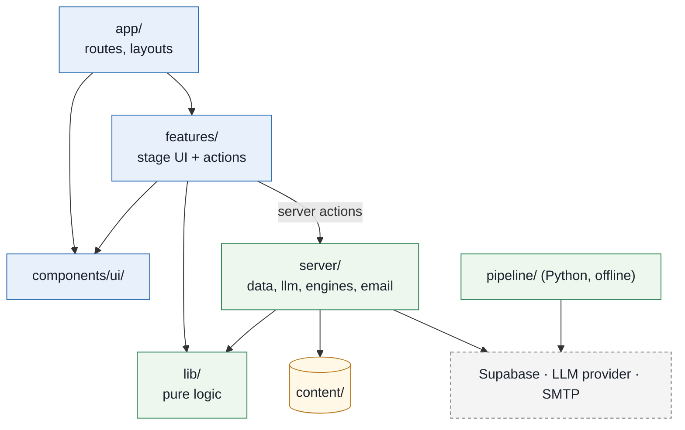

# CareerPrep repository structure

**Contents:** [1 Principles](#1-principles) · [2 Tree](#2-tree) · [3 Dependency rules](#3-dependency-rules) · [4 Where each part lives](#4-where-each-part-lives) · [5 Demo mode and real mode](#5-demo-mode-and-real-mode) · [6 Naming](#6-naming) · [7 Ownership](#7-ownership) · [8 Build order](#8-build-order)

This is the folder and file layout for the code. It expands [03-architecture.md §13](03-architecture.md#13-repository-structure) and uses the component names from [03 §3](03-architecture.md#3-components), the routes from [10-ui-ux-spec.md §4](10-ui-ux-spec.md#4-app-shell) and the tables from [03 §4](03-architecture.md#4-data-model). One repo holds the Next.js app, the Python pipeline and the database schema.

## 1. Principles

- **Group by feature, not by file type.** Each stage of the product (Map, Plan, Practice, Interview, Feedback, Booking, Adviser) has one folder with its own components and server actions. Two people can work on two stages without editing the same files.
- **Keep the maths pure.** The match score, gap ordering, FSRS scheduling, mastery marking and booking rules live in `lib/` with no React, no database and no network. They are the parts judges and tests care about, and pure functions are easy to test.
- **One door to the outside world.** Database, LLM and email calls go through `server/` only. Swapping Supabase for fixtures, or OpenAI for recorded responses, is one switch in one place.
- **One copy of the demo content.** Personas, lessons, mastery questions and the interview script live once in `content/`. The UI's fixture mode and the database seed both read from there, so they can't drift apart.
- **Paths are flat and boring.** No `src/` wrapper, no monorepo tooling. The existing docs already point at `app/`, `lib/`, `pipeline/` and `supabase/`.

## 2. Tree

Files marked † are created by a tool (the Next.js, Supabase or Python setup commands), not written by hand.

```text
careerprep/
├── README.md
├── AGENTS.md                      Commands and folder rules for coding agents (Codex reads this first)
├── .env.example                   Every variable from 03 §11, with demo-safe defaults
├── package.json  pnpm-lock.yaml†  next.config.ts  tsconfig.json  postcss.config.mjs
├── eslint.config.mjs  vitest.config.ts  playwright.config.ts
│
├── app/                           Next.js App Router: routes and layouts only, no business logic
│   ├── layout.tsx                 <html>, Inter font, globals.css, skip link
│   ├── globals.css                Design tokens from 10 §3.1 (Tailwind v4 @theme)
│   ├── manifest.ts                PWA manifest
│   ├── sw.ts                      Serwist service worker
│   ├── page.tsx                   Redirects to /onboarding or /map
│   ├── onboarding/page.tsx        Consent card, no stage nav
│   ├── (student)/                 Route group: shares the student shell
│   │   ├── layout.tsx             Header, stage nav, "Bookings · n updates", Talk to a human, footer
│   │   ├── map/page.tsx
│   │   ├── matches/page.tsx
│   │   ├── matches/[code]/page.tsx
│   │   ├── plan/page.tsx
│   │   ├── practice/page.tsx                  Today: due questions, coming up, interview card
│   │   ├── practice/[skillId]/page.tsx        Micro-lesson with hint ladder
│   │   ├── practice/[skillId]/check/page.tsx  Mastery check
│   │   ├── interview/page.tsx
│   │   ├── feedback/[answerId]/page.tsx
│   │   ├── bookings/page.tsx
│   │   ├── bookings/new/page.tsx
│   │   └── delete-my-data/page.tsx
│   └── adviser/
│       ├── layout.tsx             Adviser shell, no stage nav
│       └── page.tsx               Students table
│
├── features/                      One folder per product stage: its UI pieces and server actions
│   ├── map/
│   │   ├── module-picker.tsx      Fieldset per semester
│   │   ├── skills-radar.tsx       Plain-SVG radar, role="img", points at the table
│   │   ├── coverage-table.tsx     The radar's text alternative
│   │   ├── skill-drawer.tsx       Quote, confidence, "check with adviser"
│   │   └── actions.ts             saveModules()
│   ├── matches/
│   │   ├── match-card.tsx
│   │   ├── match-list.tsx
│   │   └── occupation-detail.tsx
│   ├── plan/
│   │   ├── confidence-form.tsx    Radio scale per gap skill
│   │   ├── plan-list.tsx
│   │   └── actions.ts             saveRatings()
│   ├── practice/
│   │   ├── today-queue.tsx
│   │   ├── recall-card.tsx
│   │   ├── hint-ladder.tsx        aria-live region, 3 steps
│   │   ├── recall-rating.tsx      Again / Hard / Good / Easy
│   │   ├── mastery-check.tsx
│   │   └── actions.ts             requestHint(), submitRecall(), submitMastery()
│   ├── interview/
│   │   ├── question-card.tsx
│   │   ├── answer-form.tsx
│   │   ├── dictate-button.tsx     Web Speech API, Chrome only, optional
│   │   └── actions.ts             submitAnswer()
│   ├── feedback/
│   │   ├── star-list.tsx
│   │   ├── feedback-sections.tsx
│   │   └── actions.ts             addWeakAreaToReviews()
│   ├── booking/
│   │   ├── booking-form.tsx
│   │   ├── booking-list.tsx
│   │   └── actions.ts             requestSession(), cancelRequest()
│   └── adviser/
│       ├── student-table.tsx      Table at medium+, cards below
│       ├── cancel-dialog.tsx
│       └── actions.ts             accept(), decline(), complete(), cancel(reason)
│
├── components/ui/                 Shared building blocks from 10 §6; no feature imports
│   ├── button.tsx  field.tsx  radio-scale.tsx  card.tsx  status-chip.tsx
│   ├── drawer.tsx  dialog.tsx  live-region.tsx  empty-state.tsx  error-banner.tsx
│   ├── stage-nav.tsx  skeleton.tsx
│   └── icons.tsx                  The few inline SVG icons (flag, check, x, clock, search, menu)
│
├── lib/                           Pure TypeScript: no React, no DB, no network. Unit-tested.
│   ├── config.ts                  τ and the mastery pass mark, read once from env with defaults
│   ├── match/score.ts             Occupation Matcher: score, "essential wins", τ cut-off
│   ├── plan/order-gaps.ts         Gap Planner: essential first, then lowest rating; daily load
│   ├── fsrs/scheduler.ts          Wrapper around ts-fsrs
│   ├── mastery/mark.ts            Marks against the answer key or keyword rubric, no LLM
│   ├── booking/transitions.ts     Booking state machine (03 §8.3)
│   └── types.ts                   Shared view-model types (Persona, Skill, Occupation, Booking…)
│
├── server/                        Server-only (import "server-only"): data, LLM, email
│   ├── env.ts                     Parses process.env with Zod; fails fast on a missing key
│   ├── data/
│   │   ├── index.ts               Picks the store from DATA_MODE
│   │   ├── store.ts               The interface every page and action uses
│   │   ├── fixtures.ts            Reads content/ (demo, no database)
│   │   └── supabase.ts            Real queries, RLS applies
│   ├── db/
│   │   ├── client.ts              Supabase server and browser clients
│   │   └── types.ts†              `supabase gen types` output
│   ├── llm/
│   │   ├── adapter.ts             generateJSON(schema, prompt, input, opts), retries, repair, fallback
│   │   ├── cache.ts               llm_cache read and write
│   │   ├── providers/openai.ts  anthropic.ts  gemini.ts  recorded.ts
│   │   ├── prompts/               hint.v1.md  interview-questions.v1.md  feedback.v1.md
│   │   └── schemas.ts             Zod schemas for hint, question set and feedback output
│   ├── engines/
│   │   ├── matches.ts             Occupation Matcher + gap skills: reads the store, calls lib/match
│   │   ├── lesson.ts              Lesson Engine: due items, hint ladder, mastery check
│   │   ├── interview.ts           Interview Engine: question set, turns
│   │   ├── feedback.ts            Feedback Engine: per-answer feedback, weak areas re-queued
│   │   └── handoff.ts             Adviser Hand-off: bookings, status save then email
│   └── email/
│       ├── send.ts                SMTP via SMTP_URL; a failed send never undoes the status
│       └── booking-status.ts      Plain-text template: status, slot, link only
│
├── content/                       Demo data and lesson content, written by the team, read by both modes
│   ├── demo/
│   │   ├── personas.json          Aina + 4 fictional students, their modules and ratings
│   │   ├── adviser.json           Puan Rohana (fictional)
│   │   └── bookings.json          Starting booking states
│   ├── lessons/
│   │   └── execute-integration-testing.json   Recall items, 3-step hints, model answers, 5 mastery questions + key
│   ├── interview/
│   │   └── 2519-01.json           Questions with eMASCO task ids, demo answer
│   └── llm/                       Recorded LLM responses for LLM_PROVIDER=recorded (demo and e2e)
│
├── pipeline/                      Python 3.11, offline (02 §4); writes reference tables to Supabase
│   ├── requirements.txt
│   ├── run.py                     Runs every step in order; safe to re-run
│   ├── eval.py                    P/R/F1 against the gold set, tunes τ on the dev split
│   ├── careerprep_pipeline/
│   │   ├── ingest_esco.py  ingest_masco.py  ingest_outcomes.py
│   │   ├── extract.py             Skill Extractor (quote must be a substring)
│   │   ├── normalise.py           Skill Normaliser: embeddings, top-k, LLM re-rank
│   │   ├── crosswalk.py           MASCO → ISCO → ESCO, with method and confidence
│   │   ├── embed.py
│   │   ├── llm.py                 Same adapter pattern as server/llm, pydantic validation
│   │   ├── models.py              pydantic models for every LLM output
│   │   └── db.py                  Upserts with the service-role key
│   ├── prompts/                   extract.v1.md  rerank.v1.md
│   ├── data/
│   │   ├── raw/                   ESCO CSV download (git-ignored, see README)
│   │   ├── input/                 gmi_outcomes.csv, masco_occupations.json
│   │   └── gold/                  Hand-tagged outcomes, dev and test splits
│   └── cache/                     LLM JSON cache, committed so a rerun costs nothing
│
├── supabase/
│   ├── config.toml†
│   ├── migrations/                Timestamped SQL from the Supabase CLI
│   │   ├── <ts>_reference_tables.sql   programme … occupation_skill, esco_skill.embedding
│   │   ├── <ts>_student_tables.sql     student … booking, llm_cache
│   │   ├── <ts>_rls_policies.sql       Per-student RLS; adviser booking exception
│   │   └── <ts>_indexes.sql            HNSW on embeddings, foreign keys, due dates
│   └── seed/
│       └── seed.ts                pnpm db:seed: loads content/ into the database
│
├── tests/
│   ├── unit/                      Vitest; mirrors lib/ (score.test.ts, scheduler.test.ts, mark.test.ts, transitions.test.ts)
│   ├── pipeline/                  pytest: quote check, URI rejection, crosswalk fields
│   └── e2e/                       Playwright + axe
│       ├── demo-path.spec.ts      The whole demo path in 10 §2, keyboard only
│       └── a11y.spec.ts           Every route at 375 and 1280 px
│
├── public/icons/                  PWA icons
├── docs/                          01–11, diagrams, PDFs (unchanged)
└── .github/workflows/ci.yml       Lint, type-check, unit and e2e tests on each pull request
```

## 3. Dependency rules

Imports only flow downward in Figure 11.1. A file may import from its own layer or a lower one, never from a higher one.

**Figure 11.1 — Allowed imports.** Pages assemble features; features talk to the server through actions; only `server/` touches the database, the LLM or email; `lib/` depends on nothing.



- `components/ui/` never imports from `features/`. If two features need the same piece, move it down to `components/ui/`.
- Client components (`"use client"`) never import `server/`. They call the server actions in their feature's `actions.ts`. `server/` files start with `import "server-only"`, so a mistake fails the build.
- `lib/` has no `process.env` reads except in `lib/config.ts`, so tests can pass values in directly.
- Features don't import each other. The one shared flow, "Talk to a human", is a link to `/bookings/new`, not an import.

## 4. Where each part lives

**Components from [03 §3](03-architecture.md#3-components):**

| Component | Code |
|---|---|
| Skill Extractor, Skill Normaliser | `pipeline/careerprep_pipeline/extract.py`, `normalise.py` |
| Occupation Matcher | `lib/match/score.ts`, read through `server/data/` |
| Gap Planner | `lib/plan/order-gaps.ts` |
| Lesson Engine | `server/engines/lesson.ts` + `lib/fsrs/scheduler.ts` + `lib/mastery/mark.ts` |
| Interview Engine | `server/engines/interview.ts` |
| Feedback Engine | `server/engines/feedback.ts` |
| Adviser Hand-off | `server/engines/handoff.ts` + `lib/booking/transitions.ts` + `server/email/` |
| LLM adapter | `server/llm/adapter.ts` (runtime), `pipeline/careerprep_pipeline/llm.py` (offline) |

**Screens from [10 §5](10-ui-ux-spec.md#5-screens)** map one-to-one: the route file in `app/` is a thin page that loads data from `server/data/` and renders the components in the matching `features/` folder. The mockup's "Today's practice" screen is `app/(student)/practice/page.tsx`.

**Tables from [03 §4](03-architecture.md#4-data-model):** the reference tables (filled by the pipeline) are in `<ts>_reference_tables.sql`; the student tables (filled by the app) and `llm_cache` are in `<ts>_student_tables.sql`. Row-level security lives in its own migration so it can be reviewed on its own.

## 5. Demo mode and real mode

Two switches let the UI run with no backend, which is what the hackathon video needs, and then move to Supabase without touching any page.

| Variable | Demo value | Real value | Effect |
|---|---|---|---|
| `DATA_MODE` | `fixtures` | `supabase` | `server/data/index.ts` returns the fixture store (reads `content/`) or the Supabase store |
| `LLM_PROVIDER` | `recorded` | `openai` | `recorded` replays `content/llm/` responses; no network call on camera |

State changes in fixture mode (ratings, bookings, recall answers) are kept in memory per server process, which is enough to record the demo path in one sitting. Both values are in `.env.example`.

## 6. Naming

| Thing | Convention | Example |
|---|---|---|
| Route folders | lowercase, matches the URL | `app/(student)/practice/[skillId]/check/page.tsx` |
| React component files | kebab-case, one component per file | `features/map/skill-drawer.tsx` exports `SkillDrawer` |
| Server actions | verb first, one `actions.ts` per feature | `requestSession()`, `submitMastery()` |
| Pure logic files | kebab-case noun | `lib/booking/transitions.ts` |
| Tests | the file under test + `.test.ts` | `tests/unit/match/score.test.ts` |
| Prompts | `<task>.v<N>.md`; a wording change bumps N (the cache key includes it) | `server/llm/prompts/feedback.v2.md` |
| Lesson content | ESCO skill label in kebab-case | `content/lessons/report-test-findings.json` |
| Migrations | Supabase CLI timestamp + purpose | `20261021090000_rls_policies.sql` |
| Python | snake_case modules | `ingest_masco.py` |

## 7. Ownership

From the roles in [README → Team](../README.md#15-team). Owning a folder means reviewing its pull requests, not working alone in it.

| Folder | Owner |
|---|---|
| `pipeline/`, `lib/match/`, `lib/plan/`, `supabase/migrations/` | Faiz (Member A) |
| `app/`, `components/ui/`, `features/map` `matches` `plan` `booking` `adviser`, `server/data/` | Member B |
| `features/practice` `interview` `feedback`, `server/llm/`, `server/engines/`, `lib/fsrs/`, `lib/mastery/`, `content/lessons/`, `content/interview/` | Member C |
| `docs/`, `content/demo/`, `README.md` | Member D |

## 8. Build order

For the hackathon, build in this order so there is something to record at every step:

1. Scaffold the Next.js app, `globals.css` tokens, `components/ui/` and the two shells.
2. `content/` for the demo persona and one gap skill, `server/data/fixtures.ts`, `LLM_PROVIDER=recorded`.
3. The screens in demo-video order ([10 §2](10-ui-ux-spec.md#2-scope-and-priority)), each pulling from the fixture store.
4. `lib/` functions with their unit tests, then the e2e demo-path test.
5. After the round: `supabase/migrations`, `server/data/supabase.ts`, the pipeline run, and the live LLM providers.
